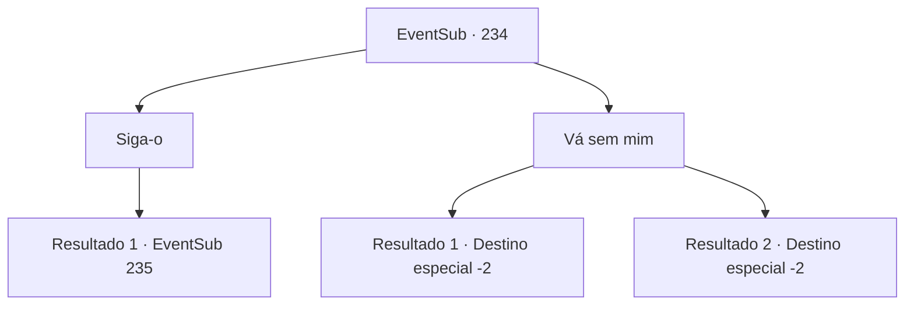

# Eventos secundários · 234

[Índice da tabela](index.md) · [Índice geral](../index.md)

ID: `pt:EventSub:234` · Fonte: `EventSub4` · Versão: 1.2.47.

Mapeamento estático dos arquivos; a disponibilidade e a execução dependem do estado da run.

## Texto do evento

Você espera que a Viúva do Amor tenha completado o processo de reforço agora. Então, um homem com roupas sujas e esfarrapadas corre para você, ofegante. 

 "*Uff*...*Uff*.... Capitão Parrie está procurando por você."

 Ele enxuga o suor com as mangas, recuperando o fôlego.

## Dados de entrada

```json
{
  "id": 234,
  "grade": 1,
  "subEvent": "",
  "required": "12_6_4"
}
```

## Mapa das escolhas



## Escolhas e resultados

### Escolha 1

Siga-o

Requisitos e outros campos da escolha:

```json
{
  "required": "8_213_1"
}
```

#### Resultado 1.1

Você segue o homem suado até a viúva do amor. O capitão Parrie o cumprimenta, parecendo nervoso. 

 "Você está aqui. Vamos então. Para derrotar esse 'Diabo'."

 Você embarca na viúva do amor. Depois que o navio partiu e a terra não pode mais ser vista, você chama o merfolk com a concha mágica. A sereia de olhos azuis, que você viu da última vez, aparece a cabeça para a superfície. Ela está usando uma armadura turquesa, ao contrário da última vez. 

 "Vejo que você está preparado. Isso é um pouco ... tarde, mas deixe -me apresentar -me. Eu sou Madellin. A rainha da sereia e o governante legítimo de Ikene, a cidade subaquática."

 Parrie responde. 

 "Haha! Claro! Você parecia especial, eu sabia disso. Eu sou chamado de Parrie. Capitão da viúva do amor aqui. E estes são minha equipe."

 Ele olha em volta, antes de olhar para você. 

 "Isso é {1}, o aventureiro. Você tem algo a dizer?"


Continuação registrada: [Evento 235](0235.md) na mesma tabela.

```json
{
  "required": "",
  "chance": "1",
  "nextEvent": 235,
  "type": 2,
  "reward": ""
}
```

### Escolha 2

Vá sem mim

Requisitos e outros campos da escolha:

```json
{
  "required": ""
}
```

#### Resultado 2.1

Você mostra recusa e entrega a ele a concha mágica. Você então diz a ele para levar isso ao seu capitão. Ele inspeciona-a de perto, inclina a cabeça e vira as costas para você.

Continuação registrada: [Destino especial `-2`](../destinos-especiais.md).

```json
{
  "required": "8_213_1",
  "chance": "1",
  "nextEvent": -2,
  "type": 2,
  "reward": "12_6_-1|4_213_1"
}
```

#### Resultado 2.2

Você mostra recusa. Ele inclina a cabeça e vira as costas para você. Ele murmura algo ao sair, mas é inaudível.

Continuação registrada: [Destino especial `-2`](../destinos-especiais.md).

```json
{
  "required": "10_213_1",
  "chance": "1",
  "nextEvent": -2,
  "type": 2,
  "reward": "12_6_-1"
}
```

## Referências que chegam a este evento

Nenhum `nextEvent` positivo da mesma tabela aponta para este nó. Isso não prova que seja inacessível: sorteio e estado de história podem selecioná-lo.

