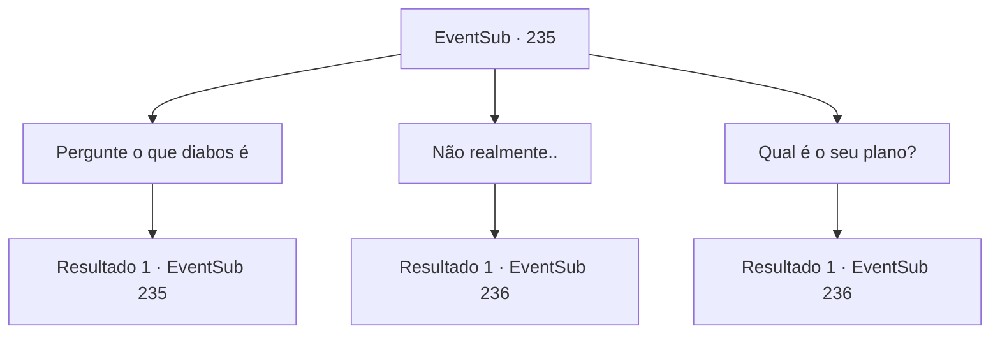

# Eventos secundários · 235

[Índice da tabela](index.md) · [Índice geral](../index.md)

ID: `pt:EventSub:235` · Fonte: `EventSub4` · Versão: 1.2.47.

Mapeamento estático dos arquivos; a disponibilidade e a execução dependem do estado da run.

## Texto do evento

*Sem texto no arquivo.*

## Dados de entrada

```json
{
  "id": 235,
  "grade": 1,
  "subEvent": "",
  "required": ""
}
```

## Mapa das escolhas



## Escolhas e resultados

### Escolha 1

Pergunte o que diabos é

Requisitos e outros campos da escolha:

```json
{
  "required": "5_211_0"
}
```

#### Resultado 1.1

Você pergunta a ela sobre o Diabo do Mar que ela contou. Madellin responde calmamente, embora com um rosto sombrio. 

 "Aquele... diabo é chamado por muitos nomes entre os humanos. Kraken, Krayken e... uh... Cricket? De qualquer forma."

 Depois de ouvir isso, os rostos dos marinheiros ficam pálidos. Mas Parrie era diferente. Ele grita confiantemente. 

 "Com minha 'Viúva do Amor', o Kraken não é nada! Claro!!"


Continuação registrada: [Evento 235](0235.md) na mesma tabela.

```json
{
  "required": "",
  "chance": "1",
  "nextEvent": 235,
  "type": 2,
  "reward": "5_211_1"
}
```

### Escolha 2

Não realmente..

Requisitos e outros campos da escolha:

```json
{
  "required": ""
}
```

#### Resultado 2.1

Madellin assente depois de ouvir sua resposta. 

 "Eu e meus soldados iremos acompanhá -lo. Nós o notificaremos quando o Kraken aparecer. Antes disso, você terá que nos informar sobre qual será sua estratégia."

 Parrie responde a ela. 

 "Reforçamos o baralho e instalamos um Ballista. Uma enorme barra de aço será disparada e empalando a besta. E também temos canhões ... o que quero dizer é que vamos atacar de longe."

 Parrie, de maneira fácil, conclui sua explicação. Madellin assente. Os dois lados finalmente concordam com o Merfolk atraindo o Kraken e a viúva do amor atacando o Kraken com balistas e canhões. 

 Depois que a longa viagem terminou, a viúva do amor para no meio do oceano. Madellin diz para você esperar e desaparece no oceano. Logo, nuvens negras começam a aparecer, derramando água e a própria espuma do mar. 

 "Está chegando ... prepare -se!"

 Parrie adverte a tripulação. Mas as coisas acabam sendo diferentes do plano. Tentáculos enormes aparecem do mar e envolvem a viúva do amor. O navio grita com dor, e Parrie ordena a equipe de pânico. <link=shake>

 "MALDIÇÃO!! Todo mundo se livra desses tentáculos !! Atirem os canhões, esfaqueiem com suas espadas! FAÇAM ALGO!"

 </link> Ele então corre para o Ballista. Você também corre para os tentáculos, com suas armas desenhadas.

Continuação registrada: [Evento 236](0236.md) na mesma tabela.

```json
{
  "required": "",
  "chance": "1",
  "nextEvent": 236,
  "type": 2,
  "reward": "6_0_112",
  "place": 3
}
```

### Escolha 3

Qual é o seu plano?

Requisitos e outros campos da escolha:

```json
{
  "required": ""
}
```

#### Resultado 3.1

Madellin responde olhando e questionando Parrie. 

 "Sim. Claro que temos um plano. Antes disso, o que você é capaz exatamente?"

 Parrie cruza os braços e responde. 

 "Reforçamos o baralho e instalamos um Ballista. Uma enorme barra de aço será disparada e empalando a besta. E também temos canhões ... o que quero dizer é que vamos atacar de longe."

 Parrie, de maneira fácil, conclui sua explicação. Madellin assente. 

 "Eu e meus guardas o acompanharemos. E nós o notificaremos se o Kraken aparecer."

 Os dois lados finalmente concordam com o Merfolk atraindo o Kraken e a viúva do amor atacando o Kraken com balistas e canhões. 

 Depois que a longa viagem terminou, a viúva do amor para no meio do oceano.  Madellin diz para você esperar e desaparece no oceano.  Logo, nuvens negras começam a aparecer, derramando água e a própria espuma do mar.  

 "Está chegando ... prepare -se!"

  Parrie adverte a tripulação. Mas as coisas acabam sendo diferentes do plano.  Tentáculos enormes aparecem do mar e envolvem a viúva do amor.  O navio grita com dor, e Parrie ordena a equipe de pânico.  <link=shake>

 "MALDIÇÃO!! Todo mundo se livra desses tentáculos !! Atirem os canhões, esfaqueiem com suas espadas! FAÇAM ALGO!"

</link>  Ele então corre para o Ballista. Você também corre para os tentáculos, com suas armas desenhadas.

Continuação registrada: [Evento 236](0236.md) na mesma tabela.

```json
{
  "required": "",
  "chance": "1",
  "nextEvent": 236,
  "type": 2,
  "reward": "6_0_112",
  "place": 3
}
```

## Referências que chegam a este evento

- [Evento 234 · escolha 1 · resultado 1](0234.md#escolha-1)
- [Evento 235 · escolha 1 · resultado 1](0235.md#escolha-1)
