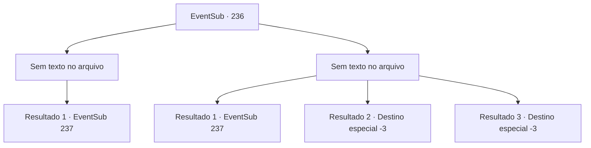

# Eventos secundários · 236

[Índice da tabela](index.md) · [Índice geral](../index.md)

ID: `pt:EventSub:236` · Fonte: `EventSub4` · Versão: 1.2.47.

Mapeamento estático dos arquivos; a disponibilidade e a execução dependem do estado da run.

## Texto do evento

*Sem texto no arquivo.*

## Dados de entrada

```json
{
  "id": 236,
  "grade": 1,
  "subEvent": "",
  "required": ""
}
```

## Mapa das escolhas



## Escolhas e resultados

### Escolha 1

*Sem texto no arquivo; o papel dessa opção depende da interface do jogo.*

Requisitos e outros campos da escolha:

```json
{
  "required": ""
}
```

#### Resultado 1.1

Os tentáculos estão gravemente danificados, sofrendo os ataques de você e da tripulação. Parrie cai no convés, e o Ballista agora está vazio, tendo disparado toda a sua munição. A tripulação aplaude, mostrando felicidade, mas isso é apenas uma breve pausa. O mar começa a espalhar novamente e seis tentáculos subiram para o céu. Eles então deitam resíduos na viúva do amor, destruindo -a em pedaços. Os marinheiros gritam em pânico, sendo jogados no oceano e você sofre o mesmo destino. Infelizmente, você fica cara a cara com o destruidor do navio. |drawing_kraken| Apenas olhando para o enorme kraken pressiona você. Então, a rainha da sereia de olhos azuis Madellin se aproxima de você. De repente, ela puxa os lábios para os seus. 

 "Você deve poder respirar debaixo d'água agora. Não conseguimos atrair a besta para nossas intenções ..."

 Quando você olha em volta, os outros Merfolk estão fazendo o mesmo com os outros marinheiros. Antes que você possa dizer qualquer coisa, o Kraken vem atacando com as pernas se espalham.

Continuação registrada: [Evento 237](0237.md) na mesma tabela.

```json
{
  "required": "",
  "chance": "1",
  "nextEvent": 237,
  "type": 2,
  "reward": "6_0_113",
  "place": 3
}
```

### Escolha 2

*Sem texto no arquivo; o papel dessa opção depende da interface do jogo.*

Requisitos e outros campos da escolha:

```json
{
  "required": ""
}
```

#### Resultado 2.1

Apesar de você e os ataques cooperativos da tripulação, os gigantes Tenacles rasgam o navio em pedaços. O navio se separa e você é jogado na água. Você logo fica cara a cara com o destruidor do navio. |drawing_kraken| Apenas olhando para o enorme kraken pressiona você. Então, a rainha da sereia de olhos azuis Madellin se aproxima de você. De repente, ela puxa os lábios para os seus. 

 "Você deve poder respirar debaixo d'água agora. Não conseguimos atrair a besta para nossas intenções ..."

 Quando você olha em volta, os outros Merfolk estão fazendo o mesmo com os outros marinheiros. Antes que você possa dizer qualquer coisa, o Kraken vem atacando com as pernas se espalham.

Continuação registrada: [Evento 237](0237.md) na mesma tabela.

```json
{
  "required": "1_0_2|1_1_2",
  "chance": "1",
  "nextEvent": 237,
  "type": 2,
  "reward": "6_0_113|0_0_-1|0_1_-1",
  "place": 3
}
```

#### Resultado 2.2

Apesar dos ataques cooperativos seus e da tripulação, os tentáculos gigantes destroem o navio em pedaços. O navio se despedaça e você é jogado na água, perdendo a consciência.

Continuação registrada: [Destino especial `-3`](../destinos-especiais.md).

```json
{
  "required": "2_0_2",
  "chance": "1",
  "nextEvent": -3,
  "type": 2,
  "reward": "0_0_-1|0_1_-1"
}
```

#### Resultado 2.3

Apesar dos ataques cooperativos seus e da tripulação, os tentáculos gigantes destroem o navio em pedaços. O navio se despedaça e você é jogado na água, perdendo a consciência.

Continuação registrada: [Destino especial `-3`](../destinos-especiais.md).

```json
{
  "required": "2_1_2",
  "chance": "1",
  "nextEvent": -3,
  "type": 2,
  "reward": "0_0_-1|0_1_-1"
}
```

## Referências que chegam a este evento

- [Evento 235 · escolha 2 · resultado 1](0235.md#escolha-2)
- [Evento 235 · escolha 3 · resultado 1](0235.md#escolha-3)
