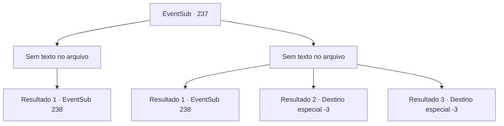

# Eventos secundários · 237

[Índice da tabela](index.md) · [Índice geral](../index.md)

ID: `pt:EventSub:237` · Fonte: `EventSub4` · Versão: 1.2.47.

Mapeamento estático dos arquivos; a disponibilidade e a execução dependem do estado da run.

## Texto do evento

*Sem texto no arquivo.*

## Dados de entrada

```json
{
  "id": 237,
  "grade": 1,
  "subEvent": "",
  "required": ""
}
```

## Mapa das escolhas



## Escolhas e resultados

### Escolha 1

*Sem texto no arquivo; o papel dessa opção depende da interface do jogo.*

Requisitos e outros campos da escolha:

```json
{
  "required": ""
}
```

#### Resultado 1.1

A tripulação restante luta contra o Kraken com os seres do mar. As perdas são grandes, mas a grande besta cospe sangue azul e desmorona. Após a batalha, a tripulação exausta segura os pedaços quebrados do navio, e os seres do mar flutuam na água. Madellin recupera o fôlego e se aproxima de você. 

 "Ofegante... obrigada. Se não fosse por você... não teríamos sido vitoriosos."

 Então, Parrie grita com o rosto irritado. 

 "Malditos peixes...! Se vocês tivessem seguido o nosso plano, meu navio não teria sido destroçado! O que vocês vão fazer! O QUE VOCÊS VÃO FAZER!!!"

 Madellin fala calmamente, encarando Parrie. 

 "Eu... sinto muito por isso. Mas, essa atitude não vai te levar a lugar nenhum."

 A resposta da Rainha foi o suficiente para deixar Parrie com raiva, e finalmente ele aponta a espada para a Rainha. 

 "Claro! Vamos ver como isso termina para nós!"

 A tripulação olha preocupada uns para os outros.

Continuação registrada: [Evento 238](0238.md) na mesma tabela.

```json
{
  "required": "",
  "chance": "1",
  "nextEvent": 238,
  "type": 2,
  "reward": "5_219_1"
}
```

### Escolha 2

*Sem texto no arquivo; o papel dessa opção depende da interface do jogo.*

Requisitos e outros campos da escolha:

```json
{
  "required": ""
}
```

#### Resultado 2.1

A resistência do Kraken é considerável. Você é atingido por seu tentáculo gigante, quase perdendo a consciência. Madellin e os outros seres do mar estão exaustos. O Kraken consegue escapar. A tinta do Kraken cobre o mar de preto. Depois que a tinta é dissipada, o Kraken não pode ser visto em lugar nenhum. 

 "Ha..hah....Bom trabalho, pessoal. Vamos mover os feridos."

 Você escolta os feridos com outros seres do mar capazes, Então, Parrie grita com uma expressão irritada. 

 "Malditos peixes...! Se vocês tivessem seguido nosso plano, meu navio não teria sido destroçado em pedaços! O que vocês vão fazer! O QUE VOCÊS VÃO FAZER!!!"

 Madellin fala calmamente, encarando Parrie. 

 "Eu... sinto muito por isso. Mas, esse tipo de atitude não vai te levar a lugar nenhum."

 A resposta da Rainha foi o suficiente para deixar Parrie com raiva, e finalmente ele aponta a espada para a Rainha. 

 "Claro! Deixe-me ver como isso termina para nós!"

 A tripulação olha preocupada uns para os outros.

Continuação registrada: [Evento 238](0238.md) na mesma tabela.

```json
{
  "required": "1_0_2|1_1_2",
  "chance": "1",
  "nextEvent": 238,
  "type": 2,
  "reward": "0_0_-1|0_1_-1"
}
```

#### Resultado 2.2

A resistência do Kraken é considerável. Você é atingido por seu tentáculo gigante, sendo arremessado contra uma parede próxima. Isso leva sua consciência para o abismo.

Continuação registrada: [Destino especial `-3`](../destinos-especiais.md).

```json
{
  "required": "2_0_2",
  "chance": "1",
  "nextEvent": -3,
  "type": 2,
  "reward": "0_0_-1|0_1_-1"
}
```

#### Resultado 2.3

A resistência do Kraken é considerável. Você é atingido por seu tentáculo gigante, sendo arremessado contra uma parede próxima. Isso leva sua consciência para o abismo.

Continuação registrada: [Destino especial `-3`](../destinos-especiais.md).

```json
{
  "required": "2_1_2",
  "chance": "1",
  "nextEvent": -3,
  "type": 2,
  "reward": "0_0_-1|0_1_-1"
}
```

## Referências que chegam a este evento

- [Evento 236 · escolha 1 · resultado 1](0236.md#escolha-1)
- [Evento 236 · escolha 2 · resultado 1](0236.md#escolha-2)
