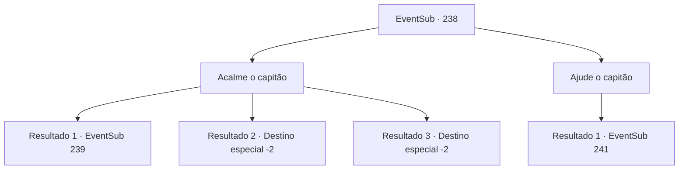

# Eventos secundários · 238

[Índice da tabela](index.md) · [Índice geral](../index.md)

ID: `pt:EventSub:238` · Fonte: `EventSub4` · Versão: 1.2.47.

Mapeamento estático dos arquivos; a disponibilidade e a execução dependem do estado da run.

## Texto do evento

*Sem texto no arquivo.*

## Dados de entrada

```json
{
  "id": 238,
  "grade": 1,
  "subEvent": "",
  "required": ""
}
```

## Mapa das escolhas



## Escolhas e resultados

### Escolha 1

Acalme o capitão

Requisitos e outros campos da escolha:

```json
{
  "required": ""
}
```

#### Resultado 1.1

Você diz a Parrie para olhar em volta. Ele olha para o ambiente por um segundo. Driftting marinheiros, mal segurando as peças quebradas do navio, entre na visão de tiro no sangue do capitão. 

 "Hmph ... hmm ... vejo que estava excitado demais. Eu sinto Muito."

 Parrie embainha a espada e pede desculpas, enquanto Madellin aperta as mãos, dizendo que não é nada. 

 "Eu entendo. Você está certo, de qualquer maneira ... traremos você à terra. E o tesouro prometido."

 Como a rainha ordenou, os Merfolk trazem os marinheiros para a terra.
 Depois de algum tempo se passou, você e os marinheiros retornam com segurança à terra. E antes de você, dois merfolks trazem um peito pesado. O baú é feito com um metal turquesa, com algumas conchas e plantas aquáticas presas aqui e ali. 

 "O tesouro prometido. Abra."

 Parrie sinaliza seus homens para abrir o peito. Uma das tripulantes, peluda, abre o peito. Está cheio de uma carga pesada de moedas de ouro, gemas valiosas, brincos de jóias. Você definitivamente pode ver que vale muito. Depois de colocar a caixa, o Merfolk desaparece com as ondas e Parrie faz uma declaração. 

 "Eu deveria primeiro comprar um novo navio com isso. Vou distribuir para você."

 Isso envia a tripulação para um alvoroço. 

 "O que, você é o único que luta pela sua vida? Tocamos ociosamente enquanto você fazia seu trabalho? O tesouro deve ser dividido igualmente!"

 "Por que só recebemos as sobras?"

 Depois de ouvir isso, Parrie parece enojado. 

 "Olha agora ... sem aquele maldito navio, você nem conseguiu ver o merfolk, ou o Kraken! Ei {1}! Você não concorda?"

 Agora o foco está em você. Olha de muitas terras em você como flechas.

Continuação registrada: [Evento 239](0239.md) na mesma tabela.

```json
{
  "required": "5_219_1",
  "chance": "1|0_7_1",
  "nextEvent": 239,
  "type": 0,
  "reward": ""
}
```

#### Resultado 1.2

Você diz a Parrie para se acalmar e olhar em volta. Mesmo depois de ouvir isso, ele não bate sua espada. Então, Madellin agarra você pela mão e começa a nadar. Os Merfolk a seguem. Com Parrie e sua tripulação deixados presos no meio do oceano. 

 Um pouco depois, você consegue voltar à superfície. A rainha da sereia lhe dá o tridente e fala. 

 "Obrigado pela ajuda. Este tridente é um artefato ancestral, transmitido por gerações. É seu agora, faça bom uso dele."

 Ela te beija na sua bochecha e desaparece com as ondas.

Continuação registrada: [Destino especial `-2`](../destinos-especiais.md).

```json
{
  "required": "5_219_1",
  "chance": "13",
  "nextEvent": -2,
  "type": 1,
  "reward": "12_6_-1|3_214_1|14_6_5"
}
```

#### Resultado 1.3

Você diz a Parrie para se acalmar e olhar em volta. Mesmo depois de ouvir isso, ele não bate sua espada. Então, Madellin agarra você pela mão e começa a nadar. Os Merfolk a seguem. Com Parrie e sua tripulação deixados presos no meio do oceano. 

 Um pouco depois, você consegue voltar à superfície. A rainha da sereia lhe dá o tridente e fala. 

 "Obrigado pela ajuda. Este tridente é um artefato ancestral, transmitido por gerações. É seu agora, faça bom uso dele."

 Ela te beija na sua bochecha e desaparece com as ondas.

Continuação registrada: [Destino especial `-2`](../destinos-especiais.md).

```json
{
  "required": "18_219_1",
  "chance": "1",
  "nextEvent": -2,
  "type": 2,
  "reward": "12_6_-1|3_215_1|14_6_5"
}
```

### Escolha 2

Ajude o capitão

Requisitos e outros campos da escolha:

```json
{
  "required": ""
}
```

#### Resultado 2.1

Você ajuda o capitão, apoiando-o. A Rainha Sereia solta um suspiro curto e responde. 

 "Tudo bem, se essa é a sua resposta. Vamos voltar."

 Os seres do mar, seguindo sua ordem, nadam de volta para o oceano rapidamente. Ao mesmo tempo, você sente a bênção que permitia que você respirasse debaixo d'água desaparecendo. 

 "Para onde você pensa que está INDO!!!"

 Parrie se debate, se agita, mas os seres do mar já se foram. Agora, o problema é encontrar um caminho de volta para a terra.

Continuação registrada: [Evento 241](0241.md) na mesma tabela.

```json
{
  "required": "",
  "chance": "1",
  "nextEvent": 241,
  "type": 2,
  "reward": ""
}
```

## Referências que chegam a este evento

- [Evento 237 · escolha 1 · resultado 1](0237.md#escolha-1)
- [Evento 237 · escolha 2 · resultado 1](0237.md#escolha-2)
