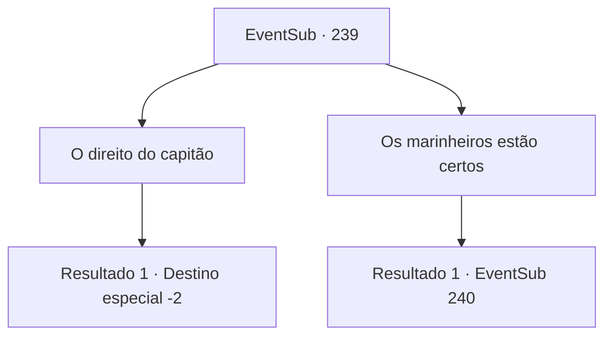

# Eventos secundários · 239

[Índice da tabela](index.md) · [Índice geral](../index.md)

ID: `pt:EventSub:239` · Fonte: `EventSub4` · Versão: 1.2.47.

Mapeamento estático dos arquivos; a disponibilidade e a execução dependem do estado da run.

## Texto do evento

*Sem texto no arquivo.*

## Dados de entrada

```json
{
  "id": 239,
  "grade": 1,
  "subEvent": "",
  "required": ""
}
```

## Mapa das escolhas



## Escolhas e resultados

### Escolha 1

O direito do capitão

Requisitos e outros campos da escolha:

```json
{
  "required": ""
}
```

#### Resultado 1.1

Você insiste que o capitão está certo. A tripulação murmura brevemente, mas o tumulto logo se acalma e concordam em distribuir o lucro igualmente. O rosto de Parrie se ilumina. 

 "Vamos ver aqui, agora..."

 Ele pega sua parte do baú do tesouro e dá o restante para a tripulação. Ele sussurra para você que te deu um pouco mais. 

 "Isso realmente foi uma experiência inesquecível. Quem mais seria capaz de caçar o Kraken com os seres da água assim, hahaha!"

 Você se despede dele e pega sua parte.

Continuação registrada: [Destino especial `-2`](../destinos-especiais.md).

```json
{
  "required": "",
  "chance": "1",
  "nextEvent": -2,
  "type": 2,
  "reward": "12_6_-1|14_6_6|0_4_250"
}
```

### Escolha 2

Os marinheiros estão certos

Requisitos e outros campos da escolha:

```json
{
  "required": ""
}
```

#### Resultado 2.1

Você apoia os marinheiros. Agora Parrie está realmente irritado, sacando sua espada. 

 "Malditos LADRÕES! Quem tiver algo a dizer, lute comigo! Eu vou matar TODOS VOCÊS!!"

 Ele olha para você com olhos vermelhos de sangue. Ele então se aproxima de você, gritando. 

 "Sim...! Você é o pastor, e eles são o rebanho!"

 Você acaba lutando contra Parrie, e a tripulação também parte para cima dele.

Continuação registrada: [Evento 240](0240.md) na mesma tabela.

```json
{
  "required": "",
  "chance": "1",
  "nextEvent": 240,
  "type": 2,
  "reward": "6_2_110",
  "place": 3
}
```

## Referências que chegam a este evento

- [Evento 238 · escolha 1 · resultado 1](0238.md#escolha-1)
