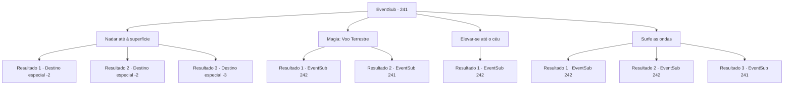

# Eventos secundários · 241

[Índice da tabela](index.md) · [Índice geral](../index.md)

ID: `pt:EventSub:241` · Fonte: `EventSub4` · Versão: 1.2.47.

Mapeamento estático dos arquivos; a disponibilidade e a execução dependem do estado da run.

## Texto do evento

*Sem texto no arquivo.*

## Dados de entrada

```json
{
  "id": 241,
  "grade": 1,
  "subEvent": "",
  "required": ""
}
```

## Mapa das escolhas



## Escolhas e resultados

### Escolha 1

Nadar até à superfície

Requisitos e outros campos da escolha:

```json
{
  "required": ""
}
```

#### Resultado 1.1

Você nada através das ondas, com todo o seu poder. Essa ação requer uma quantidade tremenda de resistência e força, mas você consegue fazê-la com uma vitalidade incrível. Alguns marinheiros seguem o exemplo, nadando. Mas ninguém mais consegue chegar à superfície. Você chega à praia, respirando com dificuldade. Você faz uma pequena pausa, olhando para o mar cheio de ondas. Você passou por muitas coisas, mas acabou sem nada, e você puxa seu corpo de volta e se afasta da praia.

Continuação registrada: [Destino especial `-2`](../destinos-especiais.md).

```json
{
  "required": "",
  "chance": "1|0_13_1|0_5_1",
  "nextEvent": -2,
  "type": 0,
  "reward": "12_6_-1|14_6_5|0_5_1|0_13_1"
}
```

#### Resultado 1.2

Você nada nas ondas, com todo o seu poder. Essa ação requer uma quantidade enorme de resistência e poder, e você já está exausto antes de alcançar a superfície. Você é então engolido pelas ondas, perdendo a consciência.

 Depois de algum tempo se passou, você acorda em terra. Você se puxa de volta, tossindo a água do mar de seus pulmões. Você faz uma pequena pausa, olhando para o mar cheio de ondas. Você já passou por muita coisa, mas acabou sem nada, E você puxa seu corpo de volta e se afasta da praia.

Continuação registrada: [Destino especial `-2`](../destinos-especiais.md).

```json
{
  "required": "1_0_2",
  "chance": "40",
  "nextEvent": -2,
  "type": 1,
  "reward": "12_6_-1|14_6_5|0_0_-1"
}
```

#### Resultado 1.3

Você nada através das ondas, com todo o seu poder. Essa ação requer uma quantidade tremenda de resistência e força, e você já está exausto antes de conseguir alcançar a superfície. Você é então engolido pelas ondas, perdendo a consciência.

Continuação registrada: [Destino especial `-3`](../destinos-especiais.md).

```json
{
  "required": "2_0_2",
  "chance": "40",
  "nextEvent": -3,
  "type": 1,
  "reward": "0_0_-1"
}
```

### Escolha 2

Magia: Voo Terrestre

Requisitos e outros campos da escolha:

```json
{
  "required": "20_0_4|5_219_0|1_1_2"
}
```

#### Resultado 2.1

Você precisa de magia, com uma duração maior do que um voo normal. Isso requer um pouco de concentração, e você consegue fazer isso mesmo com a água do mar batendo em seu rosto. Enquanto seu corpo sobe aos céus, Parrie rapidamente chama seu nome. 

 "Ei...ei! Nos salve! Pelo menos me resgate!!"

 Os marinheiros à deriva vêm pedindo para você resgatá-los.

Continuação registrada: [Evento 242](0242.md) na mesma tabela.

```json
{
  "required": "",
  "chance": "1|0_14_1",
  "nextEvent": 242,
  "type": 0,
  "reward": "0_1_-1"
}
```

#### Resultado 2.2

Você precisa de magia, com uma duração maior do que um voo normal. Isso requer um pouco de concentração, e você simplesmente não pode conjurá-lo com a água do mar batendo em seu rosto. Você deve tentar algo diferente.

Continuação registrada: [Evento 241](0241.md) na mesma tabela.

```json
{
  "required": "",
  "chance": "10",
  "nextEvent": 241,
  "type": 1,
  "reward": "5_219_1|0_1_-1"
}
```

### Escolha 3

Elevar-se até o céu

Requisitos e outros campos da escolha:

```json
{
  "required": "20_10_1"
}
```

#### Resultado 3.1

Você voa até o céu, com a ajuda dos seus itens mágicos. 

 "Ei... salve-nos! Pelo menos me resgate!!"

 Os marinheiros à deriva vêm pedindo para você resgatá-los.

Continuação registrada: [Evento 242](0242.md) na mesma tabela.

```json
{
  "required": "",
  "chance": "1",
  "nextEvent": 242,
  "type": 2,
  "reward": ""
}
```

### Escolha 4

Surfe as ondas

Requisitos e outros campos da escolha:

```json
{
  "required": "5_218_0"
}
```

#### Resultado 4.1

Você surfa nas ondas, com a ajuda dos seus itens mágicos. Presenciando isso, Parrie chama o seu nome. 

 "E..ei! Nos salve! Pelo menos me resgate!!"

 Os marinheiros à deriva vêm pedindo para você resgatá-los.

Continuação registrada: [Evento 242](0242.md) na mesma tabela.

```json
{
  "required": "8_95_1",
  "chance": "1",
  "nextEvent": 242,
  "type": 2,
  "reward": ""
}
```

#### Resultado 4.2

Você surfa nas ondas, com a ajuda dos seus itens mágicos. Presenciando isso, Parrie chama o seu nome. 

 "Ei... ei! Nos salve! Pelo menos me resgate!!"

 Os marinheiros à deriva vêm pedindo para você resgatá-los.

Continuação registrada: [Evento 242](0242.md) na mesma tabela.

```json
{
  "required": "8_214_1",
  "chance": "1",
  "nextEvent": 242,
  "type": 2,
  "reward": ""
}
```

#### Resultado 4.3

Tentas surfar nas ondas numa prancha de madeira. Mas a prancha logo se parte, e tens que encontrar outro caminho.

Continuação registrada: [Evento 241](0241.md) na mesma tabela.

```json
{
  "required": "10_95_1|10_214_1",
  "chance": "1",
  "nextEvent": 241,
  "type": 2,
  "reward": "5_218_1"
}
```

## Referências que chegam a este evento

- [Evento 238 · escolha 2 · resultado 1](0238.md#escolha-2)
- [Evento 241 · escolha 2 · resultado 2](0241.md#escolha-2)
- [Evento 241 · escolha 4 · resultado 3](0241.md#escolha-4)
