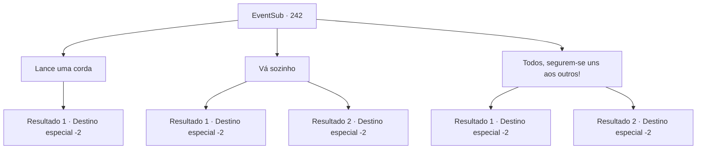

# Eventos secundários · 242

[Índice da tabela](index.md) · [Índice geral](../index.md)

ID: `pt:EventSub:242` · Fonte: `EventSub4` · Versão: 1.2.47.

Mapeamento estático dos arquivos; a disponibilidade e a execução dependem do estado da run.

## Texto do evento

*Sem texto no arquivo.*

## Dados de entrada

```json
{
  "id": 242,
  "grade": 1,
  "subEvent": "",
  "required": ""
}
```

## Mapa das escolhas



## Escolhas e resultados

### Escolha 1

Lance uma corda

Requisitos e outros campos da escolha:

```json
{
  "required": "8_39_1"
}
```

#### Resultado 1.1

Você amarra uma corda em volta da sua cintura e joga a outra ponta para os marinheiros. Eles seguram apressadamente a corda, e aqueles que não conseguem agarrá-la seguram nas roupas e partes do corpo de outros marinheiros. Depois de carregá-los até o fim, você finalmente chega a uma praia próxima. Alguns marinheiros parecem estar faltando, mas aparentemente Parrie não se importa. Ele cospe no oceano com raiva. 

 "Maldição... Eu... Eu não sei o que dizer. Desculpe. Eu simplesmente não suportava a arrogância daquela sereia... Mas conseguimos sobreviver, não é mesmo."

 Ele parte, com a solene promessa de que um dia irá retribuir você. A tripulação murmura entre si, olha o capitão se afastando e logo se dispersa.

Continuação registrada: [Destino especial `-2`](../destinos-especiais.md).

```json
{
  "required": "",
  "chance": "1",
  "nextEvent": -2,
  "type": 2,
  "reward": "12_6_-1|14_6_8|0_3_3"
}
```

### Escolha 2

Vá sozinho

Requisitos e outros campos da escolha:

```json
{
  "required": ""
}
```

#### Resultado 2.1

Você ignora o pedido deles e vai para a praia sozinho. Só depois de muito tempo você chega à terra. Você passou por muitas coisas, mas acabou sem nada. O som das ondas batendo parece gritos aos seus ouvidos, então você decide rapidamente sair.

Continuação registrada: [Destino especial `-2`](../destinos-especiais.md).

```json
{
  "required": "1_3_-14",
  "chance": "1",
  "nextEvent": -2,
  "type": 2,
  "reward": "12_6_-1|14_6_5|0_3_-5"
}
```

#### Resultado 2.2

Você zomba deles. Em seguida, você vai para a praia sozinho. Somente depois de muito tempo você chega à terra. Você passou por muitas coisas, mas acabou sem nada.

Continuação registrada: [Destino especial `-2`](../destinos-especiais.md).

```json
{
  "required": "2_3_-14",
  "chance": "1",
  "nextEvent": -2,
  "type": 2,
  "reward": "12_6_-1|14_6_5|0_3_-5"
}
```

### Escolha 3

Todos, segurem-se uns aos outros!

Requisitos e outros campos da escolha:

```json
{
  "required": "1_3_10"
}
```

#### Resultado 3.1

Você grita para a tripulação se segurar uns aos outros. Eles rapidamente agarram as roupas e partes do corpo uns dos outros, e você pega o braço de um dos marinheiros e os lidera. Depois de carregá-los até o fim, você finalmente chega a uma praia próxima. Alguns marinheiros parecem estar faltando, mas aparentemente Parrie não se importa. Ele cospe no oceano com raiva. 

 "Maldição... Eu... Eu não sei o que dizer. Desculpe. Eu simplesmente não suportava a arrogância daquela sereia... Mas conseguimos sobreviver, não é mesmo."

 Ele parte, com uma promessa solene de que ele irá retribuir você algum dia. A tripulação murmura entre si, olha o capitão se afastando e logo se dispersa.

Continuação registrada: [Destino especial `-2`](../destinos-especiais.md).

```json
{
  "required": "",
  "chance": "1|0_5_1",
  "nextEvent": -2,
  "type": 0,
  "reward": "12_6_-1|14_6_8|0_3_3"
}
```

#### Resultado 3.2

Você grita para a tripulação se segurar uns aos outros. Eles rapidamente agarram as roupas e partes do corpo uns dos outros, e você pega o braço de um dos marinheiros e os lidera. Mas no caminho para a praia, você perde o controle do braço. Todos são engolidos pelas ondas, e antes que você perceba, eles desaparecem. Você só pode seguir para a praia sozinho, e somente depois de muito tempo você chega à terra. Você passou por muitas coisas, mas acabou sem nada. O som das ondas batendo parece gritos aos seus ouvidos, então você decide rapidamente partir.

Continuação registrada: [Destino especial `-2`](../destinos-especiais.md).

```json
{
  "required": "",
  "chance": "20",
  "nextEvent": -2,
  "type": 1,
  "reward": "12_6_-1|14_6_5"
}
```

## Referências que chegam a este evento

- [Evento 241 · escolha 2 · resultado 1](0241.md#escolha-2)
- [Evento 241 · escolha 3 · resultado 1](0241.md#escolha-3)
- [Evento 241 · escolha 4 · resultado 1](0241.md#escolha-4)
- [Evento 241 · escolha 4 · resultado 2](0241.md#escolha-4)
