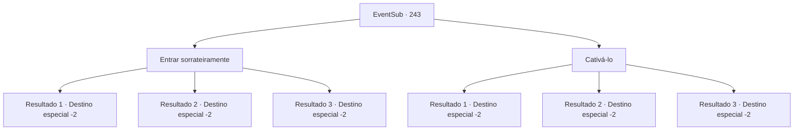

# Eventos secundários · 243

[Índice da tabela](index.md) · [Índice geral](../index.md)

ID: `pt:EventSub:243` · Fonte: `EventSub4` · Versão: 1.2.47.

Mapeamento estático dos arquivos; a disponibilidade e a execução dependem do estado da run.

## Texto do evento

*Sem texto no arquivo.*

## Dados de entrada

```json
{
  "id": 243,
  "grade": 1,
  "subEvent": "",
  "required": ""
}
```

## Mapa das escolhas



## Escolhas e resultados

### Escolha 1

Entrar sorrateiramente

Requisitos e outros campos da escolha:

```json
{
  "required": ""
}
```

#### Resultado 1.1

Você espera até que o capitão esteja ocupado recrutando novos marinheiros e entra sorrateiramente na Viúva do Amor. Você segue direto para o Quarto do Capitão. Em sua mesa, há uma lista com os nomes dos membros da tripulação, e você inscreve o seu próprio nome nessa lista. Você também verifica a programação do navio, que também está na mesa. Assim, você se junta à tripulação da Viúva do Amor. Você sai do navio quando ninguém está olhando, assim como quando entrou.

Continuação registrada: [Destino especial `-2`](../destinos-especiais.md).

```json
{
  "required": "",
  "chance": "1|0_6_1",
  "nextEvent": -2,
  "type": 0,
  "reward": "12_6_1|0_2_1"
}
```

#### Resultado 1.2

Você espera até que o capitão esteja ocupado recrutando novos marinheiros e se infiltra na Viúva do Amor. Você segue direto para o Quarto do Capitão. Em sua mesa, há uma lista com os nomes dos membros da tripulação, e você inscreve o seu próprio nome nessa lista. Você também verifica a programação do navio, que também é encontrada na mesa. Assim, você se junta à tripulação da Viúva do Amor. Você sai do navio quando ninguém está olhando, assim como quando entrou.

Continuação registrada: [Destino especial `-2`](../destinos-especiais.md).

```json
{
  "required": "20_5_2",
  "chance": "1|0_6_1",
  "nextEvent": -2,
  "type": 0,
  "reward": "12_6_1|0_2_1"
}
```

#### Resultado 1.3

Você espera até que o capitão esteja ocupado recrutando novos marinheiros e tenta se infiltrar furtivamente na Viúva do Amor. Mas ele te descobre, gritando e xingando com você. Você foge às pressas da situação constrangedora.

Continuação registrada: [Destino especial `-2`](../destinos-especiais.md).

```json
{
  "required": "",
  "chance": "18",
  "nextEvent": -2,
  "type": 1,
  "reward": "12_6_-1"
}
```

### Escolha 2

Cativá-lo

Requisitos e outros campos da escolha:

```json
{
  "required": "11_0_1"
}
```

#### Resultado 2.1

Você olha seu oponente nos olhos. Ele tenta evitar contato visual com você. Enquanto você sussurra baixinho 'Vá com calma comigo', o olhar dele cai para o chão. 

 "Preparar... apontar... fogo!"

 Assim que a partida começa, você domina o homem encapuzado. Ele aperta exageradamente o braço, sentindo dor, e você joga os braços para o alto em vitória. Parrie se aproxima de você, aplaudindo. 

 "Agora, agora, parece que meu instinto estava errado! Você conquistou seu lugar no Viúva do Amor!"

 Ele pede que você chegue na hora, pois eles partirão em alguns dias. Você tenta ao máximo se lembrar da data que ele te disse e vai embora.

Continuação registrada: [Destino especial `-2`](../destinos-especiais.md).

```json
{
  "required": "",
  "chance": "1|0_12_1",
  "nextEvent": -2,
  "type": 0,
  "reward": "12_6_1|0_2_1"
}
```

#### Resultado 2.2

Você encara seu oponente nos olhos. Ele tenta evitar contato visual com você. Enquanto sussurra baixinho 'Vá com calma comigo', o olhar dele cai para o chão. 

 "Preparar... apontar... fogo!"

 Assim que a partida começa, você domina o homem encapuzado. Ele aperta exageradamente o braço, sentindo dor, e você joga os braços para o alto em vitória. Parrie se aproxima de você, aplaudindo. 

 "Agora, agora, parece que meu instinto estava errado! Você conquistou seu lugar no Viúva do Amor!"

 Ele pede que você chegue no horário, pois eles partirão em alguns dias. Você tenta ao máximo se lembrar da data que ele te disse e vai embora.

Continuação registrada: [Destino especial `-2`](../destinos-especiais.md).

```json
{
  "required": "20_4_2",
  "chance": "1|0_12_1",
  "nextEvent": -2,
  "type": 0,
  "reward": "12_6_1|0_2_1"
}
```

#### Resultado 2.3

Você olha seu oponente nos olhos. Ele nem tenta evitar seu olhar e encara você como um predador observando sua presa. Enquanto você sussurra baixinho 'Vá com calma comigo', você vê o rosto dele ficando vermelho, provavelmente de raiva. 

 "Pronto... preparar... já!"

 Mas assim que a luta começa, o homem encapuzado dobra seu braço ao meio. Enquanto você sente dor, Parrie estala a língua, olhando para você. 

 "Maldição... é tão difícil encontrar homens adequados neste lugar?"

 Você foge rapidamente da humilhação, segurando seus pulsos.

Continuação registrada: [Destino especial `-2`](../destinos-especiais.md).

```json
{
  "required": "",
  "chance": "12",
  "nextEvent": -2,
  "type": 1,
  "reward": "12_6_-1"
}
```

## Referências que chegam a este evento

- [Evento 181 · escolha 1 · resultado 1](0181.md#escolha-1)
