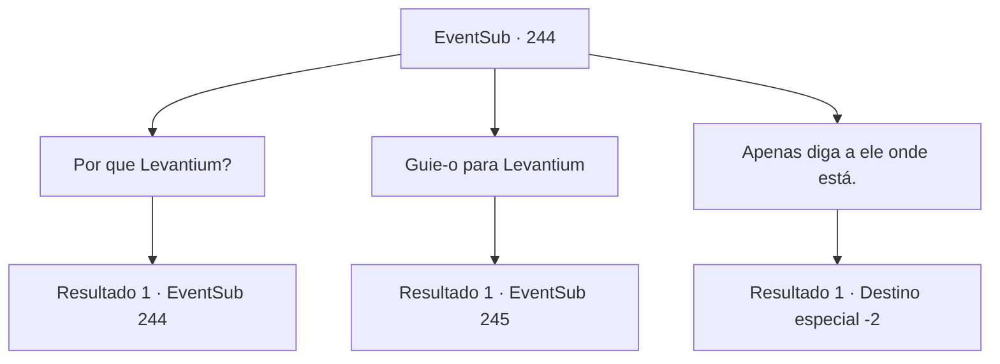

# Eventos secundários · 244

[Índice da tabela](index.md) · [Índice geral](../index.md)

ID: `pt:EventSub:244` · Fonte: `EventSub4` · Versão: 1.2.47.

Mapeamento estático dos arquivos; a disponibilidade e a execução dependem do estado da run.

## Texto do evento

Você conhece um bardo vagabundo. Ele está segurando uma velha harpa nas mãos, envolta em tecido tricotado em vários padrões. Ele tem uma pele morena bronzeada, cabelos grisalhos escuros e um par de olhos verdes. O bardo olha fixamente para você antes de se apresentar. 

 "Bem cumprido. Meu nome é Mahir, canto canções, vagando de um lugar para outro. Estou procurando por Levantium, você faria a gentileza de me dizer onde fica?"


## Dados de entrada

```json
{
  "id": 244,
  "grade": 1,
  "subEvent": "",
  "required": "12_6_5"
}
```

## Mapa das escolhas



## Escolhas e resultados

### Escolha 1

Por que Levantium?

Requisitos e outros campos da escolha:

```json
{
  "required": "5_230_0"
}
```

#### Resultado 1.1

Ele responde em resposta, tocando sua harpa. 

 "Ouvi dizer que um capitão de um navio atracado lá está procurando a Harpa Fantástica. Bem, como sou um jogador fantástico e tenho uma harpa, não há motivo para eu não ir lá."

 Ele toca uma melodia, como se quisesse mostrar suas habilidades. Suas mãos movem as cordas da harpa como água fluindo, e a velha harpa ressoa com um som claro e bonito.

Continuação registrada: [Evento 244](0244.md) na mesma tabela.

```json
{
  "required": "",
  "chance": "1",
  "nextEvent": 244,
  "type": 2,
  "reward": "5_230_1"
}
```

### Escolha 2

Guie-o para Levantium

Requisitos e outros campos da escolha:

```json
{
  "required": ""
}
```

#### Resultado 2.1

Você o guia até Levantium. O bardo improvisa uma música enquanto observa a cidade. Lá, ele conhece Parrie, capitão da 'Viúva do Amor'. Ele reconhece seu rosto e te cumprimenta. 

 "Você... Eu me lembro de você. Seu nome era..."

 Após uma breve consideração, Parrie pega suas mãos e as aperta, provavelmente porque ele não está tão interessado em lembrar seu nome agora. Então ele olha para o bardo ao seu lado, perguntando quem ele é. O bardo se apresenta adequadamente em resposta. 

 "Saudações. Eu sou aquele que toca a Harpa Fantástica, chamado Mahir. Ouvi dizer que você estava procurando pela Harpa Fantástica, então vim aqui pessoalmente."

 O rosto de Parrie se ilumina com um sorriso largo. 

 "Bem, isso não é ótimo! Vamos tentar mais uma vez então! O navio e sua tripulação estão prontos, então vamos lá."

 A Viúva do Amor leva você e o bardo para as chamadas ilhas dos seres do mar. Logo, a Viúva do Amor chega no meio das três ilhas rochosas, onde se diz que os seres do mar aparecem. Já faz um bom tempo que você está aqui, mas o lugar está tão tranquilo como sempre.

Continuação registrada: [Evento 245](0245.md) na mesma tabela.

```json
{
  "required": "",
  "chance": "1",
  "nextEvent": 245,
  "type": 2,
  "reward": "5_230_1"
}
```

### Escolha 3

Apenas diga a ele onde está.

Requisitos e outros campos da escolha:

```json
{
  "required": ""
}
```

#### Resultado 3.1

Você aponta para a direção onde fica Levantium. Mahir agradece elegantemente e segue em direção à cidade portuária, Mas você não o segue. Você se vira e caminha na direção oposta.

Continuação registrada: [Destino especial `-2`](../destinos-especiais.md).

```json
{
  "required": "",
  "chance": "1",
  "nextEvent": -2,
  "type": 2,
  "reward": "12_6_-1"
}
```

## Referências que chegam a este evento

- [Evento 244 · escolha 1 · resultado 1](0244.md#escolha-1)
