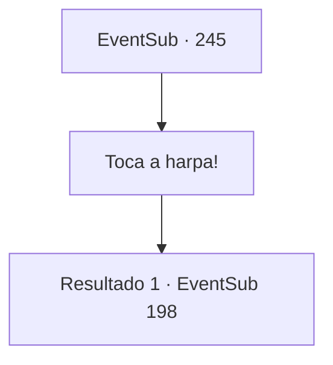

# Eventos secundários · 245

[Índice da tabela](index.md) · [Índice geral](../index.md)

ID: `pt:EventSub:245` · Fonte: `EventSub4` · Versão: 1.2.47.

Mapeamento estático dos arquivos; a disponibilidade e a execução dependem do estado da run.

## Texto do evento

*Sem texto no arquivo.*

## Dados de entrada

```json
{
  "id": 245,
  "grade": 1,
  "subEvent": "",
  "required": ""
}
```

## Mapa das escolhas



## Escolhas e resultados

### Escolha 1

Toca a harpa!

Requisitos e outros campos da escolha:

```json
{
  "required": ""
}
```

#### Resultado 1.1

Mahir prepara sua velha harpa e vai para o convés. Ele então começa a cantar uma música, tocando melodias agradáveis, fáceis para os ouvidos. Um por um, os rostos da tripulação ficam tristes com a emocionante apresentação e logo as sereias do fundo do mar vêm até as ilhas rochosas, ouvindo a harpa. E finalmente, uma sereia com olhos azuis parecidos com gemas emerge à superfície, e pelo comportamento das outras sereias, ela parece ser a líder do grupo. Um momento depois, quando a harpa para de tocar, ela abre a boca. 

 "Sua apresentação impecável nos guiou até aqui. Por quais motivos você nos convocou?"

 Sua voz é ouvida alta e clara, tanto por você quanto pelos outros marinheiros. Talvez eles tenham pensado que as sereias eram apenas mais uma espécie de animais. Então, quando percebem que as sereias falam a língua dos humanos, todos ficam assustados. O rosto de Parrie também escurece.

Continuação registrada: [Evento 198](0198.md) na mesma tabela.

```json
{
  "required": "",
  "chance": "1",
  "nextEvent": 198,
  "type": 2,
  "reward": "0_2_1"
}
```

## Referências que chegam a este evento

- [Evento 244 · escolha 2 · resultado 1](0244.md#escolha-2)
