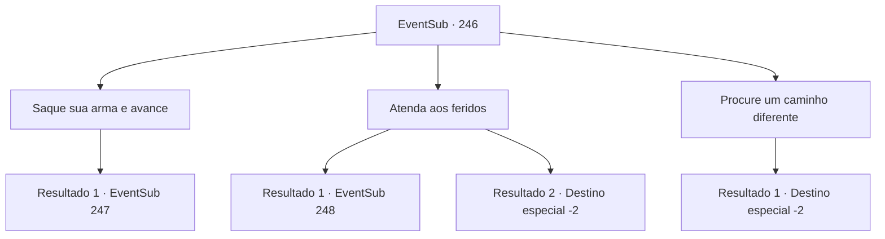

# Eventos secundários · 246

[Índice da tabela](index.md) · [Índice geral](../index.md)

ID: `pt:EventSub:246` · Fonte: `EventSub4` · Versão: 1.2.47.

Mapeamento estático dos arquivos; a disponibilidade e a execução dependem do estado da run.

## Texto do evento

Ao passar por um caminho de montanha, você testemunha um grupo de soldados sendo atacados por uma matilha de lobos. Sua formação parece abalada, com soldados feridos deitados aqui e ali. Aparentemente, eles foram emboscados. 

 "Não tema! Alec da Casa Atléon está aqui!"

 Você vê um cavaleiro chamado 'Alec', tentando o seu melhor para controlar o soldado, em uma armadura de prata brilhante. Mas os soldados já estão em pânico. Eles não prestam atenção na voz de Alec. Os lobos agora parecem mais confiantes, tentando acabar com a caçada. Esses lobos são pelo menos duas vezes maiores que os lobos selvagens usuais, e suas mandíbulas emitem frieza. Você percebe que eles são lobos de inverno. 

## Dados de entrada

```json
{
  "id": 246,
  "grade": 1,
  "subEvent": "",
  "required": "12_7_0"
}
```

## Mapa das escolhas



## Escolhas e resultados

### Escolha 1

Saque sua arma e avance

Requisitos e outros campos da escolha:

```json
{
  "required": ""
}
```

#### Resultado 1.1

Você avança entre os soldados e os lobos do inverno, para ajudar na luta. Sua entrada surpreende os lobos do inverno por um tempo, mas logo eles continuam seu ataque.

Continuação registrada: [Evento 247](0247.md) na mesma tabela.

```json
{
  "required": "",
  "chance": "1",
  "nextEvent": 247,
  "type": 2,
  "reward": "6_0_88",
  "place": 1
}
```

### Escolha 2

Atenda aos feridos

Requisitos e outros campos da escolha:

```json
{
  "required": ""
}
```

#### Resultado 2.1

Você move os soldados feridos para trás, aplicando tratamentos de emergência para salvar suas vidas. Graças a você, os soldados conseguem consertar sua formação novamente, levando a luta para o lado deles. Alec, o Cavaleiro, entra para terminar a luta. 

 "Hiyahh--!"

 O golpe de sua faca, rápido como um flash de luz, corta o lobo alfa do inverno ao meio. Os outros lobos do inverno começam a recuar, e os soldados gritam em triunfo. 

 "Obrigado pela ajuda. Todos nós te devemos nossas vidas."

 Depois de lidar com o lobo alfa, Alec tira o capacete e oferece um aperto de mão.

Continuação registrada: [Evento 248](0248.md) na mesma tabela.

```json
{
  "required": "",
  "chance": "1|0_7_1",
  "nextEvent": 248,
  "type": 0,
  "reward": ""
}
```

#### Resultado 2.2

Você move os soldados feridos para trás, fazendo o seu melhor para cuidar dos feridos. Mas sua intervenção apenas distrai ainda mais os soldados. A situação piora. 

 "Retirada! RETIRADA!"

 Infelizmente, Alec, o Cavaleiro, chama seus homens e ordena que eles recuem. Você se junta aos soldados em retirada e foge.

Continuação registrada: [Destino especial `-2`](../destinos-especiais.md).

```json
{
  "required": "",
  "chance": "12",
  "nextEvent": -2,
  "type": 1,
  "reward": "12_7_1"
}
```

### Escolha 3

Procure um caminho diferente

Requisitos e outros campos da escolha:

```json
{
  "required": ""
}
```

#### Resultado 3.1

Você procura por um caminho diferente, cuidado para não se tornar o alvo dos lobos do inverno. Você pode ouvir os gritos de dor vindos dos soldados cutucando suas costas.

Continuação registrada: [Destino especial `-2`](../destinos-especiais.md).

```json
{
  "required": "",
  "chance": "1",
  "nextEvent": -2,
  "type": 2,
  "reward": "12_7_1"
}
```

## Referências que chegam a este evento

Nenhum `nextEvent` positivo da mesma tabela aponta para este nó. Isso não prova que seja inacessível: sorteio e estado de história podem selecioná-lo.

