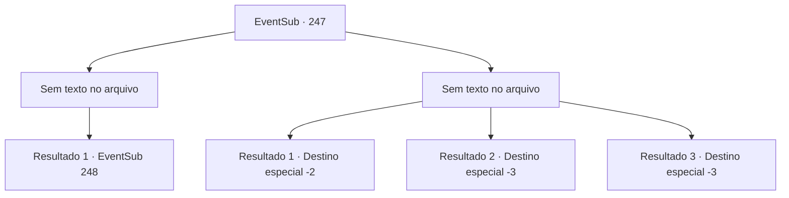

# Eventos secundários · 247

[Índice da tabela](index.md) · [Índice geral](../index.md)

ID: `pt:EventSub:247` · Fonte: `EventSub4` · Versão: 1.2.47.

Mapeamento estático dos arquivos; a disponibilidade e a execução dependem do estado da run.

## Texto do evento

*Sem texto no arquivo.*

## Dados de entrada

```json
{
  "id": 247,
  "grade": 1,
  "subEvent": "",
  "required": ""
}
```

## Mapa das escolhas



## Escolhas e resultados

### Escolha 1

*Sem texto no arquivo; o papel dessa opção depende da interface do jogo.*

Requisitos e outros campos da escolha:

```json
{
  "required": ""
}
```

#### Resultado 1.1


 "Hiyahh--!"

 O balanço de sua faca, tão rápido quanto um flash de luz, corta o lobo alfa do inverno ao meio. Os outros lobos do inverno começam a recuar, e os soldados gritam em triunfo. 

 "Obrigado pela ajuda. Todos nós lhe devemos nossas vidas."

 Depois de lidar com o lobo alfa, Alec tira o capacete e oferece um aperto de mão para você.

Continuação registrada: [Evento 248](0248.md) na mesma tabela.

```json
{
  "required": "",
  "chance": "1",
  "nextEvent": 248,
  "type": 2,
  "reward": ""
}
```

### Escolha 2

*Sem texto no arquivo; o papel dessa opção depende da interface do jogo.*

Requisitos e outros campos da escolha:

```json
{
  "required": ""
}
```

#### Resultado 2.1

Você luta contra os lobos do inverno, mas falha em virar o jogo da batalha. Outros soldados que estavam lutando ao seu lado já estão congelados, e os feridos, sem receber os tratamentos necessários, se tornam sem vida. 

 "Retirada! RETIRADA!"

 Infelizmente, Alec, o Cavaleiro, chama seus homens e ordena que eles se retirem. Você se junta aos soldados em retirada e foge.

Continuação registrada: [Destino especial `-2`](../destinos-especiais.md).

```json
{
  "required": "1_0_2|1_1_2",
  "chance": "1",
  "nextEvent": -2,
  "type": 2,
  "reward": "0_0_-1|0_1_-1|12_7_1"
}
```

#### Resultado 2.2

Seu corpo está congelado pelo frio dos lobos do inverno. Os lobos selvagens mordem e engolem sua presa violentamente.

Continuação registrada: [Destino especial `-3`](../destinos-especiais.md).

```json
{
  "required": "2_0_2",
  "chance": "1",
  "nextEvent": -3,
  "type": 2,
  "reward": "0_0_-1|0_1_-1"
}
```

#### Resultado 2.3

Seu corpo está congelado pelo frio dos lobos do inverno. Os lobos selvagens mordem e engolem sua presa violentamente.

Continuação registrada: [Destino especial `-3`](../destinos-especiais.md).

```json
{
  "required": "2_1_2",
  "chance": "1",
  "nextEvent": -3,
  "type": 2,
  "reward": "0_0_-1|0_1_-1"
}
```

## Referências que chegam a este evento

- [Evento 246 · escolha 1 · resultado 1](0246.md#escolha-1)
