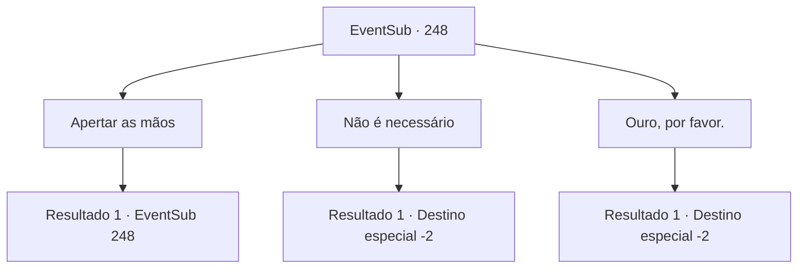

# Eventos secundários · 248

[Índice da tabela](index.md) · [Índice geral](../index.md)

ID: `pt:EventSub:248` · Fonte: `EventSub4` · Versão: 1.2.47.

Mapeamento estático dos arquivos; a disponibilidade e a execução dependem do estado da run.

## Texto do evento

*Sem texto no arquivo.*

## Dados de entrada

```json
{
  "id": 248,
  "grade": 1,
  "subEvent": "",
  "required": ""
}
```

## Mapa das escolhas



## Escolhas e resultados

### Escolha 1

Apertar as mãos

Requisitos e outros campos da escolha:

```json
{
  "required": "5_257_0"
}
```

#### Resultado 1.1

Você gentilmente aceita o aperto de mão dele. Alec, o Cavaleiro, sorri e se apresenta. 

 "Eu sou Alec, o Cavaleiro de Atléon. Como alguém que jurou lealdade ao Duque Atléon, eu estava a caminho de cumprir uma missão em seu nome."

 Ele explica que é uma missão importante, com o objetivo de lidar com um grupo de bandidos que tem causado estragos nos arredores da cidade recentemente. De repente, ele faz uma pergunta. 

 "Alguma forma de pagamento é devido, suponho. Há algo em particular que você deseja?"

 Alec toca sua barba, esperando sua resposta.

Continuação registrada: [Evento 248](0248.md) na mesma tabela.

```json
{
  "required": "",
  "chance": "1",
  "nextEvent": 248,
  "type": 2,
  "reward": "5_257_1"
}
```

### Escolha 2

Não é necessário

Requisitos e outros campos da escolha:

```json
{
  "required": "5_257_1"
}
```

#### Resultado 2.1

Você balança a cabeça, dizendo que não há necessidade disso. Alec fica boquiaberto e então te elogia como o aventureiro humilde que é tão difícil de encontrar nos dias de hoje. 

 "Sua decisão. Mas caso precise da minha ajuda mais tarde, por favor, não hesite em me enviar uma carta."

 Ele te dá um tapinha no ombro, chama seus homens e segue em direção ao destino de sua missão.

Continuação registrada: [Destino especial `-2`](../destinos-especiais.md).

```json
{
  "required": "",
  "chance": "1",
  "nextEvent": -2,
  "type": 2,
  "reward": "5_257_2|12_7_1"
}
```

### Escolha 3

Ouro, por favor.

Requisitos e outros campos da escolha:

```json
{
  "required": "5_257_1"
}
```

#### Resultado 3.1

Você pede por ouro. Alec revira seus bolsos, mas só encontra 4 moedas de ouro. 

 "Hm... Não tenho muito comigo agora. Mas depois que essa missão terminar, estarei de volta na propriedade. Por favor, me envie uma carta quando isso acontecer."

 Alec pede para você entender as circunstâncias em que ele se encontra, convoca seus homens e segue para o destino de sua missão.

Continuação registrada: [Destino especial `-2`](../destinos-especiais.md).

```json
{
  "required": "",
  "chance": "1",
  "nextEvent": -2,
  "type": 2,
  "reward": "5_257_2|12_7_1|5_582_1"
}
```

## Referências que chegam a este evento

- [Evento 246 · escolha 2 · resultado 1](0246.md#escolha-2)
- [Evento 247 · escolha 1 · resultado 1](0247.md#escolha-1)
- [Evento 248 · escolha 1 · resultado 1](0248.md#escolha-1)
