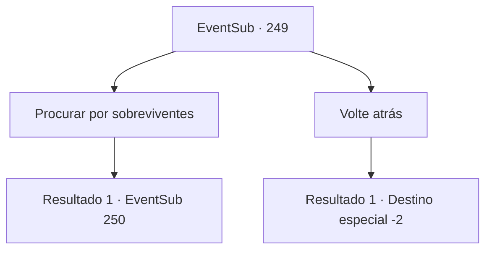

# Eventos secundários · 249

[Índice da tabela](index.md) · [Índice geral](../index.md)

ID: `pt:EventSub:249` · Fonte: `EventSub4` · Versão: 1.2.47.

Mapeamento estático dos arquivos; a disponibilidade e a execução dependem do estado da run.

## Texto do evento

|drawing_ruinedVillage| Você encontra uma vila deserta. A fumaça preta indica que o ataque aconteceu recentemente. A aldeia está cheia de corpos sem vida de seus moradores.

## Dados de entrada

```json
{
  "id": 249,
  "grade": 1,
  "subEvent": "7",
  "required": "12_7_1"
}
```

## Mapa das escolhas



## Escolhas e resultados

### Escolha 1

Procurar por sobreviventes

Requisitos e outros campos da escolha:

```json
{
  "required": ""
}
```

#### Resultado 1.1

Você procura sobreviventes, vasculhando os escombros da vila. Depois de um tempo, você encontra um jovem deitado nas pilhas de feno dentro de um estábulo. Ele parece muito ferido, mal respirando. |drawing_hurtBenjamin|

Continuação registrada: [Evento 250](0250.md) na mesma tabela.

```json
{
  "required": "",
  "chance": "1",
  "nextEvent": 250,
  "type": 2,
  "reward": ""
}
```

### Escolha 2

Volte atrás

Requisitos e outros campos da escolha:

```json
{
  "required": ""
}
```

#### Resultado 2.1

Você deixa a aldeia, tentando não se meter em problemas maiores.

Continuação registrada: [Destino especial `-2`](../destinos-especiais.md).

```json
{
  "required": "",
  "chance": "1",
  "nextEvent": -2,
  "type": 2,
  "reward": "12_7_-1"
}
```

## Referências que chegam a este evento

Nenhum `nextEvent` positivo da mesma tabela aponta para este nó. Isso não prova que seja inacessível: sorteio e estado de história podem selecioná-lo.

