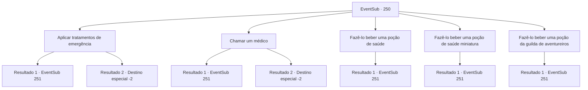

# Eventos secundários · 250

[Índice da tabela](index.md) · [Índice geral](../index.md)

ID: `pt:EventSub:250` · Fonte: `EventSub4` · Versão: 1.2.47.

Mapeamento estático dos arquivos; a disponibilidade e a execução dependem do estado da run.

## Texto do evento

*Sem texto no arquivo.*

## Dados de entrada

```json
{
  "id": 250,
  "grade": 1,
  "subEvent": "7",
  "required": ""
}
```

## Mapa das escolhas



## Escolhas e resultados

### Escolha 1

Aplicar tratamentos de emergência

Requisitos e outros campos da escolha:

```json
{
  "required": ""
}
```

#### Resultado 1.1

Você passa a noite cuidando dele. Sua saúde melhora progressivamente e ele finalmente recupera a consciência pela manhã. 

 "Hum, quem é você...?"

 O jovem pergunta, surpreso. Quando você conta o que aconteceu, ele solta um suspiro profundo e abaixa a cabeça. 

 "Agradeço por salvar minha vida, aventureiro. Me chamo Benjamin."


Continuação registrada: [Evento 251](0251.md) na mesma tabela.

```json
{
  "required": "",
  "chance": "1|0_7_1",
  "nextEvent": 251,
  "type": 0,
  "reward": "0_2_1"
}
```

#### Resultado 1.2

Você cobre suas feridas com roupas e amassa as gramas próximas como pomada. Mas, apesar de seus melhores esforços, o jovem não sobrevive. Você enterra seu corpo e deixa a vila abandonada.

Continuação registrada: [Destino especial `-2`](../destinos-especiais.md).

```json
{
  "required": "",
  "chance": "13",
  "nextEvent": -2,
  "type": 1,
  "reward": "12_7_-1"
}
```

### Escolha 2

Chamar um médico

Requisitos e outros campos da escolha:

```json
{
  "required": "1_4_10"
}
```

#### Resultado 2.1

Você traz um médico de outra vila para cuidar do jovem. O médico diz que, embora os ferimentos não sejam muito profundos, sua saúde está realmente muito fraca. Ele rapidamente aplica alguns tratamentos de emergência, recebe seu pagamento e vai embora. Então, você passa a noite cuidando do jovem. Graças a isso, sua saúde melhora progressivamente e ele finalmente recupera a consciência pela manhã. 

 "Um, quem é você...?"

 O jovem pergunta, surpreso. Quando você conta o que aconteceu, ele solta um suspiro profundo e abaixa a cabeça. 

 "Agradeço por salvar minha vida, aventureiro. Meu nome é Benjamin."


Continuação registrada: [Evento 251](0251.md) na mesma tabela.

```json
{
  "required": "",
  "chance": "1|0_6_1",
  "nextEvent": 251,
  "type": 0,
  "reward": "0_2_1|0_4_-10"
}
```

#### Resultado 2.2

Você traz um médico de outra vila para cuidar do jovem. Mas é tarde demais quando você e o médico chegam. Você enterra o corpo do jovem morto e deixa a vila abandonada.

Continuação registrada: [Destino especial `-2`](../destinos-especiais.md).

```json
{
  "required": "",
  "chance": "13",
  "nextEvent": -2,
  "type": 1,
  "reward": "12_7_-1"
}
```

### Escolha 3

Fazê-lo beber uma poção de saúde

Requisitos e outros campos da escolha:

```json
{
  "required": "8_36_1"
}
```

#### Resultado 3.1

Você despeja sua poção de saúde na boca do jovem. Aparentemente, a poção fez seu trabalho bem. A saúde do jovem melhora progressivamente, e você passa a noite cuidando dele. Na manhã seguinte, ele abre os olhos e se levanta lentamente. 

 "Hum, quem é você...?"

 O jovem pergunta, surpreso. Quando você conta o que aconteceu, ele solta um suspiro profundo e abaixa a cabeça. 

 "Agradeço por salvar minha vida, aventureiro. Me chamo Benjamin."


Continuação registrada: [Evento 251](0251.md) na mesma tabela.

```json
{
  "required": "",
  "chance": "1",
  "nextEvent": 251,
  "type": 2,
  "reward": "4_36_1"
}
```

### Escolha 4

Fazê-lo beber uma poção de saúde miniatura

Requisitos e outros campos da escolha:

```json
{
  "required": "8_190_1"
}
```

#### Resultado 4.1

Você derrama sua mini poção de saúde na boca do jovem homem. Aparentemente, a poção fez seu trabalho bem. A saúde do jovem homem melhora progressivamente, e você passa a noite cuidando dele. Na manhã seguinte, ele abre os olhos e se levanta lentamente. 

 "Hum, quem é você...?"

 O jovem homem pergunta, surpreso. Quando você conta o que aconteceu, ele solta um suspiro profundo e abaixa a cabeça. 

 "Agradeço por salvar minha vida, aventureiro. Meu nome é Benjamin."


Continuação registrada: [Evento 251](0251.md) na mesma tabela.

```json
{
  "required": "",
  "chance": "1",
  "nextEvent": 251,
  "type": 2,
  "reward": "4_190_1"
}
```

### Escolha 5

Fazê-lo beber uma poção da guilda de aventureiros

Requisitos e outros campos da escolha:

```json
{
  "required": "8_130_1"
}
```

#### Resultado 5.1

Você despeja a poção da guilda de aventureiros na boca do jovem. Aparentemente, a poção fez seu trabalho bem. A saúde do jovem melhora progressivamente, e você passa a noite cuidando dele. Na manhã seguinte, ele abre os olhos e se levanta lentamente. 

 "Hum, quem é você...?"

 O jovem pergunta, surpreso. Quando você conta o que aconteceu, ele solta um suspiro profundo e abaixa a cabeça. 

 "Agradeço por salvar minha vida, aventureiro. Me chamo Benjamin."


Continuação registrada: [Evento 251](0251.md) na mesma tabela.

```json
{
  "required": "",
  "chance": "1",
  "nextEvent": 251,
  "type": 2,
  "reward": "4_130_1"
}
```

## Referências que chegam a este evento

- [Evento 249 · escolha 1 · resultado 1](0249.md#escolha-1)
