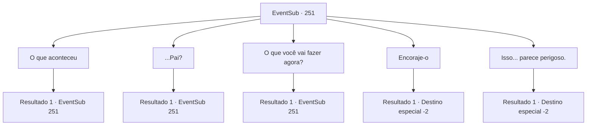

# Eventos secundários · 251

[Índice da tabela](index.md) · [Índice geral](../index.md)

ID: `pt:EventSub:251` · Fonte: `EventSub4` · Versão: 1.2.47.

Mapeamento estático dos arquivos; a disponibilidade e a execução dependem do estado da run.

## Texto do evento

*Sem texto no arquivo.*

## Dados de entrada

```json
{
  "id": 251,
  "grade": 1,
  "subEvent": "",
  "required": ""
}
```

## Mapa das escolhas



## Escolhas e resultados

### Escolha 1

O que aconteceu

Requisitos e outros campos da escolha:

```json
{
  "required": "5_258_0"
}
```

#### Resultado 1.1

Você pergunta ao jovem o que aconteceu. Benjamin levanta a cabeça novamente e começa a falar. 

 "Nossa vila era bonita e tranquila... até um grupo de bandidos atacar. Fizemos o nosso melhor para lutar de volta..."

 Benjamin não consegue terminar essa frase. Você pode sentir a dor em seus olhos. 

 "Teria sido diferente... se meu pai estivesse aqui...!"

 Sua voz fica visivelmente mais triste e ele finalmente solta outro suspiro. Seu suspiro ecoa por toda a vila deserta.

Continuação registrada: [Evento 251](0251.md) na mesma tabela.

```json
{
  "required": "",
  "chance": "1",
  "nextEvent": 251,
  "type": 2,
  "reward": "5_258_1"
}
```

### Escolha 2

...Pai?

Requisitos e outros campos da escolha:

```json
{
  "required": "5_258_1"
}
```

#### Resultado 2.1

Você pergunta a ele mais sobre seu 'pai'. Benjamin responde com uma expressão sombria, mas com um leve sorriso. 

 "Meu pai era um aventureiro. Ele até foi premiado pelo reino por capturar um líder de bandidos infame..."

 Ele também diz que seu pai contraiu uma doença incurável. Segundo Benjamin, ele se retirou para sua cidade natal e faleceu há alguns anos.

Continuação registrada: [Evento 251](0251.md) na mesma tabela.

```json
{
  "required": "",
  "chance": "1",
  "nextEvent": 251,
  "type": 2,
  "reward": "5_258_2"
}
```

### Escolha 3

O que você vai fazer agora?

Requisitos e outros campos da escolha:

```json
{
  "required": "5_258_2"
}
```

#### Resultado 3.1

Você pergunta a Benjamin o que ele vai fazer a partir de agora. Benjamin pensa por alguns segundos antes de finalmente se abrir. 

 "Vou me vingar do que fizeram à minha aldeia. Eu definitivamente lembro do rosto do líder deles."


Continuação registrada: [Evento 251](0251.md) na mesma tabela.

```json
{
  "required": "",
  "chance": "1",
  "nextEvent": 251,
  "type": 2,
  "reward": "5_258_3"
}
```

### Escolha 4

Encoraje-o

Requisitos e outros campos da escolha:

```json
{
  "required": "5_258_3"
}
```

#### Resultado 4.1

Você encoraja Benjamin. Benjamin agradece a você e pede para que você o siga, dizendo que quer compensar por tê-lo salvado. Ele te leva até um prédio em ruínas feito de madeira. Benjamin pede para que você espere, entra no prédio e logo sai com algo em suas mãos. 

 "Graças a Deus ainda está aqui. Esta é a espada do meu pai. Não se compara a você ter salvo minha vida, então por favor, pegue-a."

 É uma espada grande, forjada com liga de cromo. Você pega a arma e deixa a vila abandonada.

Continuação registrada: [Destino especial `-2`](../destinos-especiais.md).

```json
{
  "required": "",
  "chance": "1",
  "nextEvent": -2,
  "type": 2,
  "reward": "5_258_3|12_7_2|3_66_1"
}
```

### Escolha 5

Isso... parece perigoso.

Requisitos e outros campos da escolha:

```json
{
  "required": "5_258_3"
}
```

#### Resultado 5.1

Você diz a Benjamin que é muito perigoso. Benjamin pensa por alguns segundos antes de pedir para você segui-lo, dizendo que ele quer compensar por tê-lo salvado. Ele te leva até um prédio em ruínas feito de madeira. Benjamin pede para você esperar, entra no prédio e logo sai com algo em suas mãos. 

 "Graças a Deus ainda está aqui. Esta é a espada do meu pai. Não se compara a você ter salvo minha vida, então por favor, pegue-a."

 É uma espada grande, forjada com liga de cromo. Você pega a arma e deixa a vila abandonada.

Continuação registrada: [Destino especial `-2`](../destinos-especiais.md).

```json
{
  "required": "",
  "chance": "1",
  "nextEvent": -2,
  "type": 2,
  "reward": "5_258_3|12_7_3|3_66_1"
}
```

## Referências que chegam a este evento

- [Evento 250 · escolha 1 · resultado 1](0250.md#escolha-1)
- [Evento 250 · escolha 2 · resultado 1](0250.md#escolha-2)
- [Evento 250 · escolha 3 · resultado 1](0250.md#escolha-3)
- [Evento 250 · escolha 4 · resultado 1](0250.md#escolha-4)
- [Evento 250 · escolha 5 · resultado 1](0250.md#escolha-5)
- [Evento 251 · escolha 1 · resultado 1](0251.md#escolha-1)
- [Evento 251 · escolha 2 · resultado 1](0251.md#escolha-2)
- [Evento 251 · escolha 3 · resultado 1](0251.md#escolha-3)
