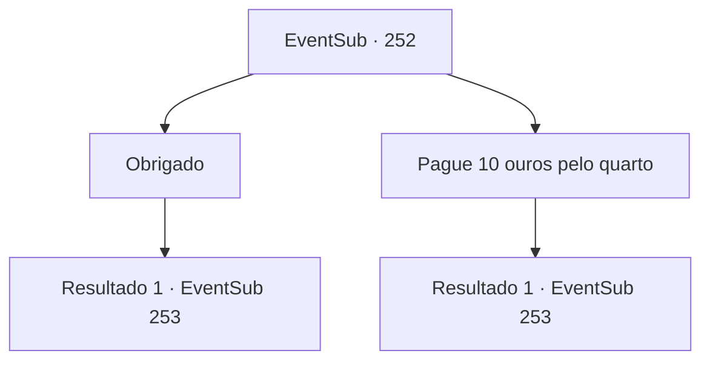

# Eventos secundários · 252

[Índice da tabela](index.md) · [Índice geral](../index.md)

ID: `pt:EventSub:252` · Fonte: `EventSub4` · Versão: 1.2.47.

Mapeamento estático dos arquivos; a disponibilidade e a execução dependem do estado da run.

## Texto do evento

Você entra em uma pousada chamada 'O Lobo e a Raposa' para relaxar e descontrair das aventuras. Você pede uma bebida e um pouco de comida. Ao olhar ao redor da pousada, você encontra um rosto familiar servindo bebidas e comida. Depois de olhar mais de perto, você o reconhece como Benjamin, o homem que conheceu na aldeia deserta. Ele parece surpreso ao vê-lo no início, mas logo sorri amplamente e se aproxima de você. Ele fala enquanto coloca sua bebida e comida. 

 "Faz muito tempo! Eu... esqueci de perguntar seu nome da última vez que nos encontramos. Vamos ver... ah, se você está procurando um lugar para dormir, eu posso te arranjar um de graça."

 

## Dados de entrada

```json
{
  "id": 252,
  "grade": 1,
  "subEvent": "",
  "required": "12_7_2|1_2_15"
}
```

## Mapa das escolhas



## Escolhas e resultados

### Escolha 1

Obrigado

Requisitos e outros campos da escolha:

```json
{
  "required": ""
}
```

#### Resultado 1.1

Agradeça a ele, diga seu nome e peça emprestado um quarto para dormir. Benjamin te leva ao seu quarto depois que você termina de comer. O quarto é um pouco pequeno, mas parece aconchegante e limpo. Você descarrega suas coisas no chão e desfruta de um doce descanso na cama. Depois de algum tempo ter passado... Benjamin bate na porta duas vezes, abre a porta e entra. 

 "Uh.,. {1}. Eu tenho algo para te perguntar, então vim aqui."

 A expressão de Benjamin parece muito séria.

Continuação registrada: [Evento 253](0253.md) na mesma tabela.

```json
{
  "required": "",
  "chance": "1",
  "nextEvent": 253,
  "type": 2,
  "reward": "0_0_1|0_1_1"
}
```

### Escolha 2

Pague 10 ouros pelo quarto

Requisitos e outros campos da escolha:

```json
{
  "required": "1_4_10"
}
```

#### Resultado 2.1

Você diz a ele que é desnecessário. Você paga 10 ouros e aluga um quarto em seu nome. Benjamin te leva até o seu quarto depois que você termina de comer. O quarto é um pouco pequeno, mas parece aconchegante e limpo. Você descarrega suas coisas no chão e desfruta de um doce descanso na cama. Depois de algum tempo ter passado... Benjamin bate na porta duas vezes, abre a porta e entra. 

 "Uh.,. {1}. Eu tenho algo para te perguntar, então vim aqui."

 A expressão de Benjamin parece muito séria.

Continuação registrada: [Evento 253](0253.md) na mesma tabela.

```json
{
  "required": "",
  "chance": "1",
  "nextEvent": 253,
  "type": 2,
  "reward": "0_0_1|0_1_1|0_4_-10"
}
```

## Referências que chegam a este evento

Nenhum `nextEvent` positivo da mesma tabela aponta para este nó. Isso não prova que seja inacessível: sorteio e estado de história podem selecioná-lo.

