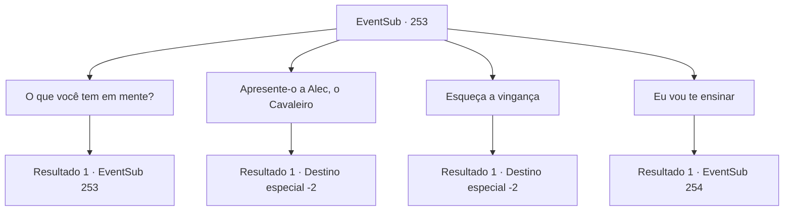

# Eventos secundários · 253

[Índice da tabela](index.md) · [Índice geral](../index.md)

ID: `pt:EventSub:253` · Fonte: `EventSub4` · Versão: 1.2.47.

Mapeamento estático dos arquivos; a disponibilidade e a execução dependem do estado da run.

## Texto do evento

*Sem texto no arquivo.*

## Dados de entrada

```json
{
  "id": 253,
  "grade": 1,
  "subEvent": "",
  "required": ""
}
```

## Mapa das escolhas



## Escolhas e resultados

### Escolha 1

O que você tem em mente?

Requisitos e outros campos da escolha:

```json
{
  "required": "5_259_0"
}
```

#### Resultado 1.1

Quando você pergunta a ele o que é, ele começa falando um pouco de sua história. Depois de ter sido resgatado por você, ele procurou trabalho aqui e ali até acabar em uma estalagem. Aparentemente, ele tem reunido informações e experiência necessárias para sua vingança, enquanto trabalha nessa estalagem. Benjamin continua com uma voz cheia de raiva. 

 "O líder dos bandidos que atacaram minha vila se chama 'Van Goyle'. Ele é um criminoso há pelo menos uma década. Ele foi capturado uma vez, mas escapou e recomeçou como bandido."

 De repente, Benjamin se ajoelha diante de você e se curva. Você pergunta por que, mas ele continua sem levantar a cabeça novamente. 

 "Eu... quero me tornar mais forte, forte o suficiente para poder matá-lo um a um! Por favor, me ajude!"


Continuação registrada: [Evento 253](0253.md) na mesma tabela.

```json
{
  "required": "",
  "chance": "1",
  "nextEvent": 253,
  "type": 2,
  "reward": "5_259_1"
}
```

### Escolha 2

Apresente-o a Alec, o Cavaleiro

Requisitos e outros campos da escolha:

```json
{
  "required": "5_259_1|5_257_2"
}
```

#### Resultado 2.1

Você se lembra de Alec, o cavaleiro, que lutou contra os lobos de inverno, e escreve uma carta de recomendação para ele. Quando Benjamin pergunta o que é isso, você explica a ele sobre Alec, o cavaleiro, e entregará a carta a ele. Benjamin agradece, pega a carta e sai da sala.

 Na manhã seguinte, Benjamin não estava em lugar algum na estalagem. Quando você pergunta ao estalajadeiro sobre ele, ele responde que Benjamin saiu e saiu. Ao ouvir isso, você sai do local com passos leves.

Continuação registrada: [Destino especial `-2`](../destinos-especiais.md).

```json
{
  "required": "",
  "chance": "1",
  "nextEvent": -2,
  "type": 2,
  "reward": "5_259_2|12_7_4"
}
```

### Escolha 3

Esqueça a vingança

Requisitos e outros campos da escolha:

```json
{
  "required": "5_259_1"
}
```

#### Resultado 3.1

Você diz a Benjamin que talvez seja melhor esquecer a vingança e seguir em frente. Mas Benjamin se levanta, diz que não será possível e sai da sala. Você rapidamente vai atrás dele, mas Benjamin já desapareceu durante a noite. Sem mais nada a fazer, você volta para o seu quarto na estalagem e descanse.

 Na manhã seguinte, você pergunta ao estalajadeiro se Benjamin voltou. Ele responde que, ao deixar você saber que Benjamin saiu e saiu, e você sai do local com passos pesados.

Continuação registrada: [Destino especial `-2`](../destinos-especiais.md).

```json
{
  "required": "",
  "chance": "1",
  "nextEvent": -2,
  "type": 2,
  "reward": "5_259_2|12_7_6|5_582_2"
}
```

### Escolha 4

Eu vou te ensinar

Requisitos e outros campos da escolha:

```json
{
  "required": "5_259_1"
}
```

#### Resultado 4.1

Você diz a ele que uma pequena lição não faria mal. Seu rosto se ilumina ao ouvir sua resposta. 

 "Obrigado! Obrigado... muito obrigado!! Pessoalmente, adoraria aprender mais sobre esgrima, mas me ensine qualquer coisa, vou aprender tudo com o coração!"


Continuação registrada: [Evento 254](0254.md) na mesma tabela.

```json
{
  "required": "",
  "chance": "1",
  "nextEvent": 254,
  "type": 2,
  "reward": "5_582_2"
}
```

## Referências que chegam a este evento

- [Evento 252 · escolha 1 · resultado 1](0252.md#escolha-1)
- [Evento 252 · escolha 2 · resultado 1](0252.md#escolha-2)
- [Evento 253 · escolha 1 · resultado 1](0253.md#escolha-1)
