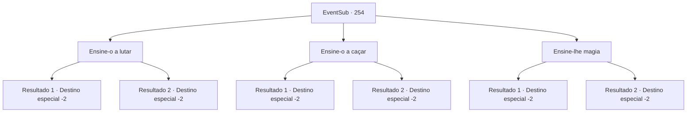

# Eventos secundários · 254

[Índice da tabela](index.md) · [Índice geral](../index.md)

ID: `pt:EventSub:254` · Fonte: `EventSub4` · Versão: 1.2.47.

Mapeamento estático dos arquivos; a disponibilidade e a execução dependem do estado da run.

## Texto do evento

*Sem texto no arquivo.*

## Dados de entrada

```json
{
  "id": 254,
  "grade": 1,
  "subEvent": "",
  "required": ""
}
```

## Mapa das escolhas



## Escolhas e resultados

### Escolha 1

Ensine-o a lutar

Requisitos e outros campos da escolha:

```json
{
  "required": ""
}
```

#### Resultado 1.1

Você decide passar alguns dias e ensinar Benjamin algumas de suas habilidades. Seguindo sua liderança, ele pratica espadas balançando, desviando flechas e correndo com armadura. Ensinar alguém é uma tarefa difícil, mas você ensina Benjamin com paciência. 

 A lição seguiu seu curso. Embora tenha sido apenas uma breve lição sobre o básico, Benjamin parece esclarecido pelo seu ensino. Com um sorriso confiante em seu rosto, ele diz que ele entendeu o básico de armas balançando e o que fazer quando os inimigos entram de perto. 

 "Obrigado, {1}! Vou treinar bastante, então posso um dia completar minha vingança !!"

 Ele se inclina, mostrando sua gratidão e sai.

Continuação registrada: [Destino especial `-2`](../destinos-especiais.md).

```json
{
  "required": "",
  "chance": "1|0_5_1|0_13_1",
  "nextEvent": -2,
  "type": 0,
  "reward": "5_260_1|12_7_12"
}
```

#### Resultado 1.2

Você decide passar alguns dias e ensinar Benjamin algumas de suas habilidades. Mas talvez você não tenha sido um ótimo professor. Ou talvez Benjamin não tenha sido um ótimo aluno. De qualquer forma, no quarto dia do treinamento, Benjamin diz para você com uma voz triste. 

 "*suspiro*... Eu não acho que tenho o que é preciso para aprender qualquer coisa, eu acho. Peço desculpas... por desperdiçar seu tempo."

 Ele então se afasta tristemente.

Continuação registrada: [Destino especial `-2`](../destinos-especiais.md).

```json
{
  "required": "",
  "chance": "20",
  "nextEvent": -2,
  "type": 1,
  "reward": "12_7_6"
}
```

### Escolha 2

Ensine-o a caçar

Requisitos e outros campos da escolha:

```json
{
  "required": ""
}
```

#### Resultado 2.1

Você decide passar alguns dias e ensinar Benjamin algumas de suas habilidades.  Seguindo sua liderança, ele pratica arcos, perseguindo animais selvagens e usando objetos naturais para se esconder.  Ensinar alguém é uma tarefa difícil, mas você ensina Benjamin com paciência.  

  A lição seguiu seu curso. Embora tenha sido apenas uma breve lição sobre o básico, Benjamin parece esclarecido pelo seu ensino.  Com um sorriso confiante em seu rosto, ele diz que ele entendeu o básico de se adaptar à natureza e o que fazer ao enfrentar uma besta selvagem.  

 "Obrigado, {1}! Vou treinar duro, então posso um dia completar minha vingança !!"

  Ele se inclina, mostrando sua gratidão e sai.

Continuação registrada: [Destino especial `-2`](../destinos-especiais.md).

```json
{
  "required": "",
  "chance": "1|0_6_1|0_14_1",
  "nextEvent": -2,
  "type": 0,
  "reward": "5_260_1|12_7_12"
}
```

#### Resultado 2.2

Você decide passar alguns dias e ensinar Benjamin algumas de suas habilidades. Mas talvez você não tenha sido um ótimo professor. Ou talvez Benjamin não tenha sido um ótimo aluno. De qualquer forma, no quarto dia do treinamento, Benjamin diz para você com uma voz triste. 

 "*suspiro*... Eu não acho que tenho o que é preciso para aprender qualquer coisa, eu acho. Peço desculpas... por desperdiçar seu tempo."

 Ele então se afasta tristemente.

Continuação registrada: [Destino especial `-2`](../destinos-especiais.md).

```json
{
  "required": "",
  "chance": "20",
  "nextEvent": -2,
  "type": 1,
  "reward": "12_7_6"
}
```

### Escolha 3

Ensine-lhe magia

Requisitos e outros campos da escolha:

```json
{
  "required": ""
}
```

#### Resultado 3.1

Você decide passar alguns dias e ensinar Benjamin algumas de suas habilidades. Seguindo sua liderança, ele aprende a ler e escrever, familiarizar -se com muitos livros e lançar alguns encantamentos simples. Ensinar alguém é uma tarefa difícil, mas você ensina Benjamin com paciência. 

 A lição seguiu seu curso. Embora tenha sido apenas uma breve lição sobre o básico, Benjamin parece esclarecido pelo seu ensino. Com um sorriso confiante em seu rosto, ele diz que ele entendeu o básico da teoria mágica e canalizando e usando adequadamente mana. 

 "Obrigado, {1}! Vou treinar duro, então posso um dia completar minha vingança !!"

 Ele se inclina, mostrando sua gratidão e sai.

Continuação registrada: [Destino especial `-2`](../destinos-especiais.md).

```json
{
  "required": "",
  "chance": "1|0_7_1|0_12_1",
  "nextEvent": -2,
  "type": 0,
  "reward": "5_260_1|12_7_12"
}
```

#### Resultado 3.2

Você decide passar alguns dias e ensinar Benjamin algumas de suas habilidades. Mas talvez você não tenha sido um ótimo professor. Ou talvez Benjamin não tenha sido um ótimo aluno. De qualquer forma, no quarto dia do treinamento, Benjamin diz para você com uma voz triste. 

 "*suspiro*... Eu não acho que tenho o que é preciso para aprender qualquer coisa, eu acho. Peço desculpas... por desperdiçar seu tempo."

 Ele então se afasta tristemente.

Continuação registrada: [Destino especial `-2`](../destinos-especiais.md).

```json
{
  "required": "",
  "chance": "20",
  "nextEvent": -2,
  "type": 1,
  "reward": "12_7_6"
}
```

## Referências que chegam a este evento

- [Evento 253 · escolha 4 · resultado 1](0253.md#escolha-4)
- [Evento 256 · escolha 4 · resultado 1](0256.md#escolha-4)
