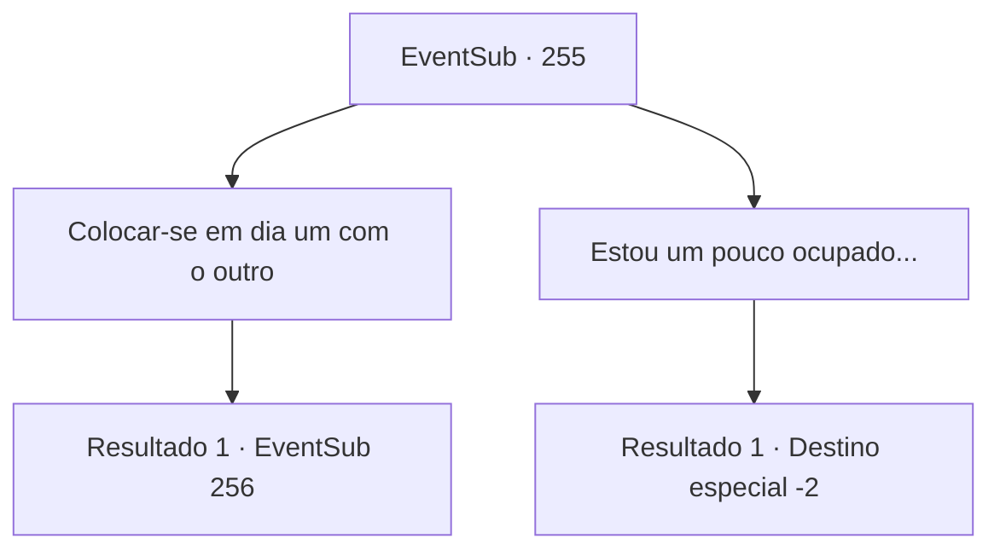

# Eventos secundários · 255

[Índice da tabela](index.md) · [Índice geral](../index.md)

ID: `pt:EventSub:255` · Fonte: `EventSub4` · Versão: 1.2.47.

Mapeamento estático dos arquivos; a disponibilidade e a execução dependem do estado da run.

## Texto do evento

|drawing_fam| Você está andando em uma estrada tranquila ao lado de uma pequena cidade chamada 'Vignon'. Ao lado da estrada, você pode ver um grupo de agricultores trabalhando incansavelmente em um enorme arrozal. Você encontra um rosto familiar entre os fazendeiros. É Benjamin, da aldeia deserta. Benjamin limpa o suor do rosto e olha para cima. Aparentemente, ele reconhece seu rosto também, enquanto se aproxima de você com um rosto brilhante. 

 "Aventureiro! Bom te ver de novo. Como você tem estado?"


## Dados de entrada

```json
{
  "id": 255,
  "grade": 1,
  "subEvent": "",
  "required": "12_7_3"
}
```

## Mapa das escolhas



## Escolhas e resultados

### Escolha 1

Colocar-se em dia um com o outro

Requisitos e outros campos da escolha:

```json
{
  "required": ""
}
```

#### Resultado 1.1

Você conta a Benjamin sobre as coisas que aconteceram. Ele te dá uma cesta de batatas, que são cultivadas por ele mesmo segundo ele - e conta o seu lado da história. Ele está morando com seu tio nesta cidade chamada 'Vignon', e por coincidência, ele descobriu algumas informações sobre o alvo de sua vingança. Então ele pergunta cuidadosamente se tem um pedido para você.

Continuação registrada: [Evento 256](0256.md) na mesma tabela.

```json
{
  "required": "",
  "chance": "1",
  "nextEvent": 256,
  "type": 2,
  "reward": "3_137_1"
}
```

### Escolha 2

Estou um pouco ocupado...

Requisitos e outros campos da escolha:

```json
{
  "required": ""
}
```

#### Resultado 2.1

Você diz a Benjamin que está ocupado. Você passa por ele. Benjamin tenta falar com você, mas logo volta para o campo de arroz.

Continuação registrada: [Destino especial `-2`](../destinos-especiais.md).

```json
{
  "required": "",
  "chance": "1",
  "nextEvent": -2,
  "type": 2,
  "reward": "12_7_-1"
}
```

## Referências que chegam a este evento

Nenhum `nextEvent` positivo da mesma tabela aponta para este nó. Isso não prova que seja inacessível: sorteio e estado de história podem selecioná-lo.

