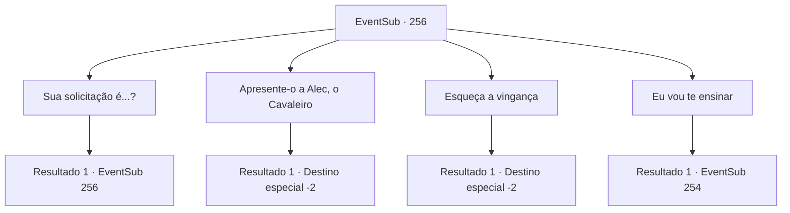

# Eventos secundários · 256

[Índice da tabela](index.md) · [Índice geral](../index.md)

ID: `pt:EventSub:256` · Fonte: `EventSub4` · Versão: 1.2.47.

Mapeamento estático dos arquivos; a disponibilidade e a execução dependem do estado da run.

## Texto do evento

*Sem texto no arquivo.*

## Dados de entrada

```json
{
  "id": 256,
  "grade": 1,
  "subEvent": "",
  "required": ""
}
```

## Mapa das escolhas



## Escolhas e resultados

### Escolha 1

Sua solicitação é...?

Requisitos e outros campos da escolha:

```json
{
  "required": "5_259_0"
}
```

#### Resultado 1.1

Você pergunta a ele qual é o seu pedido, e ele retorna com uma voz cheia de determinação. 

 "Naquela época... o líder dos bandidos que atacaram nossa vila se chama 'Van Goyle'. Ele é um criminoso há pelo menos uma década. Ele foi capturado uma vez, mas escapou e recomeçou como bandido."

 De repente, Benjamin se ajoelha diante de você e se curva. 

 "Eu... quero me tornar mais forte, forte o suficiente para poder matá-lo sozinho! Por favor, me ajude!"


Continuação registrada: [Evento 256](0256.md) na mesma tabela.

```json
{
  "required": "",
  "chance": "1",
  "nextEvent": 256,
  "type": 2,
  "reward": "5_259_1"
}
```

### Escolha 2

Apresente-o a Alec, o Cavaleiro

Requisitos e outros campos da escolha:

```json
{
  "required": "5_259_1|5_257_2"
}
```

#### Resultado 2.1

Você se lembra de Alec, o Cavaleiro, que lutou contra os lobos do inverno, e escreve uma carta de recomendação para ele. Quando Benjamin pergunta o que é isso, você explica a ele sobre Alec, o Cavaleiro, e entrega a carta para ele. Benjamin te agradece várias vezes antes de pegar a carta e sair da cidade.

Continuação registrada: [Destino especial `-2`](../destinos-especiais.md).

```json
{
  "required": "",
  "chance": "1",
  "nextEvent": -2,
  "type": 2,
  "reward": "12_7_4"
}
```

### Escolha 3

Esqueça a vingança

Requisitos e outros campos da escolha:

```json
{
  "required": "5_259_1"
}
```

#### Resultado 3.1

Você diz a Benjamin que talvez seja melhor esquecer a vingança e seguir em frente. Mas Benjamin grita com você, dizendo que ele não pode simplesmente esquecer isso. Ele então foge. Você rapidamente vai atrás dele. Logo depois, você o encontra conversando com um fazendeiro de meia-idade. Você percebe alguma semelhança familiar entre os dois. O fazendeiro fala com uma voz reconfortante. 

 "Pobre rapaz, entendo que seja difícil, mas você precisa seguir em frente. É assim que você pode se tornar mais feliz!"

 Felizmente, Benjamin parece estar se acalmando. Você vê os dois conversando por um tempo e depois partem.

Continuação registrada: [Destino especial `-2`](../destinos-especiais.md).

```json
{
  "required": "",
  "chance": "1",
  "nextEvent": -2,
  "type": 2,
  "reward": "12_7_5"
}
```

### Escolha 4

Eu vou te ensinar

Requisitos e outros campos da escolha:

```json
{
  "required": "5_259_1"
}
```

#### Resultado 4.1

Você diz a ele que uma pequena lição não faria mal. Seu rosto se ilumina ao ouvir sua resposta. 

 "Obrigado! Obrigado... muito obrigado!! Pessoalmente, adoraria aprender mais sobre esgrima, mas me ensine qualquer coisa, vou aprender tudo com o coração!"


Continuação registrada: [Evento 254](0254.md) na mesma tabela.

```json
{
  "required": "",
  "chance": "1",
  "nextEvent": 254,
  "type": 2,
  "reward": ""
}
```

## Referências que chegam a este evento

- [Evento 255 · escolha 1 · resultado 1](0255.md#escolha-1)
- [Evento 256 · escolha 1 · resultado 1](0256.md#escolha-1)
