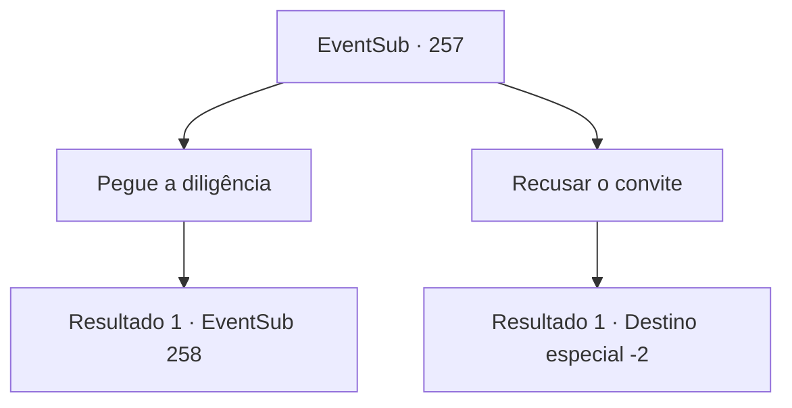

# Eventos secundários · 257

[Índice da tabela](index.md) · [Índice geral](../index.md)

ID: `pt:EventSub:257` · Fonte: `EventSub4` · Versão: 1.2.47.

Mapeamento estático dos arquivos; a disponibilidade e a execução dependem do estado da run.

## Texto do evento

Você está andando em uma colina, onde uma pequena cidade pode ser vista. Então, uma diligência luxuosamente adornada aparece diante de você. Uma crista familiar está inscrita nele. Assim que você está tentando se lembrar de onde viu o brasão antes, um velho em ternos bem cuidados desce da diligência. 

 "Saudações, {1}. Eu sou o mensageiro da Casa Atleon. Alec deseja vê-lo. Se você quiser, por favor."

 Ele abre a porta da carruagem e gesticula para você entrar.

## Dados de entrada

```json
{
  "id": 257,
  "grade": 1,
  "subEvent": "",
  "required": "12_7_4"
}
```

## Mapa das escolhas



## Escolhas e resultados

### Escolha 1

Pegue a diligência

Requisitos e outros campos da escolha:

```json
{
  "required": ""
}
```

#### Resultado 1.1

Você monta a diligência para a propriedade de Atleon. 

 A mansão de Alec está localizada no coração da ampla propriedade. É enorme e bem decorado, como se simbolizasse a fé do duque em Alec. 

 "YAH! Oi! Ha!"

 Enquanto você é levado à mansão pelos servos, ouve alguém gritando. Quando você espia pela janela, vê Benjamin treinando para fora nos quintais. É quando Alec sai para recebê -lo, vestindo roupas finas. 

 "Haha, aí está você. Já faz muito tempo, não é? Convidei você aqui para mostrar meus agradecimentos por nos ajudar da última vez e para ... falar, é claro."

 Depois de dar um tapinha suavemente no ombro, Alec leva você à sala de jantar, dizendo que há uma refeição pronta.

Continuação registrada: [Evento 258](0258.md) na mesma tabela.

```json
{
  "required": "",
  "chance": "1",
  "nextEvent": 258,
  "type": 2,
  "reward": ""
}
```

### Escolha 2

Recusar o convite

Requisitos e outros campos da escolha:

```json
{
  "required": ""
}
```

#### Resultado 2.1

Você educadamente recusa o convite e segue em frente.

Continuação registrada: [Destino especial `-2`](../destinos-especiais.md).

```json
{
  "required": "",
  "chance": "1",
  "nextEvent": -2,
  "type": 2,
  "reward": "12_7_-1"
}
```

## Referências que chegam a este evento

Nenhum `nextEvent` positivo da mesma tabela aponta para este nó. Isso não prova que seja inacessível: sorteio e estado de história podem selecioná-lo.

