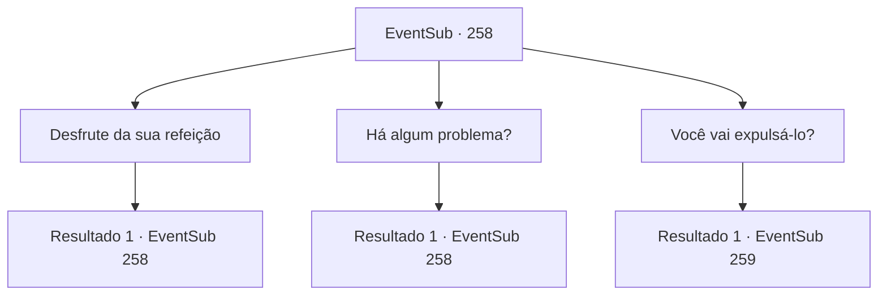

# Eventos secundários · 258

[Índice da tabela](index.md) · [Índice geral](../index.md)

ID: `pt:EventSub:258` · Fonte: `EventSub4` · Versão: 1.2.47.

Mapeamento estático dos arquivos; a disponibilidade e a execução dependem do estado da run.

## Texto do evento

*Sem texto no arquivo.*

## Dados de entrada

```json
{
  "id": 258,
  "grade": 1,
  "subEvent": "",
  "required": ""
}
```

## Mapa das escolhas



## Escolhas e resultados

### Escolha 1

Desfrute da sua refeição

Requisitos e outros campos da escolha:

```json
{
  "required": "5_261_0"
}
```

#### Resultado 1.1

Você desfruta da sua refeição na sala de jantar com Alec, envolvendo-se em uma conversa animada. Depois de saborear um copo de vinho caro, Alec lhe pergunta algo. 

 "Ei, hum... sobre aquele cara que você me apresentou, Benjamin..."


Continuação registrada: [Evento 258](0258.md) na mesma tabela.

```json
{
  "required": "",
  "chance": "1",
  "nextEvent": 258,
  "type": 2,
  "reward": "5_261_1"
}
```

### Escolha 2

Há algum problema?

Requisitos e outros campos da escolha:

```json
{
  "required": "5_261_1"
}
```

#### Resultado 2.1

Você pergunta a Alec se há algum problema. Alec não consegue esconder a decepção de seu rosto. 

 "Ele é diligente, gentil... é apenas... ele não tem o talento para se tornar meu aprendiz."

 Alec explica que o trabalho de um aprendiz de cavaleiro não é apenas seguir outro cavaleiro, mas apoiá-lo e se tornar o cavaleiro da próxima geração, sucedendo-o. Ele estala a língua, acrescentando que a falta de talento de Benjamin pode dificultar o cumprimento dessa posição.

Continuação registrada: [Evento 258](0258.md) na mesma tabela.

```json
{
  "required": "",
  "chance": "1",
  "nextEvent": 258,
  "type": 2,
  "reward": "5_261_2"
}
```

### Escolha 3

Você vai expulsá-lo?

Requisitos e outros campos da escolha:

```json
{
  "required": "5_261_2"
}
```

#### Resultado 3.1

Você pergunta a ele se ele está planejando expulsar Benjamin. Alec hesita um pouco antes de assentir lentamente. 

 "Porém. Se ele conseguir passar no teste amanhã, as coisas podem mudar. Embora eu espere que seja difícil..."

 Alec pede que, caso Benjamin falhe, você o ajude a retornar com segurança para sua cidade natal. A refeição termina assim, e ele se levanta da cadeira, retornando ao seu quarto.

Continuação registrada: [Evento 259](0259.md) na mesma tabela.

```json
{
  "required": "",
  "chance": "1",
  "nextEvent": 259,
  "type": 2,
  "reward": "5_261_3"
}
```

## Referências que chegam a este evento

- [Evento 257 · escolha 1 · resultado 1](0257.md#escolha-1)
- [Evento 258 · escolha 1 · resultado 1](0258.md#escolha-1)
- [Evento 258 · escolha 2 · resultado 1](0258.md#escolha-2)
