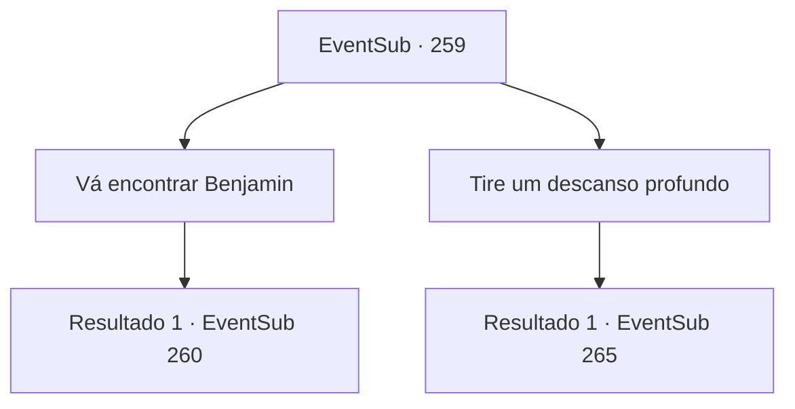

# Eventos secundários · 259

[Índice da tabela](index.md) · [Índice geral](../index.md)

ID: `pt:EventSub:259` · Fonte: `EventSub4` · Versão: 1.2.47.

Mapeamento estático dos arquivos; a disponibilidade e a execução dependem do estado da run.

## Texto do evento

*Sem texto no arquivo.*

## Dados de entrada

```json
{
  "id": 259,
  "grade": 1,
  "subEvent": "",
  "required": ""
}
```

## Mapa das escolhas



## Escolhas e resultados

### Escolha 1

Vá encontrar Benjamin

Requisitos e outros campos da escolha:

```json
{
  "required": ""
}
```

#### Resultado 1.1

Termina a tua refeição e dirige-te para o pátio de treino. O sol está quase a pôr-se. O pátio de treino também fica laranja. Está lá o Benjamin, a balançar a sua espada, sozinho. Quando ele te vê, os seus olhos ficam arregalados de surpresa. 

 "Ah..! Já passou muito tempo, aventureiro!"

 Tu reparas na sua aparência. Olhos cansados, olheiras que se estendem até às suas bochechas e cabelo desarrumado. Dá para perceber que ele está ansioso.

Continuação registrada: [Evento 260](0260.md) na mesma tabela.

```json
{
  "required": "",
  "chance": "1",
  "nextEvent": 260,
  "type": 2,
  "reward": ""
}
```

### Escolha 2

Tire um descanso profundo

Requisitos e outros campos da escolha:

```json
{
  "required": ""
}
```

#### Resultado 2.1

Você experimenta um pouco da outra comida também. Você coloca uma garrafa de vinho na sua bolsa. Enquanto você está colocando um pão na sua bolsa, o mordomo limpa a garganta e fala. 

 "Ahem. Você gostou da comida? O banho está pronto. Leve o tempo que precisar. Também preparamos um quarto para você passar a noite."

 Você devagarmente coloca o pão de volta onde ele pertence e o segue até o banho. Depois de desfrutar de um banho quente e vaporoso, você vai para o quarto que Alec preparou para você. Assim que você se deita na cama branca e limpa, você adormece.

Continuação registrada: [Evento 265](0265.md) na mesma tabela.

```json
{
  "required": "",
  "chance": "1",
  "nextEvent": 265,
  "type": 2,
  "reward": "3_225_1|0_0_1|0_1_1"
}
```

## Referências que chegam a este evento

- [Evento 258 · escolha 3 · resultado 1](0258.md#escolha-3)
