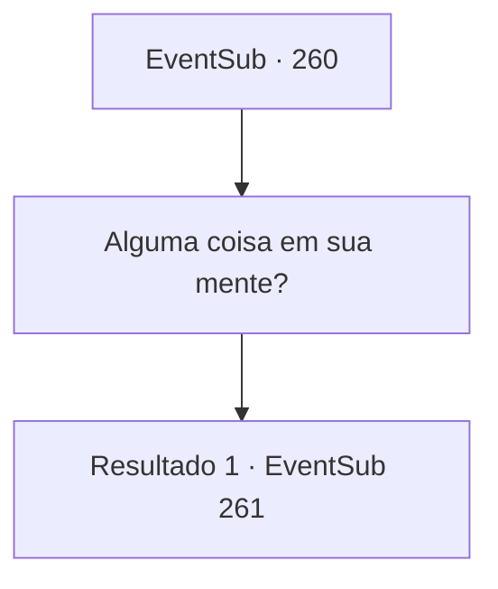

# Eventos secundários · 260

[Índice da tabela](index.md) · [Índice geral](../index.md)

ID: `pt:EventSub:260` · Fonte: `EventSub4` · Versão: 1.2.47.

Mapeamento estático dos arquivos; a disponibilidade e a execução dependem do estado da run.

## Texto do evento

*Sem texto no arquivo.*

## Dados de entrada

```json
{
  "id": 260,
  "grade": 1,
  "subEvent": "",
  "required": ""
}
```

## Mapa das escolhas



## Escolhas e resultados

### Escolha 1

Alguma coisa em sua mente?

Requisitos e outros campos da escolha:

```json
{
  "required": ""
}
```

#### Resultado 1.1

Quando você pergunta a ele se ele está preocupado, ele suspira e conta sobre sua preocupação. 

 "Eu não acho que o Sir Alec realmente me aprova... Ele está inventando esse teste só para me expulsar, estou te dizendo. Estou fazendo o meu melhor. O que devo fazer?"


Continuação registrada: [Evento 261](0261.md) na mesma tabela.

```json
{
  "required": "",
  "chance": "1",
  "nextEvent": 261,
  "type": 2,
  "reward": ""
}
```

## Referências que chegam a este evento

- [Evento 259 · escolha 1 · resultado 1](0259.md#escolha-1)
