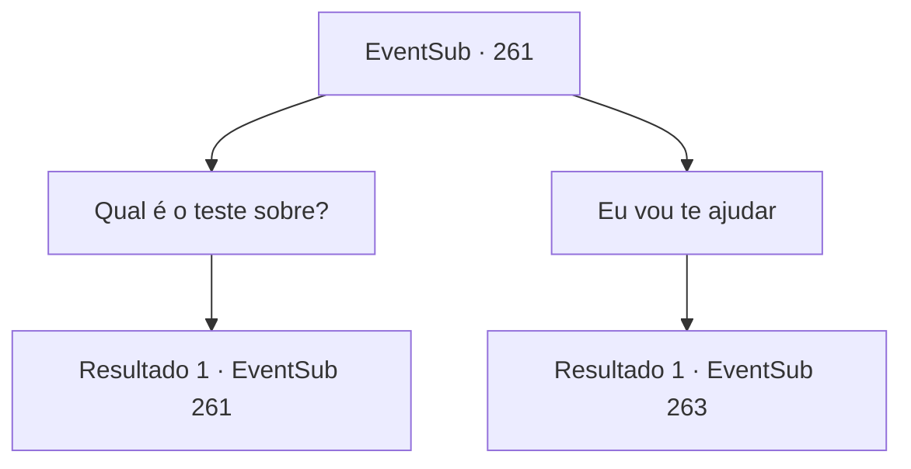

# Eventos secundários · 261

[Índice da tabela](index.md) · [Índice geral](../index.md)

ID: `pt:EventSub:261` · Fonte: `EventSub4` · Versão: 1.2.47.

Mapeamento estático dos arquivos; a disponibilidade e a execução dependem do estado da run.

## Texto do evento

*Sem texto no arquivo.*

## Dados de entrada

```json
{
  "id": 261,
  "grade": 1,
  "subEvent": "",
  "required": ""
}
```

## Mapa das escolhas



## Escolhas e resultados

### Escolha 1

Qual é o teste sobre?

Requisitos e outros campos da escolha:

```json
{
  "required": "5_262_0"
}
```

#### Resultado 1.1

Benjamin abana a cabeça em resposta. 

 "Ele não me disse. Ele disse que os cavaleiros devem ser bons em improvisar..."

 Aparentemente, ele nem sabe sobre o que está sendo testado. Então, sem nenhum conhecimento do que se preparar, ele apenas praticou balançar espadas.

Continuação registrada: [Evento 261](0261.md) na mesma tabela.

```json
{
  "required": "",
  "chance": "1",
  "nextEvent": 261,
  "type": 2,
  "reward": "5_262_1"
}
```

### Escolha 2

Eu vou te ajudar

Requisitos e outros campos da escolha:

```json
{
  "required": "5_262_1"
}
```

#### Resultado 2.1

Você diz a ele que você o ajudará a completar o teste. Sua expressão se torna visivelmente melhor. 

 "Se você me ajudar ... talvez isso também conte como improvisando ... Obrigada! Eu tenho que alimentar os cavalos agora, se você me desculpar."

 Ele corre para os estábulos e você volta para a sala Alec forneceu a você. Assim que você deita na cama branca e limpa, adormece. 

 Na manhã seguinte, Alec deu a Benjamin a tarefa final. Benjamin deve subir as montanhas na parte de trás da mansão e voltar com o líder da cabeça do Wolf Pack. 

 "Essa não será uma tarefa fácil. Mas se você realmente se tornar um cavaleiro, esse tipo de trabalho deve ser um pedaço de bolo."

 Benjamin assente ansiosamente. Ele então prepara a espada e o escudo, caminhando para a montanha.

Continuação registrada: [Evento 263](0263.md) na mesma tabela.

```json
{
  "required": "",
  "chance": "1",
  "nextEvent": 263,
  "type": 2,
  "reward": ""
}
```

## Referências que chegam a este evento

- [Evento 260 · escolha 1 · resultado 1](0260.md#escolha-1)
- [Evento 261 · escolha 1 · resultado 1](0261.md#escolha-1)
