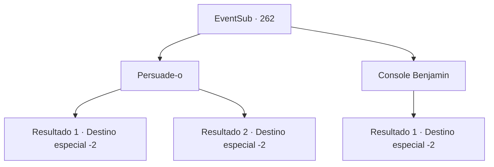

# Eventos secundários · 262

[Índice da tabela](index.md) · [Índice geral](../index.md)

ID: `pt:EventSub:262` · Fonte: `EventSub4` · Versão: 1.2.47.

Mapeamento estático dos arquivos; a disponibilidade e a execução dependem do estado da run.

## Texto do evento

*Sem texto no arquivo.*

## Dados de entrada

```json
{
  "id": 262,
  "grade": 1,
  "subEvent": "",
  "required": ""
}
```

## Mapa das escolhas



## Escolhas e resultados

### Escolha 1

Persuade-o

Requisitos e outros campos da escolha:

```json
{
  "required": ""
}
```

#### Resultado 1.1

Você persuade Alec a dar a Benjamin mais uma chance. Alec parece perdido em pensamentos por um tempo, então solta um suspiro curto e assente. 

 "Hm... Tudo bem. Benjamin! Você terá mais uma chance. Então continue praticando até sua próxima tarefa!"

 Alec termina e retorna para sua mansão. Benjamin solta um suspiro de alívio. 

 "Obrigado... ufa..."

 Ele então volta para o pátio de treinamento. Você encara Benjamin por um tempo antes de deixar a mansão.

Continuação registrada: [Destino especial `-2`](../destinos-especiais.md).

```json
{
  "required": "",
  "chance": "1|0_7_1",
  "nextEvent": -2,
  "type": 0,
  "reward": "0_2_1|12_7_7|0_3_1"
}
```

#### Resultado 1.2

Você persuade Alec a dar a Benjamin mais uma chance.  Mas parece que ele já tomou sua decisão. 

 "Desculpe. Eu simplesmente não posso aceitá-lo como meu aprendiz. Você também deveria ir embora agora."

 Após terminar, Alec retorna para sua mansão. Benjamin deixa a mansão, desapontado. Você encara suas costas por um tempo antes de seguir para outro lugar.

Continuação registrada: [Destino especial `-2`](../destinos-especiais.md).

```json
{
  "required": "",
  "chance": "12",
  "nextEvent": -2,
  "type": 1,
  "reward": "12_7_6|0_2_1"
}
```

### Escolha 2

Console Benjamin

Requisitos e outros campos da escolha:

```json
{
  "required": ""
}
```

#### Resultado 2.1

Você se aproxima de Benjamin para consolá-lo. Mas ele te ignora e rapidamente sai da mansão, como se estivesse fugindo. 

 "Deixe-o ir embora. Isso é tudo que o garoto sempre foi capaz de fazer."

 Alec julga Benjamin de forma fria e retorna para sua mansão. Você encara as portas fechadas brevemente antes de sair da mansão.

Continuação registrada: [Destino especial `-2`](../destinos-especiais.md).

```json
{
  "required": "",
  "chance": "1",
  "nextEvent": -2,
  "type": 2,
  "reward": "12_7_6|0_2_1"
}
```

## Referências que chegam a este evento

- [Evento 265 · escolha 1 · resultado 1](0265.md#escolha-1)
