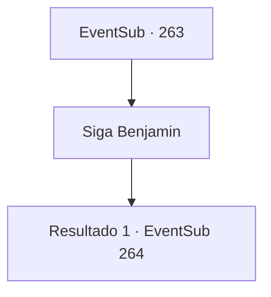

# Eventos secundários · 263

[Índice da tabela](index.md) · [Índice geral](../index.md)

ID: `pt:EventSub:263` · Fonte: `EventSub4` · Versão: 1.2.47.

Mapeamento estático dos arquivos; a disponibilidade e a execução dependem do estado da run.

## Texto do evento

*Sem texto no arquivo.*

## Dados de entrada

```json
{
  "id": 263,
  "grade": 1,
  "subEvent": "",
  "required": ""
}
```

## Mapa das escolhas



## Escolhas e resultados

### Escolha 1

Siga Benjamin

Requisitos e outros campos da escolha:

```json
{
  "required": ""
}
```

#### Resultado 1.1

Alec retorna à sua mansão. Você segue silenciosamente Benjamin, tentando evitar ser pego por Alec. A montanha não é tão alta, mas o caminho é difícil, dificultando a subida. 

 "*Pant*...*Pant*...!"

 Segundo Alec, o líder da mochila vive na caverna localizada no topo das montanhas. Você e Benjamin respiram pesadamente, subindo a montanha. 

 Depois que cerca de duas horas se passaram, Benjamin se esgota e se senta em uma rocha próxima para descansar. Ele pede uma pequena pausa, respirando pesadamente. É quando um lobo aparece dos arbustos, como se estivesse esperando por esse momento. 

 "Grrrr...!"

 É o líder da matilha, que trouxe mais alguns lobos para caçá -lo. Assustado, Benjamin se levanta. Os lobos começam seu ataque. 

Continuação registrada: [Evento 264](0264.md) na mesma tabela.

```json
{
  "required": "",
  "chance": "1",
  "nextEvent": 264,
  "type": 2,
  "reward": "6_3_27",
  "place": 1
}
```

## Referências que chegam a este evento

- [Evento 261 · escolha 2 · resultado 1](0261.md#escolha-2)
