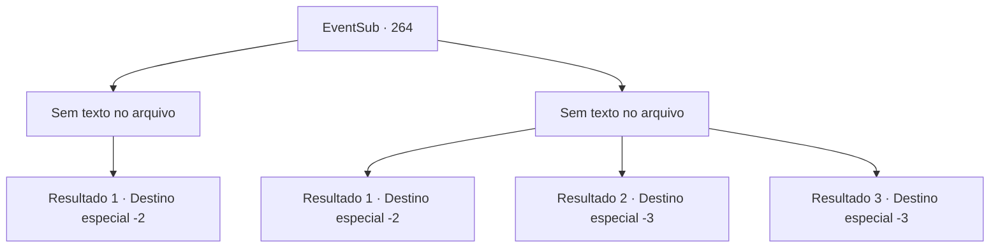

# Eventos secundários · 264

[Índice da tabela](index.md) · [Índice geral](../index.md)

ID: `pt:EventSub:264` · Fonte: `EventSub4` · Versão: 1.2.47.

Mapeamento estático dos arquivos; a disponibilidade e a execução dependem do estado da run.

## Texto do evento

*Sem texto no arquivo.*

## Dados de entrada

```json
{
  "id": 264,
  "grade": 1,
  "subEvent": "",
  "required": ""
}
```

## Mapa das escolhas



## Escolhas e resultados

### Escolha 1

*Sem texto no arquivo; o papel dessa opção depende da interface do jogo.*

Requisitos e outros campos da escolha:

```json
{
  "required": ""
}
```

#### Resultado 1.1

Você ajuda Benjamin a derrotar o líder da matilha. O resto dos lobos abaixam suas caudas e fogem. Benjamin corta a cabeça do líder e a coloca em sua bolsa. 

 "Suponho que isso será suficiente como evidência? Agradeço por me ajudar. Se não fosse por você, aventureiro, eu teria..."

 Ele balança a cabeça, como se recusando a sequer pensar nisso. 

 "Quando eu me tornar um cavaleiro, com certeza vou me lembrar de te recompensar!"

 Depois de mostrar sua gratidão, Benjamin desce a montanha. Você olha para as costas dele antes de seguir para outro lugar.

Continuação registrada: [Destino especial `-2`](../destinos-especiais.md).

```json
{
  "required": "",
  "chance": "1",
  "nextEvent": -2,
  "type": 2,
  "reward": "12_7_7"
}
```

### Escolha 2

*Sem texto no arquivo; o papel dessa opção depende da interface do jogo.*

Requisitos e outros campos da escolha:

```json
{
  "required": ""
}
```

#### Resultado 2.1

Você foge dos lobos com Benjamin. Depois de correr por muito tempo, os lobos não estão em lugar nenhum. 

 "*ofegante*...*ofegante*..."

 Benjamin não diz nada. Ele apenas respira pesadamente. Sangue esguicha de sua perna, e você percebe a sensação de profunda decepção em seu rosto. Ele manca de volta para Alec, e você encara suas costas antes de seguir para outro lugar.

Continuação registrada: [Destino especial `-2`](../destinos-especiais.md).

```json
{
  "required": "1_0_2|1_1_2",
  "chance": "1",
  "nextEvent": -2,
  "type": 2,
  "reward": "0_0_-1|0_1_-1|12_7_6"
}
```

#### Resultado 2.2

O líder da matilha te derruba. Em seguida, ele crava suas presas afiadas em sua garganta. 

 "A...aaccckk!!"

 Benjamin foge gritando, e você fecha os olhos, encarando suas costas.

Continuação registrada: [Destino especial `-3`](../destinos-especiais.md).

```json
{
  "required": "2_0_2",
  "chance": "1",
  "nextEvent": -3,
  "type": 2,
  "reward": "0_0_-1|0_1_-1"
}
```

#### Resultado 2.3

O líder da matilha te derruba. Em seguida, ele crava suas presas afiadas em sua garganta. 

 "A...aaccckk!!"

 Benjamin foge gritando, e você fecha os olhos, encarando suas costas.

Continuação registrada: [Destino especial `-3`](../destinos-especiais.md).

```json
{
  "required": "2_1_2",
  "chance": "1",
  "nextEvent": -3,
  "type": 2,
  "reward": "0_0_-1|0_1_-1"
}
```

## Referências que chegam a este evento

- [Evento 263 · escolha 1 · resultado 1](0263.md#escolha-1)
