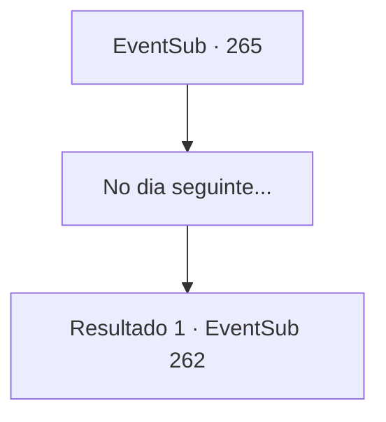

# Eventos secundários · 265

[Índice da tabela](index.md) · [Índice geral](../index.md)

ID: `pt:EventSub:265` · Fonte: `EventSub4` · Versão: 1.2.47.

Mapeamento estático dos arquivos; a disponibilidade e a execução dependem do estado da run.

## Texto do evento

*Sem texto no arquivo.*

## Dados de entrada

```json
{
  "id": 265,
  "grade": 1,
  "subEvent": "",
  "required": ""
}
```

## Mapa das escolhas



## Escolhas e resultados

### Escolha 1

No dia seguinte...

Requisitos e outros campos da escolha:

```json
{
  "required": ""
}
```

#### Resultado 1.1

O sol aparece novamente, e você deixa a cama confortável e sai para os jardins. Lá estão Alec e Benjamin, e Alec está dando a Benjamin sua tarefa final. Benjamin deve subir as montanhas na parte de trás da mansão e voltar com o líder da cabeça do Wolf Pack.  

 "Essa não será uma tarefa fácil. Mas se você realmente se tornar um cavaleiro, esse tipo de trabalho deve ser um pedaço de bolo."

  Benjamin assente ansiosamente.  Ele então prepara a espada e o escudo, caminhando para a montanha.  

  Você e Alec estão na sala de recepção, olhando pela janela.  O sol se põe e a mansão é engolida pela escuridão. Alec murmura consigo mesmo, que sabia que Benjamin falharia.  Mas então, Benjamin aparece. Como Alec esperava, ele está de mãos vazias, cheio de feridas.  

 "Hmph. Como esperado."

  Alec olha para Benjamin com os olhos, dizendo que ele não o aceitará como seu aprendiz.

Continuação registrada: [Evento 262](0262.md) na mesma tabela.

```json
{
  "required": "",
  "chance": "1",
  "nextEvent": 262,
  "type": 2,
  "reward": ""
}
```

## Referências que chegam a este evento

- [Evento 259 · escolha 2 · resultado 1](0259.md#escolha-2)
