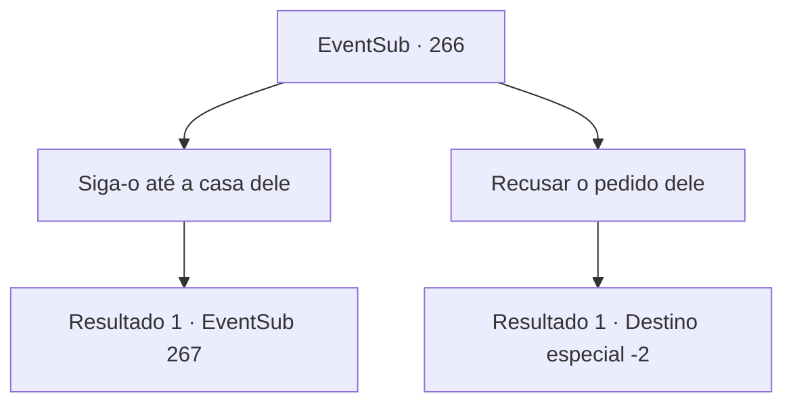

# Eventos secundários · 266

[Índice da tabela](index.md) · [Índice geral](../index.md)

ID: `pt:EventSub:266` · Fonte: `EventSub4` · Versão: 1.2.47.

Mapeamento estático dos arquivos; a disponibilidade e a execução dependem do estado da run.

## Texto do evento

Enquanto você está andando em uma estrada ao lado de um enorme campo, você vê um fazendeiro de meia-idade com cabelos grisalhos se aproximando de você. Ele fala com você desesperadamente. 

 "Você deve ser.. {1}, certo? Eu tenho um pedido! Meu sobrinho... Benjamin... ele está desaparecido! Por favor, encontre-o!!"

 O fazendeiro de meia-idade alega que não conseguiu encontrá-lo, mesmo depois de vasculhar a cidade inteira o dia todo. Ele começa a soluçar.

## Dados de entrada

```json
{
  "id": 266,
  "grade": 1,
  "subEvent": "",
  "required": "12_7_5|1_2_35"
}
```

## Mapa das escolhas



## Escolhas e resultados

### Escolha 1

Siga-o até a casa dele

Requisitos e outros campos da escolha:

```json
{
  "required": ""
}
```

#### Resultado 1.1

Você segue o fazendeiro de meia-idade até sua casa. Sua casa é um pouco desgastada, assim como outras casas de fazenda, mas tem todas as necessidades para se viver. Você procura em sua casa, procurando por qualquer pista que Benjamin possa ter deixado. Enquanto procura em uma mesa, você abre uma de suas gavetas e encontra o diário de Benjamin. O diário diz que ele tem planejado cumprir sua vingança todo esse tempo, e partiu para a cidade mais próxima, 'Vernu'.

Continuação registrada: [Evento 267](0267.md) na mesma tabela.

```json
{
  "required": "",
  "chance": "1",
  "nextEvent": 267,
  "type": 2,
  "reward": ""
}
```

### Escolha 2

Recusar o pedido dele

Requisitos e outros campos da escolha:

```json
{
  "required": ""
}
```

#### Resultado 2.1

Você recusa o pedido do fazendeiro. Atônito, o fazendeiro olha fixamente para você antes de seguir para outro lugar.

Continuação registrada: [Destino especial `-2`](../destinos-especiais.md).

```json
{
  "required": "",
  "chance": "1",
  "nextEvent": -2,
  "type": 2,
  "reward": "12_7_6|0_2_1"
}
```

## Referências que chegam a este evento

Nenhum `nextEvent` positivo da mesma tabela aponta para este nó. Isso não prova que seja inacessível: sorteio e estado de história podem selecioná-lo.

