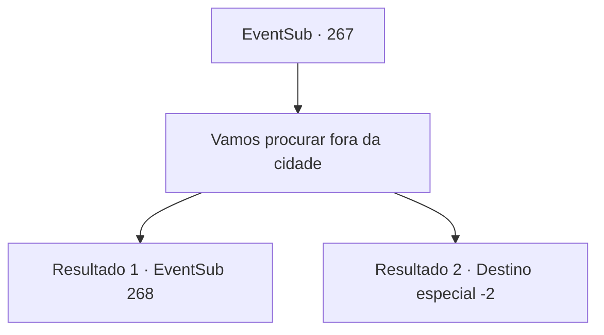

# Eventos secundários · 267

[Índice da tabela](index.md) · [Índice geral](../index.md)

ID: `pt:EventSub:267` · Fonte: `EventSub4` · Versão: 1.2.47.

Mapeamento estático dos arquivos; a disponibilidade e a execução dependem do estado da run.

## Texto do evento

*Sem texto no arquivo.*

## Dados de entrada

```json
{
  "id": 267,
  "grade": 1,
  "subEvent": "",
  "required": ""
}
```

## Mapa das escolhas



## Escolhas e resultados

### Escolha 1

Vamos procurar fora da cidade

Requisitos e outros campos da escolha:

```json
{
  "required": ""
}
```

#### Resultado 1.1

As pegadas estão conectadas ao lado de fora da aldeia, então você procura por mais do lado de fora. Logo, você encontra as pegadas de Benjamin. Você segue as pegadas para fora. Depois de caminhar por muito tempo, você encontra Benjamin na floresta, olhando para um mapa. Quando você se aproxima dele, Benjamin dá um passo para trás, assustado. 

 "Um... aventureiro!? Mas como você..."

 Benjamin hesita por um segundo, antes de gritar que nunca mais voltará.

Continuação registrada: [Evento 268](0268.md) na mesma tabela.

```json
{
  "required": "",
  "chance": "1|0_14_1",
  "nextEvent": 268,
  "type": 0,
  "reward": ""
}
```

#### Resultado 1.2

Você sai da casa e procura por pistas que Benjamin possa ter deixado. Mas você não consegue encontrar nada de importância e não tem nada a fazer além de consolar o fazendeiro e sair.

Continuação registrada: [Destino especial `-2`](../destinos-especiais.md).

```json
{
  "required": "",
  "chance": "11",
  "nextEvent": -2,
  "type": 1,
  "reward": "12_7_6|0_2_1"
}
```

## Referências que chegam a este evento

- [Evento 266 · escolha 1 · resultado 1](0266.md#escolha-1)
