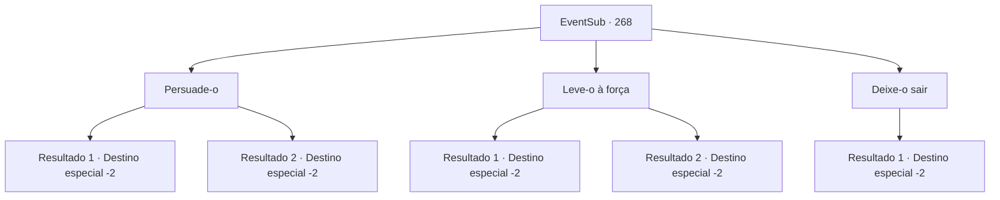

# Eventos secundários · 268

[Índice da tabela](index.md) · [Índice geral](../index.md)

ID: `pt:EventSub:268` · Fonte: `EventSub4` · Versão: 1.2.47.

Mapeamento estático dos arquivos; a disponibilidade e a execução dependem do estado da run.

## Texto do evento

*Sem texto no arquivo.*

## Dados de entrada

```json
{
  "id": 268,
  "grade": 1,
  "subEvent": "",
  "required": ""
}
```

## Mapa das escolhas



## Escolhas e resultados

### Escolha 1

Persuade-o

Requisitos e outros campos da escolha:

```json
{
  "required": ""
}
```

#### Resultado 1.1

Você diz a ele que o tio dele está preocupado, tentando convencer Benjamin a voltar. No começo, ele se recusa, mas depois de repetidas tentativas, ele finalmente o segue de volta à cidade.

 O fazendeiro abraça Benjamin firmemente, chorando. 

 "Ben! Esqueça a vingança ... você pode começar uma nova vida aqui comigo ..!"

 Benjamin parece perplexo, pensando no que deveria fazer. Mas logo ele pede desculpas, também começando a chorar. Depois que ele termina de chorar, Benjamin recupera a compostura e lhe entrega a bolsa dele. 

 "Estas são coisas que eu me preparei para minha jornada, mas não preciso mais deles. Por favor, leve -os."

 Você pega a poção na bolsa e parte.

Continuação registrada: [Destino especial `-2`](../destinos-especiais.md).

```json
{
  "required": "",
  "chance": "1|0_7_1",
  "nextEvent": -2,
  "type": 0,
  "reward": "0_2_1|3_190_1|12_7_8"
}
```

#### Resultado 1.2

Você diz a ele que seu tio está preocupado, tentando convencer Benjamin a voltar. Mas Benjamin não ouve e foge como uma flecha. Você rapidamente vai atrás dele, mas já faz muito tempo desde que ele desapareceu na noite. Infelizmente, você volta para a cidade e consola o fazendeiro antes de partir.

Continuação registrada: [Destino especial `-2`](../destinos-especiais.md).

```json
{
  "required": "",
  "chance": "15",
  "nextEvent": -2,
  "type": 1,
  "reward": "12_7_6|0_2_1"
}
```

### Escolha 2

Leve-o à força

Requisitos e outros campos da escolha:

```json
{
  "required": ""
}
```

#### Resultado 2.1

Você leva Benjamin de volta à cidade pela força. Benjamin resiste fortemente, mas ele não se liberta do seu alcance.

 O fazendeiro abraça Benjamin firmemente, chorando. 

 "Ben! Esqueça a vingança ... você pode começar uma nova vida aqui comigo ..!"

 Benjamin parece perplexo, pensando no que deveria fazer. Mas logo ele pede desculpas, também começando a chorar. Depois que ele termina de chorar, Benjamin decide voltar para a casa de seu tio, e você se despediu.

Continuação registrada: [Destino especial `-2`](../destinos-especiais.md).

```json
{
  "required": "",
  "chance": "1|0_5_1",
  "nextEvent": -2,
  "type": 0,
  "reward": "0_2_1|12_7_8"
}
```

#### Resultado 2.2

Tentas agarrar Benjamin, mas ele escapa rapidamente do teu alcance. Tu vais atrás dele rapidamente, mas já faz muito tempo desde que ele desapareceu na noite. Infelizmente, regressas à cidade e consolas o agricultor antes de partir.

Continuação registrada: [Destino especial `-2`](../destinos-especiais.md).

```json
{
  "required": "",
  "chance": "15",
  "nextEvent": -2,
  "type": 1,
  "reward": "12_7_6|0_2_1"
}
```

### Escolha 3

Deixe-o sair

Requisitos e outros campos da escolha:

```json
{
  "required": ""
}
```

#### Resultado 3.1

Sensando uma forte determinação, você decide deixá-lo ir livremente. Quando você diz isso a ele, ele hesita por um momento antes de agradecer e desaparecer na floresta. Você olha para as costas dele antes de voltar para a cidade. 

 "E...espere! Você simplesmente o deixou ir assim?!"

 O tio de Benjamin parece perplexo. Ele hesita por um momento antes de abrir a boca. 

 "Tal pai, tal filho... Ele é teimoso como uma mula. *suspiro*... bem, vejo que não adianta mais tentar segurá-lo agora. Se você encontrar Benjamin novamente no futuro, por favor, coloque-o de volta ao caminho certo."

 Ele agradece a você, dando-lhe uma cesta de batatas, e retorna para sua casa.

Continuação registrada: [Destino especial `-2`](../destinos-especiais.md).

```json
{
  "required": "",
  "chance": "1",
  "nextEvent": -2,
  "type": 2,
  "reward": "3_137_1|12_7_6|0_2_1"
}
```

## Referências que chegam a este evento

- [Evento 267 · escolha 1 · resultado 1](0267.md#escolha-1)
