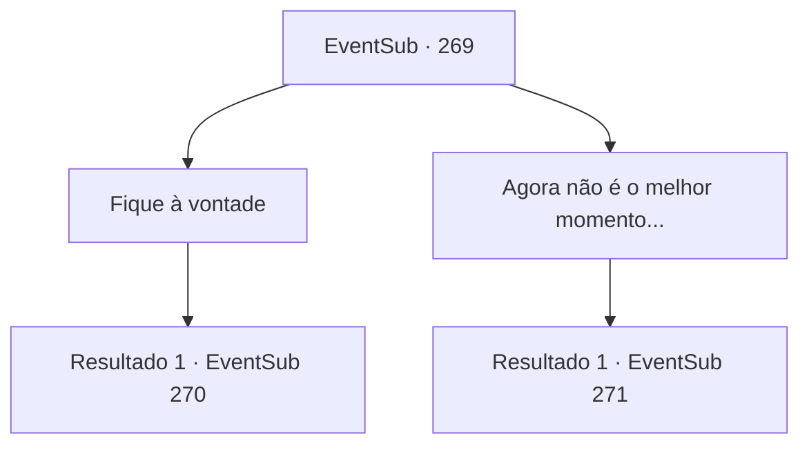

# Eventos secundários · 269

[Índice da tabela](index.md) · [Índice geral](../index.md)

ID: `pt:EventSub:269` · Fonte: `EventSub4` · Versão: 1.2.47.

Mapeamento estático dos arquivos; a disponibilidade e a execução dependem do estado da run.

## Texto do evento


 "{1}!"

 Você para e olha para trás depois de ouvir uma voz familiar. Lá está Benjamin, usando uma cota de malha, reforçada com placas de metal. 

 "Há quanto tempo! Vim para avisar que me tornei um aprendiz de cavaleiro!"

 Depois de se aproximar de você e cumprimentá-lo, ele mostra a espada na cintura. 

 "Se você não se importa... você poderia me ensinar uma coisa ou duas?"

 Ele pergunta confiante.

## Dados de entrada

```json
{
  "id": 269,
  "grade": 2,
  "subEvent": "",
  "required": "12_7_7|1_2_40"
}
```

## Mapa das escolhas



## Escolhas e resultados

### Escolha 1

Fique à vontade

Requisitos e outros campos da escolha:

```json
{
  "required": ""
}
```

#### Resultado 1.1

Você aceita felizmente o desafio dele. Benjamin cumprimenta você educadamente antes de pegar sua espada. 

 "Ok... aqui vou eu!"


Continuação registrada: [Evento 270](0270.md) na mesma tabela.

```json
{
  "required": "",
  "chance": "1",
  "nextEvent": 270,
  "type": 2,
  "reward": "6_0_117",
  "place": 4
}
```

### Escolha 2

Agora não é o melhor momento...

Requisitos e outros campos da escolha:

```json
{
  "required": ""
}
```

#### Resultado 2.1

Você diz a ele que agora não é o melhor momento, e Benjamin coça suas bochechas decepcionado. 

 "Bem então... Eu queria te mostrar o quanto eu melhorei... Mas tudo bem. Suponho que já esteja na hora."

 Benjamin coloca um sorriso brilhante e toca o cabo de sua espada. Quando você pergunta a ele sobre o que ele está falando, Benjamin responde que é hora de sua vingança.

Continuação registrada: [Evento 271](0271.md) na mesma tabela.

```json
{
  "required": "",
  "chance": "1",
  "nextEvent": 271,
  "type": 2,
  "reward": ""
}
```

## Referências que chegam a este evento

Nenhum `nextEvent` positivo da mesma tabela aponta para este nó. Isso não prova que seja inacessível: sorteio e estado de história podem selecioná-lo.

