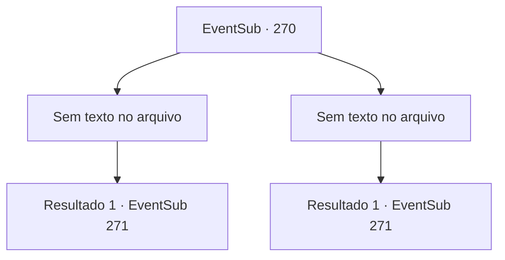

# Eventos secundários · 270

[Índice da tabela](index.md) · [Índice geral](../index.md)

ID: `pt:EventSub:270` · Fonte: `EventSub4` · Versão: 1.2.47.

Mapeamento estático dos arquivos; a disponibilidade e a execução dependem do estado da run.

## Texto do evento

*Sem texto no arquivo.*

## Dados de entrada

```json
{
  "id": 270,
  "grade": 1,
  "subEvent": "",
  "required": ""
}
```

## Mapa das escolhas



## Escolhas e resultados

### Escolha 1

*Sem texto no arquivo; o papel dessa opção depende da interface do jogo.*

Requisitos e outros campos da escolha:

```json
{
  "required": ""
}
```

#### Resultado 1.1

Você alcança as mãos de Benjamin, que está deitado no chão. Você o agarra e o ajuda a levantar. 

 "Uck... Droga, você realmente é algo... Mas ainda assim, acho que está na hora."

 Benjamin sorri brilhantemente e toca o cabo de sua espada. Quando você pergunta a ele sobre o que está falando, Benjamin responde que é hora de sua vingança.

Continuação registrada: [Evento 271](0271.md) na mesma tabela.

```json
{
  "required": "",
  "chance": "1",
  "nextEvent": 271,
  "type": 2,
  "reward": ""
}
```

### Escolha 2

*Sem texto no arquivo; o papel dessa opção depende da interface do jogo.*

Requisitos e outros campos da escolha:

```json
{
  "required": ""
}
```

#### Resultado 2.1

Benjamin estende as mãos para você. Quando você segura, Benjamin sorri calorosamente e ajuda você a se levantar. 

 "Nunca pensei que seria capaz de vencer você, isso é... ótimo. Acho que está na hora."

 Benjamin sorri radiante e toca a empunhadura de sua espada. Quando você pergunta o que ele está falando, Benjamin responde que é hora de sua vingança.

Continuação registrada: [Evento 271](0271.md) na mesma tabela.

```json
{
  "required": "",
  "chance": "1",
  "nextEvent": 271,
  "type": 2,
  "reward": ""
}
```

## Referências que chegam a este evento

- [Evento 269 · escolha 1 · resultado 1](0269.md#escolha-1)
