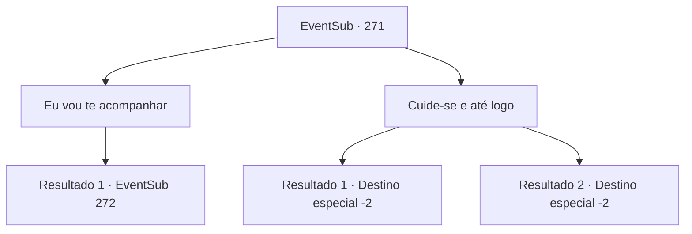

# Eventos secundários · 271

[Índice da tabela](index.md) · [Índice geral](../index.md)

ID: `pt:EventSub:271` · Fonte: `EventSub4` · Versão: 1.2.47.

Mapeamento estático dos arquivos; a disponibilidade e a execução dependem do estado da run.

## Texto do evento

*Sem texto no arquivo.*

## Dados de entrada

```json
{
  "id": 271,
  "grade": 1,
  "subEvent": "",
  "required": ""
}
```

## Mapa das escolhas



## Escolhas e resultados

### Escolha 1

Eu vou te acompanhar

Requisitos e outros campos da escolha:

```json
{
  "required": ""
}
```

#### Resultado 1.1

Benjamin parece surpreso com sua resposta. Seus olhos se arregalaram. 

 "Eu ... realmente aprecio isso, mas você não precisa. Tem certeza?"

 Depois de hesitar um pouco, ele fala novamente em uma voz cheia de determinação. 

 "Obrigado..... depois que o trabalho terminar, farei valer a pena. Vamos lá."

 Benjamin diz que ele já sabe onde Van Goyle e seus homens estão, liderando o caminho. |drawing_abandonedCastle| Vocês dois andam por alguns dias, antes de chegarem a uma cidadela de aparência antiga. É um forte construído em um riacho, com sinais de destruição aqui e ali. Aparentemente, ninguém tentou reparar o forte. As minúsculas janelas da Cidadela estão cheias de bandidos, com alguns deles guardando a cidadela em cima das paredes. Depois de encará -los um pouco, Benjamin pede a você com uma voz tranquila. 

 "A segurança não parece tão ótima. Alguns dos guardas estão dando fora, e alguns deles estão jogando cartas. Como devemos abordar isso?"


Continuação registrada: [Evento 272](0272.md) na mesma tabela.

```json
{
  "required": "",
  "chance": "1",
  "nextEvent": 272,
  "type": 2,
  "reward": ""
}
```

### Escolha 2

Cuide-se e até logo

Requisitos e outros campos da escolha:

```json
{
  "required": ""
}
```

#### Resultado 2.1

Você se despede de Benjamin. Ao ouvir isso, Benjamin acena lentamente com a cabeça, como se fortalecendo sua determinação. 

 "Quando o trabalho estiver terminado... vamos fazer uma refeição juntos algum dia. Eu pago por isso."

 Benjamin acena com a mão para você, dizendo adeus.

Continuação registrada: [Destino especial `-2`](../destinos-especiais.md).

```json
{
  "required": "",
  "chance": "1",
  "nextEvent": -2,
  "type": 2,
  "reward": "12_7_9"
}
```

#### Resultado 2.2

Você se despede de Benjamin. Ao ouvir isso, Benjamin acena lentamente com a cabeça, como se fortalecendo sua determinação. 

 "Quando o trabalho estiver terminado... vamos fazer uma refeição juntos algum dia. Eu pago por isso."

 Benjamin acena com a mão para você, dizendo adeus.

Continuação registrada: [Destino especial `-2`](../destinos-especiais.md).

```json
{
  "required": "",
  "chance": "1",
  "nextEvent": -2,
  "type": 2,
  "reward": "12_7_9"
}
```

## Referências que chegam a este evento

- [Evento 269 · escolha 2 · resultado 1](0269.md#escolha-2)
- [Evento 270 · escolha 1 · resultado 1](0270.md#escolha-1)
- [Evento 270 · escolha 2 · resultado 1](0270.md#escolha-2)
