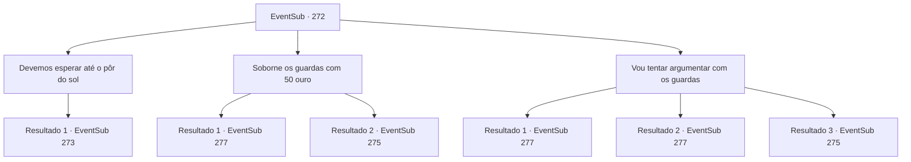

# Eventos secundários · 272

[Índice da tabela](index.md) · [Índice geral](../index.md)

ID: `pt:EventSub:272` · Fonte: `EventSub4` · Versão: 1.2.47.

Mapeamento estático dos arquivos; a disponibilidade e a execução dependem do estado da run.

## Texto do evento

*Sem texto no arquivo.*

## Dados de entrada

```json
{
  "id": 272,
  "grade": 1,
  "subEvent": "",
  "required": ""
}
```

## Mapa das escolhas



## Escolhas e resultados

### Escolha 1

Devemos esperar até o pôr do sol

Requisitos e outros campos da escolha:

```json
{
  "required": ""
}
```

#### Resultado 1.1

Você diz a ele que o sol precisa se pôr antes de entrar. Benjamin acena com a cabeça, concordando. Os dois esperam juntos até a noite. Você e Benjamin se escondem atrás das rochas. 

 "Ainda temos algum tempo. Diria que uma hora ou duas, até o sol se pôr."

 Parece óbvio que ele está tentando esconder sua ansiedade.

Continuação registrada: [Evento 273](0273.md) na mesma tabela.

```json
{
  "required": "",
  "chance": "1",
  "nextEvent": 273,
  "type": 2,
  "reward": ""
}
```

### Escolha 2

Soborne os guardas com 50 ouro

Requisitos e outros campos da escolha:

```json
{
  "required": "1_4_50"
}
```

#### Resultado 2.1

Você se aproxima confiantemente dos guardas. Eles gritam 'Quem está aí!', levantando suas armas. Você se apresenta como um comerciante inofensivo, procurando comprar passagem pagando o 'pedágio'. Sua explicação lógica convence os guardas. 

 "Hm... Entendi. Bem, contanto que você esteja disposto a pagar.."

 Você e Benjamin passam pelo portão do castelo. Os guardas dizem, 'nem pense em fazer algo engraçado' e mandam vocês saírem imediatamente pelo outro portão. Mas vocês dois se infiltram dentro do forte. 

 "A sala mais profunda do forte. É lá que Van Goyle deve estar."

 Você e Benjamin seguem para a parte mais profunda do forte, e lá se encontra uma porta luxuosamente decorada.

Continuação registrada: [Evento 277](0277.md) na mesma tabela.

```json
{
  "required": "",
  "chance": "1|0_7_1",
  "nextEvent": 277,
  "type": 0,
  "reward": "0_4_-50"
}
```

#### Resultado 2.2

Você se aproxima confiantemente dos guardas. Eles gritam 'Quem está aí!', levantando suas armas. Você esquece o que estava tentando dizer e responde com silêncio. Os guardas empurram suas armas em sua garganta e você decide adotar uma abordagem diferente.

Continuação registrada: [Evento 275](0275.md) na mesma tabela.

```json
{
  "required": "",
  "chance": "13",
  "nextEvent": 275,
  "type": 1,
  "reward": "6_3_2",
  "place": 4
}
```

### Escolha 3

Vou tentar argumentar com os guardas

Requisitos e outros campos da escolha:

```json
{
  "required": ""
}
```

#### Resultado 3.1

Benjamin parece preocupado, mas você se aproxima confiantemente dos guardas. Eles gritam 'Quem está aí!', levantando suas armas. Você sorri calorosamente e os cumprimenta. Você se apresenta como um aventureiro errante, solicitando um tour pelo citadela. 

 "Uh... Hm. Eu entendo. Mas... Eu não acho que devemos permitir que qualquer um entre..."

 Um dos guardas hesita, mas o outro fala. 

 "Está tudo bem, está tudo bem. Esse sujeito não deve ser um problema."

 Eles estão impressionados com sua carisma. O portão se abre. Você e Benjamin entram na citadela. 

 "Incrível... De qualquer forma, a sala mais profunda do forte. É lá que Van Goyle deve estar."

 Você e Benjamin seguem para a parte mais profunda do forte, e lá está uma porta luxuosamente decorada.

Continuação registrada: [Evento 277](0277.md) na mesma tabela.

```json
{
  "required": "11_0_0",
  "chance": "1|0_12_1",
  "nextEvent": 277,
  "type": 0,
  "reward": ""
}
```

#### Resultado 3.2

Benjamin parece preocupado, mas você se aproxima confiantemente dos guardas. Eles gritam 'Quem está aí!', levantando suas armas. Você sorri calorosamente e os cumprimenta. Você se apresenta como um aventureiro errante, solicitando um tour pelo citadela. 

 "Uh... Hm. Eu entendo. Mas... Eu não acho que devemos permitir que qualquer um entre..."

 Um dos guardas hesita, mas o outro fala. 

 "Está tudo bem, está tudo bem. Essa senhora não deve ser um problema."

 Eles estão impressionados com sua carisma. O portão se abre. Você e Benjamin entram na citadela. 

 "Incrível... De qualquer forma, a sala mais profunda do forte. É lá que Van Goyle deve estar."

 Você e Benjamin seguem para a parte mais profunda do forte, e lá está uma porta luxuosamente decorada.

Continuação registrada: [Evento 277](0277.md) na mesma tabela.

```json
{
  "required": "11_0_1",
  "chance": "1|0_12_2",
  "nextEvent": 277,
  "type": 0,
  "reward": ""
}
```

#### Resultado 3.3

Benjamin parece preocupado, mas você se aproxima confiantemente dos guardas. Eles gritam 'Quem está aí!', levantando suas armas. Você sorri calorosamente e os cumprimenta. Você se apresenta como um aventureiro errante, solicitando um tour pelo citadela. Mas parece que você não foi atraente o suficiente para cativar os guardas. 

 "Olhe para você, lixo de rua... Cuidado com quem está tentando enganar!"

 Eles ficam mais agitados e correm em sua direção.

Continuação registrada: [Evento 275](0275.md) na mesma tabela.

```json
{
  "required": "",
  "chance": "26",
  "nextEvent": 275,
  "type": 1,
  "reward": "6_3_2",
  "place": 4
}
```

## Referências que chegam a este evento

- [Evento 271 · escolha 1 · resultado 1](0271.md#escolha-1)
- [Evento 313 · escolha 1 · resultado 1](0313.md#escolha-1)
