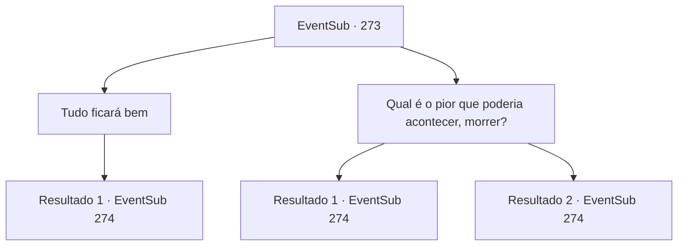

# Eventos secundários · 273

[Índice da tabela](index.md) · [Índice geral](../index.md)

ID: `pt:EventSub:273` · Fonte: `EventSub4` · Versão: 1.2.47.

Mapeamento estático dos arquivos; a disponibilidade e a execução dependem do estado da run.

## Texto do evento

*Sem texto no arquivo.*

## Dados de entrada

```json
{
  "id": 273,
  "grade": 1,
  "subEvent": "",
  "required": ""
}
```

## Mapa das escolhas



## Escolhas e resultados

### Escolha 1

Tudo ficará bem

Requisitos e outros campos da escolha:

```json
{
  "required": ""
}
```

#### Resultado 1.1

Você consola Benjamin. Ele ainda parece ansioso, mas logo acena com a cabeça, agradecendo a você. 

 "Com você, aventureiro, ao meu lado... não tenho dúvidas."

 Ele fecha as mãos em punhos, olhando com raiva para a cidadela. O sol está quase se pondo, e você segue para a cidadela com Benjamin.

Continuação registrada: [Evento 274](0274.md) na mesma tabela.

```json
{
  "required": "",
  "chance": "1",
  "nextEvent": 274,
  "type": 2,
  "reward": ""
}
```

### Escolha 2

Qual é o pior que poderia acontecer, morrer?

Requisitos e outros campos da escolha:

```json
{
  "required": ""
}
```

#### Resultado 2.1

Você faz uma piada, para animar o clima. Ele ri, concorda e agradece. 

 "Teehee, com você, aventureiro, ao meu lado... não tenho dúvidas."

 Ele fecha as mãos em punhos, olhando com malícia para a cidadela. O sol está quase se pondo, e você segue para a cidadela com Benjamin.

Continuação registrada: [Evento 274](0274.md) na mesma tabela.

```json
{
  "required": "-1|18_260_1|11_0_0",
  "chance": "1",
  "nextEvent": 274,
  "type": 2,
  "reward": ""
}
```

#### Resultado 2.2

Você faz uma piada, para animar o clima. Ele ri, concorda e agradece. Ele olha brevemente nos seus olhos e continua a falar antes que as coisas fiquem muito estranhas. 

 "Haha... Vejo que você estava disposto a ir tão longe. Sabe, depois que tudo estiver terminado.... você.... esquece."

 Ele não consegue terminar a frase. O tempo passa e o sol se põe. Você e Benjamin vão para a cidadela.

Continuação registrada: [Evento 274](0274.md) na mesma tabela.

```json
{
  "required": "11_0_1|5_260_1",
  "chance": "1",
  "nextEvent": 274,
  "type": 2,
  "reward": "5_263_1"
}
```

## Referências que chegam a este evento

- [Evento 272 · escolha 1 · resultado 1](0272.md#escolha-1)
