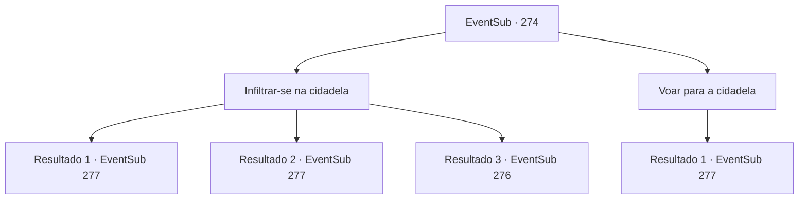

# Eventos secundários · 274

[Índice da tabela](index.md) · [Índice geral](../index.md)

ID: `pt:EventSub:274` · Fonte: `EventSub4` · Versão: 1.2.47.

Mapeamento estático dos arquivos; a disponibilidade e a execução dependem do estado da run.

## Texto do evento

*Sem texto no arquivo.*

## Dados de entrada

```json
{
  "id": 274,
  "grade": 1,
  "subEvent": "",
  "required": ""
}
```

## Mapa das escolhas



## Escolhas e resultados

### Escolha 1

Infiltrar-se na cidadela

Requisitos e outros campos da escolha:

```json
{
  "required": ""
}
```

#### Resultado 1.1

Você espera pela troca de turnos dos guardas e se infiltra na cidadela com Benjamin. Eles não têm ideia da sua chegada. Depois que vocês dois estão dentro do forte, Benjamin sussurra para você. 

 "O quarto mais profundo do forte. É lá que Van Goyle deve estar."

 Você e Benjamin seguem para a parte mais profunda do forte e lá está uma porta luxuosamente decorada.

Continuação registrada: [Evento 277](0277.md) na mesma tabela.

```json
{
  "required": "",
  "chance": "1|0_6_1",
  "nextEvent": 277,
  "type": 0,
  "reward": ""
}
```

#### Resultado 1.2

Você espera pela troca de turnos dos guardas e se infiltra na cidadela com Benjamin. Eles não têm ideia da sua chegada. Depois que vocês dois estão dentro do forte, Benjamin sussurra para você. 

 "O quarto mais profundo do forte. É lá que Van Goyle deve estar."

 Você e Benjamin seguem para a parte mais profunda do forte e lá está uma porta luxuosamente decorada.

Continuação registrada: [Evento 277](0277.md) na mesma tabela.

```json
{
  "required": "20_5_1",
  "chance": "1|0_6_1",
  "nextEvent": 277,
  "type": 0,
  "reward": ""
}
```

#### Resultado 1.3

Você espera pela troca de turno dos guardas e tenta se infiltrar na cidadela com Benjamin. Mas os guardas percebem, ao contrário do que você esperava. 

 "Você aí! O que está fazendo!!"

 Quando o guarda do portão assobia, um ruído agudo ecoa por toda a cidadela, e bandidos aparecem de todos os lugares. Eles estão armados com uma variedade de armas, com todos os rostos parecendo violentos. 

 "Intruso! Capturem eles! Ninguém vai se importar se eles morrerem mesmo!"

 Você e Benjamin ficam de costas um para o outro e são obrigados a lutar contra os bandidos.

Continuação registrada: [Evento 276](0276.md) na mesma tabela.

```json
{
  "required": "",
  "chance": "22",
  "nextEvent": 276,
  "type": 1,
  "reward": "6_0_118",
  "place": 4
}
```

### Escolha 2

Voar para a cidadela

Requisitos e outros campos da escolha:

```json
{
  "required": "20_10_1"
}
```

#### Resultado 2.1

Você voa pelo ar e pousa confortavelmente nas paredes do castelo. Em seguida, você joga a escada colocada perto das paredes do castelo para que Benjamin possa subir. Depois de subir, Benjamin sussurra. 

 "Obrigado a você, conseguimos chegar aqui facilmente. O quarto mais profundo do forte. É lá que Van Goyle deve estar."

 Você e Benjamin seguem para a parte mais profunda do forte, e lá está uma porta luxuosamente decorada.

Continuação registrada: [Evento 277](0277.md) na mesma tabela.

```json
{
  "required": "",
  "chance": "1",
  "nextEvent": 277,
  "type": 2,
  "reward": ""
}
```

## Referências que chegam a este evento

- [Evento 273 · escolha 1 · resultado 1](0273.md#escolha-1)
- [Evento 273 · escolha 2 · resultado 1](0273.md#escolha-2)
- [Evento 273 · escolha 2 · resultado 2](0273.md#escolha-2)
