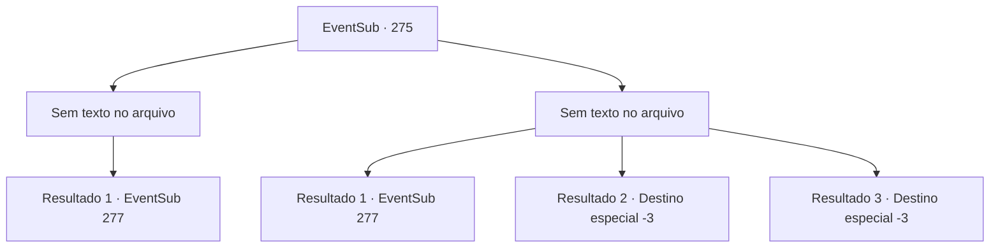

# Eventos secundários · 275

[Índice da tabela](index.md) · [Índice geral](../index.md)

ID: `pt:EventSub:275` · Fonte: `EventSub4` · Versão: 1.2.47.

Mapeamento estático dos arquivos; a disponibilidade e a execução dependem do estado da run.

## Texto do evento

*Sem texto no arquivo.*

## Dados de entrada

```json
{
  "id": 275,
  "grade": 1,
  "subEvent": "",
  "required": ""
}
```

## Mapa das escolhas



## Escolhas e resultados

### Escolha 1

*Sem texto no arquivo; o papel dessa opção depende da interface do jogo.*

Requisitos e outros campos da escolha:

```json
{
  "required": ""
}
```

#### Resultado 1.1

Quando Benjamin percebe que você está lutando contra os guardas, ele corre para ajudar. Mas você já lidou com os guardas. Benjamin abre o portão da cidadela e fala. 

 "Vamos. Logo eles descobrirão sobre isso."

 Você e Benjamin seguem para a parte mais profunda do forte, e lá está uma porta luxuosamente decorada.

Continuação registrada: [Evento 277](0277.md) na mesma tabela.

```json
{
  "required": "",
  "chance": "1",
  "nextEvent": 277,
  "type": 2,
  "reward": ""
}
```

### Escolha 2

*Sem texto no arquivo; o papel dessa opção depende da interface do jogo.*

Requisitos e outros campos da escolha:

```json
{
  "required": ""
}
```

#### Resultado 2.1

Quando Benjamin percebe que você está lutando contra os guardas, ele corre para ajudar. Mas você já lidou com os guardas. Benjamin abre o portão da cidadela e fala. 

 "Vamos. Logo eles descobrirão sobre isso."

 Você e Benjamin seguem para a parte mais profunda do forte, e lá está uma porta luxuosamente decorada.

Continuação registrada: [Evento 277](0277.md) na mesma tabela.

```json
{
  "required": "1_0_2|1_1_2",
  "chance": "1",
  "nextEvent": 277,
  "type": 2,
  "reward": "0_0_-1|0_1_-1"
}
```

#### Resultado 2.2

Você é derrotado pela faca do bandido guarda.

Continuação registrada: [Destino especial `-3`](../destinos-especiais.md).

```json
{
  "required": "2_0_2",
  "chance": "1",
  "nextEvent": -3,
  "type": 2,
  "reward": "0_0_-1|0_1_-1"
}
```

#### Resultado 2.3

Você é derrotado pela faca do bandido guarda.

Continuação registrada: [Destino especial `-3`](../destinos-especiais.md).

```json
{
  "required": "2_1_2",
  "chance": "1",
  "nextEvent": -3,
  "type": 2,
  "reward": "0_0_-1|0_1_-1"
}
```

## Referências que chegam a este evento

- [Evento 272 · escolha 2 · resultado 2](0272.md#escolha-2)
- [Evento 272 · escolha 3 · resultado 3](0272.md#escolha-3)
