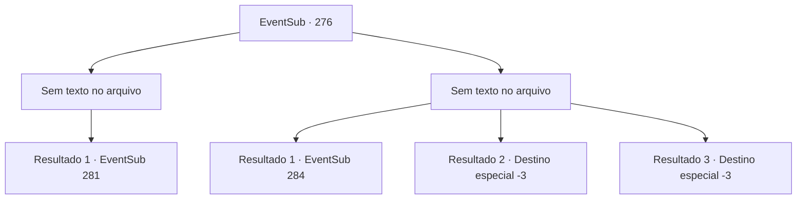

# Eventos secundários · 276

[Índice da tabela](index.md) · [Índice geral](../index.md)

ID: `pt:EventSub:276` · Fonte: `EventSub4` · Versão: 1.2.47.

Mapeamento estático dos arquivos; a disponibilidade e a execução dependem do estado da run.

## Texto do evento

*Sem texto no arquivo.*

## Dados de entrada

```json
{
  "id": 276,
  "grade": 1,
  "subEvent": "",
  "required": ""
}
```

## Mapa das escolhas



## Escolhas e resultados

### Escolha 1

*Sem texto no arquivo; o papel dessa opção depende da interface do jogo.*

Requisitos e outros campos da escolha:

```json
{
  "required": ""
}
```

#### Resultado 1.1

Enquanto você e Benjamin estão derrubando os bandidos um por um, um homem enorme empunhando um martelo gigante aparece. 

 "O que está acontecendo!!"

 Sua voz ecoa por todo o castelo. Benjamin se vira para olhar o homem que acabou de gritar. Quando ele olha para o rosto do homem enorme com um tapa-olho, Benjamin grita furiosamente. 

 "VAN GOYLE!! HOJE SERÁ SEU FUNERAL!"

 O homem enorme, que acabou de ser chamado de Van Goyle, ri alto e responde. 

 "Ahahaha! Eu sabia! Você me parece familiar! Você é o filho amaldiçoado daquele maldito 'Bowie'! Cara, você se parece muito com ele..!! Então, isso é sua maneira de vingar seu pai ou algo assim?"

 Ele sorri amargamente e continua. 

 "Ei. Você sabia? Bowie matou meu irmãozinho. Você precisa saber, a razão pela qual ataquei sua vila foi para cumprir minha vingança. Mas infelizmente, Bowie já estava morto quando cheguei lá."

 Benjamin congela.

Continuação registrada: [Evento 281](0281.md) na mesma tabela.

```json
{
  "required": "",
  "chance": "1",
  "nextEvent": 281,
  "type": 2,
  "reward": ""
}
```

### Escolha 2

*Sem texto no arquivo; o papel dessa opção depende da interface do jogo.*

Requisitos e outros campos da escolha:

```json
{
  "required": ""
}
```

#### Resultado 2.1

Há muitos bandidos demais para você e Benjamin lidarem. Com a onda interminável de bandidos impedindo vocês dois de se aproximarem de Van Goyle, Benjamin pergunta ansiosamente. 

 "Olha, vamos morrer antes mesmo de ter a chance de encostar um dedo em Goyle! Existe alguma maneira?!"

 Benjamin olha desesperadamente para você, enfiando sua espada no pescoço de um bandido aleatório.

Continuação registrada: [Evento 284](0284.md) na mesma tabela.

```json
{
  "required": "1_0_2|1_1_2",
  "chance": "1",
  "nextEvent": 284,
  "type": 2,
  "reward": "0_0_-1|0_1_-1"
}
```

#### Resultado 2.2

Você falha em desviar de uma lança voando em suas costas. Você desaba. Os bandidos pisoteiam você, e você sente seus ossos se quebrando e rachando. Você encontra o seu fim.

Continuação registrada: [Destino especial `-3`](../destinos-especiais.md).

```json
{
  "required": "2_0_2",
  "chance": "1",
  "nextEvent": -3,
  "type": 2,
  "reward": "0_0_-1|0_1_-1"
}
```

#### Resultado 2.3

Você falha em desviar de uma lança voando em suas costas. Você desaba. Os bandidos pisoteiam você, e você sente seus ossos se quebrando e rachando. Você encontra o seu fim.

Continuação registrada: [Destino especial `-3`](../destinos-especiais.md).

```json
{
  "required": "2_1_2",
  "chance": "1",
  "nextEvent": -3,
  "type": 2,
  "reward": "0_0_-1|0_1_-1"
}
```

## Referências que chegam a este evento

- [Evento 274 · escolha 1 · resultado 3](0274.md#escolha-1)
