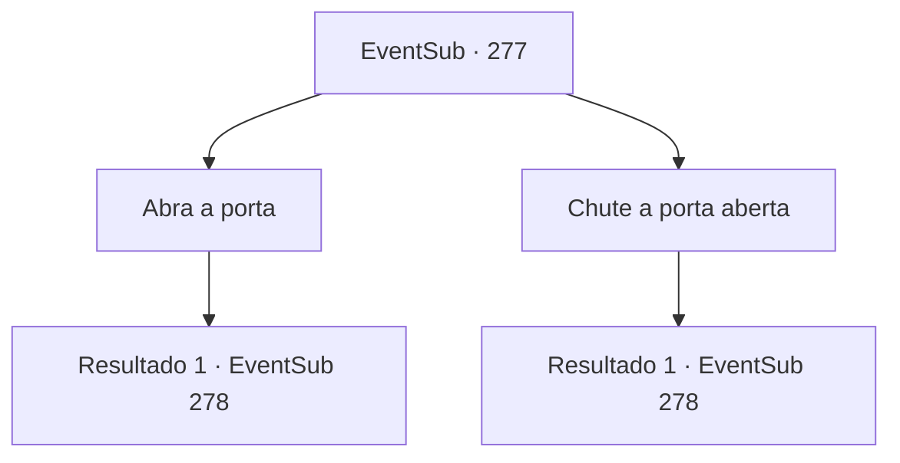

# Eventos secundários · 277

[Índice da tabela](index.md) · [Índice geral](../index.md)

ID: `pt:EventSub:277` · Fonte: `EventSub4` · Versão: 1.2.47.

Mapeamento estático dos arquivos; a disponibilidade e a execução dependem do estado da run.

## Texto do evento

*Sem texto no arquivo.*

## Dados de entrada

```json
{
  "id": 277,
  "grade": 1,
  "subEvent": "",
  "required": ""
}
```

## Mapa das escolhas



## Escolhas e resultados

### Escolha 1

Abra a porta

Requisitos e outros campos da escolha:

```json
{
  "required": ""
}
```

#### Resultado 1.1

Você abre cuidadosamente a porta chique e pesada lentamente. Você ouve uma voz áspera em algum lugar. 

 "Um convidado? Hmph... Eu já vi seu rosto antes...?"

 Dentro do quarto há um homem enorme com um tapa-olho, sentado em um trono luxuosamente decorado como um rei. Ele coça o queixo antes de pegar um martelo gigante e falar. 

 "'Bowie'.... Ah, entendi. O filho pequeno de Bowie, não é. Então, o que é isso, sua maneira de vingar seu pai? Haha... Você sabia, aliás? Que Bowie matou meu irmãozinho?"

 Benjamin congela.

Continuação registrada: [Evento 278](0278.md) na mesma tabela.

```json
{
  "required": "",
  "chance": "1",
  "nextEvent": 278,
  "type": 2,
  "reward": ""
}
```

### Escolha 2

Chute a porta aberta

Requisitos e outros campos da escolha:

```json
{
  "required": ""
}
```

#### Resultado 2.1

Você chuta a porta chique e pesada aberta. A porta se abre rangendo dolorosamente. 

 "Huh...! Quem está aí!"

 Um homem enorme com um tapa-olho fala enquanto se levanta de seu trono. 

 "...Espere aí. Seu rosto me parece familiar..."

 Ele coça o queixo antes de pegar um martelo gigante e falar. 

 "'Bowie'.... Ah, entendi. O filho pequeno de Bowie, não é. Então, o que é isso, sua maneira de vingar seu pai? Haha... Você sabia, aliás? Que Bowie matou meu irmãozinho?"

 Benjamin congela.

Continuação registrada: [Evento 278](0278.md) na mesma tabela.

```json
{
  "required": "",
  "chance": "1",
  "nextEvent": 278,
  "type": 2,
  "reward": ""
}
```

## Referências que chegam a este evento

- [Evento 272 · escolha 2 · resultado 1](0272.md#escolha-2)
- [Evento 272 · escolha 3 · resultado 1](0272.md#escolha-3)
- [Evento 272 · escolha 3 · resultado 2](0272.md#escolha-3)
- [Evento 274 · escolha 1 · resultado 1](0274.md#escolha-1)
- [Evento 274 · escolha 1 · resultado 2](0274.md#escolha-1)
- [Evento 274 · escolha 2 · resultado 1](0274.md#escolha-2)
- [Evento 275 · escolha 1 · resultado 1](0275.md#escolha-1)
- [Evento 275 · escolha 2 · resultado 1](0275.md#escolha-2)
