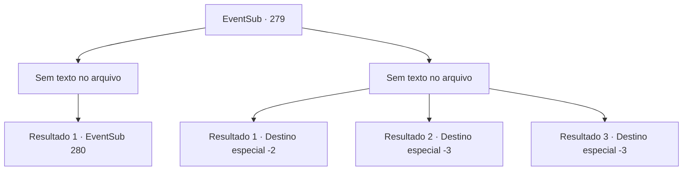

# Eventos secundários · 279

[Índice da tabela](index.md) · [Índice geral](../index.md)

ID: `pt:EventSub:279` · Fonte: `EventSub4` · Versão: 1.2.47.

Mapeamento estático dos arquivos; a disponibilidade e a execução dependem do estado da run.

## Texto do evento

*Sem texto no arquivo.*

## Dados de entrada

```json
{
  "id": 279,
  "grade": 1,
  "subEvent": "",
  "required": ""
}
```

## Mapa das escolhas



## Escolhas e resultados

### Escolha 1

*Sem texto no arquivo; o papel dessa opção depende da interface do jogo.*

Requisitos e outros campos da escolha:

```json
{
  "required": ""
}
```

#### Resultado 1.1

Benjamin aponta sua espada para Van Goyle, que agora está ajoelhado diante dele. O resultado da luta é óbvio. Mas Benjamin parece estar hesitando. Sua espada não se move mais. 

 "H, hahahaha! O que você está fazendo, seu pequeno filhote! Acabe com isso! Me mate! Você está aqui por vingança, lembra?"

 Van Goyle continua provocando Benjamin, mas sua espada ainda não se move. O rosto de Benjamin transpira profusamente, mesmo quando claramente tem a vantagem.

Continuação registrada: [Evento 280](0280.md) na mesma tabela.

```json
{
  "required": "",
  "chance": "1",
  "nextEvent": 280,
  "type": 2,
  "reward": ""
}
```

### Escolha 2

*Sem texto no arquivo; o papel dessa opção depende da interface do jogo.*

Requisitos e outros campos da escolha:

```json
{
  "required": ""
}
```

#### Resultado 2.1

O martelo de Van Goyle atinge Benjamin à distância de forma imprudente. O corpo sem vida de Benjamin espirra sangue por todo o lugar. Ele não se levanta novamente. Tudo o que você pode fazer agora é fugir de Van Goyle. 

 "Hahaha! Isso mesmo, corra! Venha me visitar novamente no futuro se ainda quiser se vingar!"

 As palavras de Van Goyle ecoam em seus ouvidos enquanto você foge.

Continuação registrada: [Destino especial `-2`](../destinos-especiais.md).

```json
{
  "required": "1_0_2|1_1_2",
  "chance": "1",
  "nextEvent": -2,
  "type": 2,
  "reward": "0_0_-1|0_1_-1|12_7_-1|14_7_6"
}
```

#### Resultado 2.2

O martelo gigante voa em direção ao seu crânio. Essa é a última coisa que você vê, antes de tudo ficar preto.

Continuação registrada: [Destino especial `-3`](../destinos-especiais.md).

```json
{
  "required": "2_0_2",
  "chance": "1",
  "nextEvent": -3,
  "type": 2,
  "reward": "0_0_-1|0_1_-1"
}
```

#### Resultado 2.3

O martelo gigante voa em direção ao seu crânio. Essa é a última coisa que você vê, antes de tudo ficar preto.

Continuação registrada: [Destino especial `-3`](../destinos-especiais.md).

```json
{
  "required": "2_1_2",
  "chance": "1",
  "nextEvent": -3,
  "type": 2,
  "reward": "0_0_-1|0_1_-1"
}
```

## Referências que chegam a este evento

- [Evento 278 · escolha 2 · resultado 1](0278.md#escolha-2)
