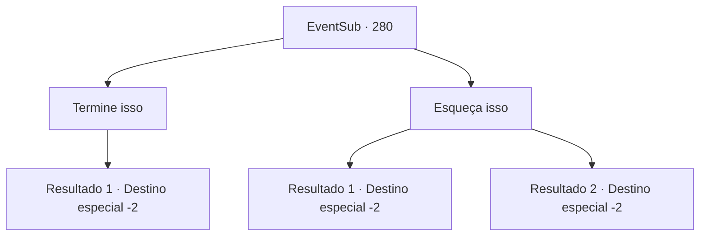

# Eventos secundários · 280

[Índice da tabela](index.md) · [Índice geral](../index.md)

ID: `pt:EventSub:280` · Fonte: `EventSub4` · Versão: 1.2.47.

Mapeamento estático dos arquivos; a disponibilidade e a execução dependem do estado da run.

## Texto do evento

*Sem texto no arquivo.*

## Dados de entrada

```json
{
  "id": 280,
  "grade": 1,
  "subEvent": "",
  "required": ""
}
```

## Mapa das escolhas



## Escolhas e resultados

### Escolha 1

Termine isso

Requisitos e outros campos da escolha:

```json
{
  "required": ""
}
```

#### Resultado 1.1

Ouvindo suas palavras, Benjamin se decide, fecha os olhos e dá o último golpe.

 <color=red>'Chop!'</color>

 Com o som de uma lâmina rasgando a carne e o osso, a cabeça de Van Goyle rola no chão. Benjamin olha para ele com olhos em branco, antes de falar. 

 "É isso. Esta é a vingança que eu queria tanto tempo ..."

 Ele olha para sua espada ensanguentada antes de voltar à realidade. 

 "Vamos sair aqui. Antes de sermos pegos."

 Você e Benjamin saem da cidadela. Benjamin trouxe o martelo de Van Goyle com ele, o que ele lhe dá. 

 "Eu não poderia ter feito isso sem a sua ajuda. Por favor, visite -me novamente no futuro."

 Benjamin pede que você o visite novamente. Você se despediu e se afasta dele.

Continuação registrada: [Destino especial `-2`](../destinos-especiais.md).

```json
{
  "required": "",
  "chance": "1",
  "nextEvent": -2,
  "type": 2,
  "reward": "12_7_10|3_231_1"
}
```

### Escolha 2

Esqueça isso

Requisitos e outros campos da escolha:

```json
{
  "required": ""
}
```

#### Resultado 2.1

Você diz a Benjamin para parar. Ao ouvir suas palavras, Benjamin se decide e corta a perna de Van Goyle em vez de seu pescoço. <link=shake>

 "ARGH-----!!!"

</link> Van Goyle segura sua perna cortada, rolando no chão. Você acha que ele está tentando o seu melhor para não gritar. Benjamin olha para ele com os olhos frios e mortos antes de continuar. 

 "Eu ... não vou me tornar como você. Mas devo fazer você pagar por todos os seus erros."

 Depois de terminar, Benjamin se vira, abre a porta e sai para fora. Você ainda pode ouvir os gritos de Goyle ecoarem em toda a cidadela. Aparentemente, ele não conseguia mais segurar o grito. Você e Benjamin se escondem rapidamente, e se despedem quando os bandidos foram verificar em Van Goyle. 

 "Essa era a coisa certa a fazer, certo?"

 Benjamin murmura com um fraco sinal de arrependimento em sua voz. Ele se despediu e sai.

Continuação registrada: [Destino especial `-2`](../destinos-especiais.md).

```json
{
  "required": "18_260_1",
  "chance": "1",
  "nextEvent": -2,
  "type": 2,
  "reward": "12_7_11|14_7_1"
}
```

#### Resultado 2.2

Você diz a Benjamin para parar. Ao ouvir suas palavras, Benjamin se decide e corta a perna de Van Goyle em vez de seu pescoço. <link=shake>

 "ARGH-----!!!"

</link> Van Goyle segura sua perna cortada, rolando no chão. Você acha que ele está tentando o seu melhor para não gritar. Benjamin olha para ele com os olhos frios e mortos antes de continuar. 

 "Eu ... não vou me tornar como você. Mas devo fazer você pagar por todos os seus erros."

 Depois de terminar, Benjamin se vira, abre a porta e sai para fora. Você ainda pode ouvir os gritos de Goyle ecoarem em toda a cidadela. Aparentemente, ele não conseguia mais segurar o grito. Você e Benjamin se escondem rapidamente, e se despedem quando os bandidos foram verificar em Van Goyle. 

 "Essa era a coisa certa a fazer, certo?"

 Benjamin murmura com um fraco sinal de arrependimento em sua voz. Ele se despediu e sai.

Continuação registrada: [Destino especial `-2`](../destinos-especiais.md).

```json
{
  "required": "5_260_1",
  "chance": "1",
  "nextEvent": -2,
  "type": 2,
  "reward": "12_7_11|14_7_12"
}
```

## Referências que chegam a este evento

- [Evento 279 · escolha 1 · resultado 1](0279.md#escolha-1)
