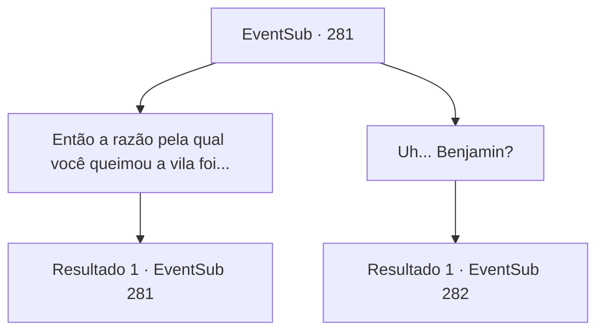

# Eventos secundários · 281

[Índice da tabela](index.md) · [Índice geral](../index.md)

ID: `pt:EventSub:281` · Fonte: `EventSub4` · Versão: 1.2.47.

Mapeamento estático dos arquivos; a disponibilidade e a execução dependem do estado da run.

## Texto do evento

*Sem texto no arquivo.*

## Dados de entrada

```json
{
  "id": 281,
  "grade": 1,
  "subEvent": "",
  "required": ""
}
```

## Mapa das escolhas



## Escolhas e resultados

### Escolha 1

Então a razão pela qual você queimou a vila foi...

Requisitos e outros campos da escolha:

```json
{
  "required": "5_264_0"
}
```

#### Resultado 1.1

Você pergunta a Van Goyle se ele atacou a vila de Benjamin por vingança. Van Goyle acena em resposta, como se estivesse confirmando um fato óbvio. 

 "Claro. Sangue por sangue, não é mesmo? E... o mesmo com você."

 Ele aponta para Benjamin com o dedo indicador.

Continuação registrada: [Evento 281](0281.md) na mesma tabela.

```json
{
  "required": "",
  "chance": "1",
  "nextEvent": 281,
  "type": 2,
  "reward": "5_264_1"
}
```

### Escolha 2

Uh... Benjamin?

Requisitos e outros campos da escolha:

```json
{
  "required": "5_264_1"
}
```

#### Resultado 2.1

Você encara Benjamin, ainda incapaz de se mover diante da chocante verdade. Benjamin franze a testa e aponta para Van Goyle com sua espada, gritando. 

 "CALA A BOCA!! Mesmo que nossa motivação seja a mesma, há uma diferença entre você, que massacrou uma vila inteira de pessoas inocentes, e eu!!"

 Após seu grito desesperado, Benjamin avança em direção a Van Goyle, incapaz de controlar sua fúria. Van Goyle ri dele e se levanta de seu trono. 

 "Você e eu? DIFERENTES?! HAHAHAHA! E quanto a você, que massacrou meus homens? Isso é justificado?"

 Van Goyle começa a balançar seu martelo gigante, zombando de Benjamin. Benjamin responde com um grito de batalha alto, e você entra na luta para ajudar Benjamin. Os outros bandidos logo se juntam para ajudar Van Goyle, e logo se torna uma briga generalizada.

Continuação registrada: [Evento 282](0282.md) na mesma tabela.

```json
{
  "required": "",
  "chance": "1",
  "nextEvent": 282,
  "type": 2,
  "reward": "6_2_118",
  "place": 7
}
```

## Referências que chegam a este evento

- [Evento 276 · escolha 1 · resultado 1](0276.md#escolha-1)
- [Evento 281 · escolha 1 · resultado 1](0281.md#escolha-1)
- [Evento 285 · escolha 1 · resultado 1](0285.md#escolha-1)
