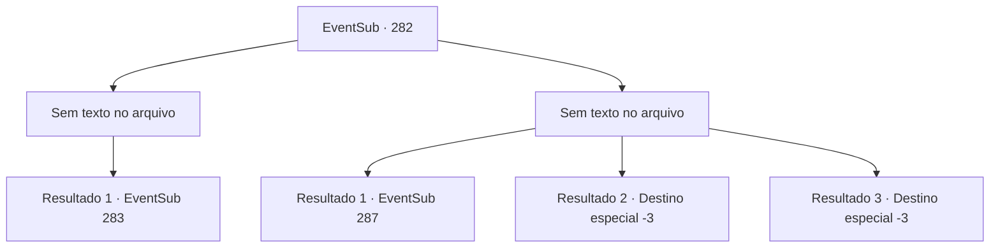

# Eventos secundários · 282

[Índice da tabela](index.md) · [Índice geral](../index.md)

ID: `pt:EventSub:282` · Fonte: `EventSub4` · Versão: 1.2.47.

Mapeamento estático dos arquivos; a disponibilidade e a execução dependem do estado da run.

## Texto do evento

*Sem texto no arquivo.*

## Dados de entrada

```json
{
  "id": 282,
  "grade": 1,
  "subEvent": "",
  "required": ""
}
```

## Mapa das escolhas



## Escolhas e resultados

### Escolha 1

*Sem texto no arquivo; o papel dessa opção depende da interface do jogo.*

Requisitos e outros campos da escolha:

```json
{
  "required": ""
}
```

#### Resultado 1.1

Você cuida dos bandidos e corre para Benjamin. Ele está lutando bravamente contra Van Goyle, mas tropeça nas pernas de Goyle e cai. 

 "Hahahaha! Um garotinho como você?! VINGANÇA?!"

 Van Goyle ergue seu martelo gigante, bem alto no ar.

Continuação registrada: [Evento 283](0283.md) na mesma tabela.

```json
{
  "required": "",
  "chance": "1",
  "nextEvent": 283,
  "type": 2,
  "reward": ""
}
```

### Escolha 2

*Sem texto no arquivo; o papel dessa opção depende da interface do jogo.*

Requisitos e outros campos da escolha:

```json
{
  "required": ""
}
```

#### Resultado 2.1

Você é pego enquanto luta contra os bandidos. Eles te amarram, então você não pode revidar. Benjamin está fazendo o seu melhor para acompanhar Van Goyle, mas ele tropeça nas pernas de Goyle e cai. 

 "Hahahaha! Um garotinho como você?! VINGANÇA?!"

 Van Goyle levanta seu martelo gigante, bem alto no ar. O martelo atinge Benjamin, e tudo o que você pode fazer é assistir a cena se desenrolar. Van Goyle se vira para você, se aproximando. 

 "Quanto a este aqui, vou deixar você ir. Essa é a minha maneira, afinal."

 Ele aproxima o martelo do seu rosto.

Continuação registrada: [Evento 287](0287.md) na mesma tabela.

```json
{
  "required": "1_0_2|1_1_2",
  "chance": "1",
  "nextEvent": 287,
  "type": 2,
  "reward": "0_0_-1|0_1_-1"
}
```

#### Resultado 2.2

Você falha em desviar de uma lança voando em suas costas. Você desaba. Os bandidos pisoteiam você, e você sente seus ossos se quebrando e rachando. Você encontra o seu fim.

Continuação registrada: [Destino especial `-3`](../destinos-especiais.md).

```json
{
  "required": "2_0_2",
  "chance": "1",
  "nextEvent": -3,
  "type": 2,
  "reward": "0_0_-1|0_1_-1"
}
```

#### Resultado 2.3

Você falha em desviar de uma lança voando em suas costas. Você desaba. Os bandidos pisoteiam você, e você sente seus ossos se quebrando e rachando. Você encontra o seu fim.

Continuação registrada: [Destino especial `-3`](../destinos-especiais.md).

```json
{
  "required": "2_1_2",
  "chance": "1",
  "nextEvent": -3,
  "type": 2,
  "reward": "0_0_-1|0_1_-1"
}
```

## Referências que chegam a este evento

- [Evento 281 · escolha 2 · resultado 1](0281.md#escolha-2)
