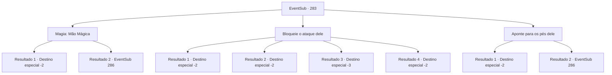

# Eventos secundários · 283

[Índice da tabela](index.md) · [Índice geral](../index.md)

ID: `pt:EventSub:283` · Fonte: `EventSub4` · Versão: 1.2.47.

Mapeamento estático dos arquivos; a disponibilidade e a execução dependem do estado da run.

## Texto do evento

*Sem texto no arquivo.*

## Dados de entrada

```json
{
  "id": 283,
  "grade": 1,
  "subEvent": "",
  "required": ""
}
```

## Mapa das escolhas



## Escolhas e resultados

### Escolha 1

Magia: Mão Mágica

Requisitos e outros campos da escolha:

```json
{
  "required": "20_0_1"
}
```

#### Resultado 1.1

Você lança um feitiço simples chamado mão mágica. O feitiço, lançado num piscar de olhos, conjura uma mão mágica e em movimento. Com essa mão, você puxa as pernas de Van Goyle para baixo. Com o martelo erguido no ar, Goyle perde o equilíbrio e treme. Benjamin, aproveitando essa oportunidade, rapidamente se levanta e apunhala o pescoço de Goyle. 

 "*cof*... ACK...!!"

 Van Goyle revira os olhos e cai. Agora, só restam você e Benjamin de pé. 

 "Isso... é isso. Essa é a vingança que eu tanto queria..."

 Benjamin retira sua espada do pescoço de Goyle e a limpa do sangue. Ele então pega o martelo de Goyle e entrega a você. 

 "Não teria conseguido sem a sua ajuda. Por favor, visite-me novamente no futuro."

 Benjamin pede para você visitá-lo novamente. Você se despede e parte.

Continuação registrada: [Destino especial `-2`](../destinos-especiais.md).

```json
{
  "required": "",
  "chance": "1|0_14_1",
  "nextEvent": -2,
  "type": 0,
  "reward": "12_7_10|3_231_1"
}
```

#### Resultado 1.2

Tentas lançar um feitiço simples, mas já é tarde demais. O martelo de Van Goyle desce, tirando a vida de Benjamin. Ele respira pesadamente e volta-se para enfrentar-te. Van Goyle olha ao redor, vê seus homens mortos no chão e aperta novamente o seu martelo. 

 "Vem pra cima de mim!!"

 Ele avança em tua direção com um grito de batalha horrível, com seu martelo ensanguentado nas mãos.

Continuação registrada: [Evento 286](0286.md) na mesma tabela.

```json
{
  "required": "",
  "chance": "10",
  "nextEvent": 286,
  "type": 1,
  "reward": "6_2_119",
  "place": 7
}
```

### Escolha 2

Bloqueie o ataque dele

Requisitos e outros campos da escolha:

```json
{
  "required": ""
}
```

#### Resultado 2.1

Você entra e desvia o golpe de martelo de Van Goyle com seu corpo. Van Goyle cambaleia com o desvio, e Benjamin aproveita a oportunidade para se levantar rapidamente e esfaquear o pescoço de Goyle. 

 "*tosse*....ACK...!!"

 Van Goyle revira os olhos e cai no chão. Agora, os únicos que estão de pé são você e Benjamin. 

 "Isso... é isso. Essa é a vingança que eu tanto queria..."

 Benjamin retira sua espada do pescoço de Goyle e a limpa do sangue. Ele então pega o martelo de Goyle e entrega para você. 

 "Não teria conseguido sem a sua ajuda. Por favor, visite-me novamente no futuro."

 Benjamin pede para você visitá-lo novamente. Você se despede e parte.

Continuação registrada: [Destino especial `-2`](../destinos-especiais.md).

```json
{
  "required": "21_9_2",
  "chance": "1|0_13_1",
  "nextEvent": -2,
  "type": 0,
  "reward": "12_7_10|3_231_1"
}
```

#### Resultado 2.2

Você entra e desvia o golpe de martelo de Van Goyle com seu corpo. Você sente uma dor excruciante e quebradora de ossos se espalhar por todo o seu corpo. Van Goyle cambaleia com a deflexão, e Benjamin aproveita essa oportunidade para se levantar rapidamente e esfaquear o pescoço de Goyle. 

 "*tosse*....ACK...!!"

 Van Goyle revira os olhos e cai no chão. Agora, os únicos que estão de pé são você e Benjamin. 

 "Isso... é isso. Essa é a vingança que eu tanto queria..."

 Benjamin retira sua espada do pescoço de Goyle e lava o sangue dela. Ele então pega o martelo de Goyle e entrega para você. 

 "Não teria conseguido sem a sua ajuda. Por favor, visite-me novamente no futuro."

 Benjamin pede para você visitá-lo novamente. Você se despede e parte.

Continuação registrada: [Destino especial `-2`](../destinos-especiais.md).

```json
{
  "required": "1_0_2|21_9_2",
  "chance": "15",
  "nextEvent": -2,
  "type": 1,
  "reward": "12_7_10|3_231_1|0_0_-1"
}
```

#### Resultado 2.3

Você entra e desvia o golpe de martelo de Van Goyle com seu corpo. A dor quebradora de ossos se espalha por todo o seu corpo e você perde a consciência.

Continuação registrada: [Destino especial `-3`](../destinos-especiais.md).

```json
{
  "required": "2_0_2|21_9_2",
  "chance": "15",
  "nextEvent": -3,
  "type": 1,
  "reward": "0_0_-1"
}
```

#### Resultado 2.4

Você entra e desvia o golpe de martelo de Van Goyle com seu corpo. Van Goyle cambaleia com o desvio, e Benjamin aproveita a oportunidade para se levantar rapidamente e esfaquear o pescoço de Goyle. 

 "*tosse*....ACK...!!"

 Van Goyle revira os olhos e cai no chão. Agora, os únicos que estão de pé são você e Benjamin. 

 "Isso... é isso. Essa é a vingança que eu tanto queria..."

 Benjamin retira sua espada do pescoço de Goyle e a limpa do sangue. Ele então pega o martelo de Goyle e entrega para você. 

 "Não teria conseguido sem a sua ajuda. Por favor, visite-me novamente no futuro."

 Benjamin pede para você visitá-lo novamente. Você se despede e parte.

Continuação registrada: [Destino especial `-2`](../destinos-especiais.md).

```json
{
  "required": "20_9_2",
  "chance": "1",
  "nextEvent": -2,
  "type": 2,
  "reward": "12_7_10|3_231_1"
}
```

### Escolha 3

Aponte para os pés dele

Requisitos e outros campos da escolha:

```json
{
  "required": ""
}
```

#### Resultado 3.1

Você pula rapidamente em direção a Van Goyle, atacando seus pés. Ele perde o equilíbrio ao tentar desviar do seu ataque. Benjamin aproveita essa oportunidade para se levantar rapidamente e esfaquear o pescoço de Goyle. 

 "*tosse*....ACK...!!"

 Van Goyle revira os olhos e cai no chão. Agora, os únicos que estão de pé são você e Benjamin. 

 "É isso... é a vingança que eu tanto desejei..."

 Benjamin retira sua espada do pescoço de Goyle e a limpa do sangue. Em seguida, ele pega o martelo de Goyle e entrega para você. 

 "Não teria conseguido sem a sua ajuda. Por favor, visite-me novamente no futuro."

 Benjamin pede para você visitá-lo novamente. Você se despede e parte.

Continuação registrada: [Destino especial `-2`](../destinos-especiais.md).

```json
{
  "required": "",
  "chance": "1|0_6_1",
  "nextEvent": -2,
  "type": 0,
  "reward": "12_7_10|3_231_1"
}
```

#### Resultado 3.2

Você salta em direção a Van Goyle, mas é tarde demais. O martelo de Van Goyle desce, tirando a vida de Benjamin. Ele respira pesadamente e depois se vira para encarar você. Van Goyle olha ao redor, vê seus homens mortos no chão e aperta novamente o punho do martelo. 

 "Venha até mim!!"

 Ele avança em sua direção com um grito de batalha horrível, com seu martelo ensanguentado nas mãos.

Continuação registrada: [Evento 286](0286.md) na mesma tabela.

```json
{
  "required": "",
  "chance": "13",
  "nextEvent": 286,
  "type": 1,
  "reward": "6_2_119",
  "place": 7
}
```

## Referências que chegam a este evento

- [Evento 282 · escolha 1 · resultado 1](0282.md#escolha-1)
