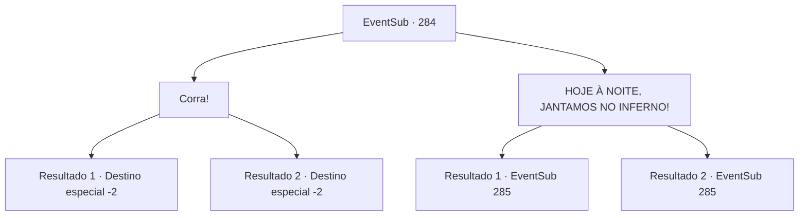

# Eventos secundários · 284

[Índice da tabela](index.md) · [Índice geral](../index.md)

ID: `pt:EventSub:284` · Fonte: `EventSub4` · Versão: 1.2.47.

Mapeamento estático dos arquivos; a disponibilidade e a execução dependem do estado da run.

## Texto do evento

*Sem texto no arquivo.*

## Dados de entrada

```json
{
  "id": 284,
  "grade": 1,
  "subEvent": "",
  "required": ""
}
```

## Mapa das escolhas



## Escolhas e resultados

### Escolha 1

Corra!

Requisitos e outros campos da escolha:

```json
{
  "required": ""
}
```

#### Resultado 1.1

Você cutuca Benjamin, dizendo que é hora de fugir. Benjamin olha fixamente para as partes mais profundas do forte, hesita, mas finalmente decide seguir você. Você e Benjamin rompem a parte mais fraca dos guardas e escapam. Os bandidos vêm correndo, gritando, mas o conhecimento de Benjamin sobre a região permite que vocês dois escapem em segurança. 

 "Eu... Eu vou cumprir minha vingança um dia. Não importa o que seja..!"

 Mesmo enquanto foge, Benjamin jura a si mesmo cumprir sua vingança. Você encoraja Benjamin, promete se encontrar no futuro e se despede dele.

Continuação registrada: [Destino especial `-2`](../destinos-especiais.md).

```json
{
  "required": "18_260_1",
  "chance": "1",
  "nextEvent": -2,
  "type": 2,
  "reward": "12_7_9"
}
```

#### Resultado 1.2

Você cutuca Benjamin, dizendo que é hora de fugir. Benjamin olha fixamente para as partes mais profundas do forte, hesita, mas finalmente decide seguir você. Você e Benjamin rompem a parte mais fraca dos guardas e escapam. Os bandidos vêm correndo, gritando, mas o conhecimento de Benjamin sobre a região permite que vocês dois escapem em segurança. Benjamin não disse nada. Mas você percebeu através de sua expressão que ele estava muito desapontado. Ele partiu sem se despedir, e você virou a cabeça enquanto olhava para as costas dele.

Continuação registrada: [Destino especial `-2`](../destinos-especiais.md).

```json
{
  "required": "5_260_1",
  "chance": "1",
  "nextEvent": -2,
  "type": 2,
  "reward": "12_7_8"
}
```

### Escolha 2

HOJE À NOITE, JANTAMOS NO INFERNO!

Requisitos e outros campos da escolha:

```json
{
  "required": ""
}
```

#### Resultado 2.1

Você encoraja Benjamin, dizendo que lutará até a morte ao lado dele. Empoderado por suas palavras, os olhos de Benjamin brilham novamente com determinação. 

 "Entendi..! Mesmo que eu morra aqui, nunca desistirei!"

 Benjamin usa toda a força que lhe resta e avança contra os bandidos. Você o segue.

Continuação registrada: [Evento 285](0285.md) na mesma tabela.

```json
{
  "required": "18_260_1",
  "chance": "1",
  "nextEvent": 285,
  "type": 2,
  "reward": "6_2_118",
  "place": 7
}
```

#### Resultado 2.2

Você encoraja Benjamin, dizendo que lutará até a morte ao lado dele. Empoderado por suas palavras, os olhos de Benjamin brilham novamente com determinação. 

 "Entendi..! Mesmo que eu morra aqui, nunca desistirei!"

 Benjamin usa toda a força que lhe resta, avançando contra os bandidos. Você o segue.

Continuação registrada: [Evento 285](0285.md) na mesma tabela.

```json
{
  "required": "11_0_1|5_260_1",
  "chance": "1",
  "nextEvent": 285,
  "type": 2,
  "reward": "5_263_1|6_2_118",
  "place": 7
}
```

## Referências que chegam a este evento

- [Evento 276 · escolha 2 · resultado 1](0276.md#escolha-2)
