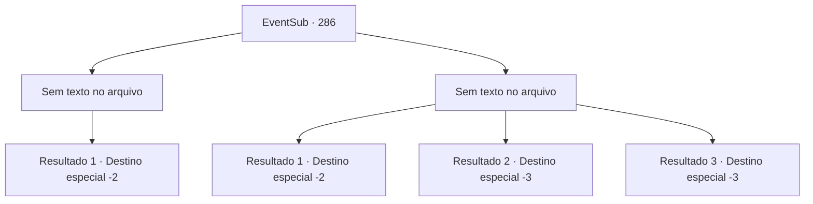

# Eventos secundários · 286

[Índice da tabela](index.md) · [Índice geral](../index.md)

ID: `pt:EventSub:286` · Fonte: `EventSub4` · Versão: 1.2.47.

Mapeamento estático dos arquivos; a disponibilidade e a execução dependem do estado da run.

## Texto do evento

*Sem texto no arquivo.*

## Dados de entrada

```json
{
  "id": 286,
  "grade": 1,
  "subEvent": "",
  "required": ""
}
```

## Mapa das escolhas



## Escolhas e resultados

### Escolha 1

*Sem texto no arquivo; o papel dessa opção depende da interface do jogo.*

Requisitos e outros campos da escolha:

```json
{
  "required": ""
}
```

#### Resultado 1.1

Van Goyle cai diante de você. Ele cospe sangue e faz o possível para falar. 

 "Gyahaha... Devo ter te prejudicado no passado também, né? Não consigo me lembrar, porém. Tive... uma vida bastante agitada..."

 Ele dá seu último suspiro, e você enterra Benjamin em solo fértil. Você presta suas homenagens em seu túmulo e segue em frente.

Continuação registrada: [Destino especial `-2`](../destinos-especiais.md).

```json
{
  "required": "",
  "chance": "1",
  "nextEvent": -2,
  "type": 2,
  "reward": "12_7_-1|14_7_11"
}
```

### Escolha 2

*Sem texto no arquivo; o papel dessa opção depende da interface do jogo.*

Requisitos e outros campos da escolha:

```json
{
  "required": ""
}
```

#### Resultado 2.1

Você faz o seu melhor para lutar contra Van Goyle, mas você não é páreo para ele. Infelizmente, você decide correr, segurando suas feridas. Van Goyle grita para você, rindo enquanto te vê fugindo. 

 "Ehahahaha! Isso mesmo! Corra, seu fraco! Corra como uma vadiazinha!"

 Você foge pelo caminho da montanha enquanto a risada de Goyle ecoa pela floresta.

Continuação registrada: [Destino especial `-2`](../destinos-especiais.md).

```json
{
  "required": "1_0_2|1_1_2",
  "chance": "1",
  "nextEvent": -2,
  "type": 2,
  "reward": "0_0_-1|0_1_-1|12_7_-1|14_7_6"
}
```

#### Resultado 2.2

O martelo gigante voa em direção ao seu crânio. Essa é a última coisa que você vê, antes de tudo ficar preto.

Continuação registrada: [Destino especial `-3`](../destinos-especiais.md).

```json
{
  "required": "2_0_2",
  "chance": "1",
  "nextEvent": -3,
  "type": 2,
  "reward": "0_0_-1|0_1_-1"
}
```

#### Resultado 2.3

O martelo gigante voa em direção ao seu crânio. Essa é a última coisa que você vê, antes de tudo ficar preto.

Continuação registrada: [Destino especial `-3`](../destinos-especiais.md).

```json
{
  "required": "2_1_2",
  "chance": "1",
  "nextEvent": -3,
  "type": 2,
  "reward": "0_0_-1|0_1_-1"
}
```

## Referências que chegam a este evento

- [Evento 283 · escolha 1 · resultado 2](0283.md#escolha-1)
- [Evento 283 · escolha 3 · resultado 2](0283.md#escolha-3)
